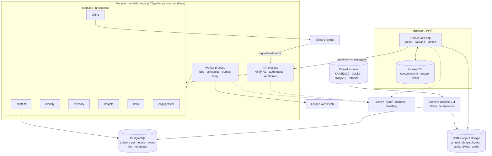
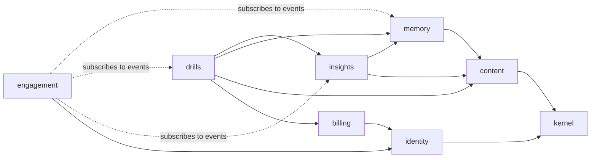
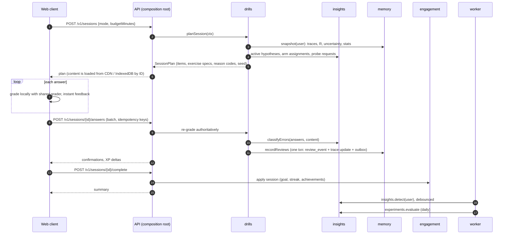
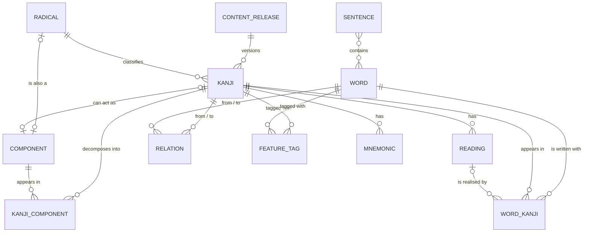
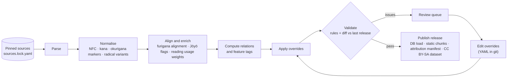
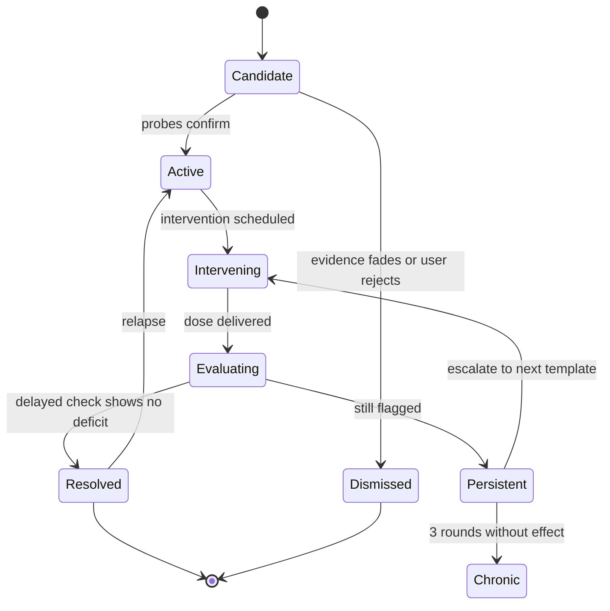
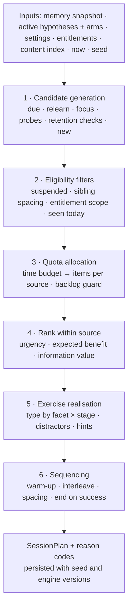
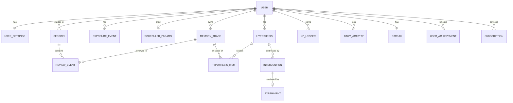

# Kizuna (絆): Architecture Design

Adaptive kanji learning SaaS · Design v1.0 · 2026-10-23 · Status: **Proposed**

> **Scope.** This document covers architecture and design only. Nothing in it is implemented yet. The repository was empty when it was written (no commits, no code, no conventions), so it also proposes the initial repository layout and engineering conventions.
>
> **Audience.** A solo developer building incrementally. Each section says what to build, in what shape, and why, without prescribing code.

## Contents

0. [Summary of key decisions](#0-summary-of-key-decisions)
1. [Goals, principles, non-goals](#1-goals-principles-non-goals)
2. [System overview](#2-system-overview)
3. [Linguistic knowledge model](#3-linguistic-knowledge-model)
4. [Learner memory model](#4-learner-memory-model)
5. [Weakness discovery engine](#5-weakness-discovery-engine)
6. [Adaptive drill engine](#6-adaptive-drill-engine)
7. [SaaS application](#7-saas-application)
8. [Technical architecture](#8-technical-architecture)
9. [Key trade-offs](#9-key-trade-offs)
10. [Risks and mitigations](#10-risks-and-mitigations)
11. [Future expansion](#11-future-expansion)
12. [Phased implementation roadmap](#12-phased-implementation-roadmap)
13. [Success metrics](#13-success-metrics)
14. [Open decisions](#14-open-decisions)
- [Appendix A: Glossary](#appendix-a-glossary)
- [Appendix B: References](#appendix-b-references)

---

## 0. Summary of key decisions

1. **Modular monolith in TypeScript.** One backend codebase runs as two process types (API and worker). It sits beside a Next.js web client and one PostgreSQL database. Each module owns its own schema and talks to other modules only through a public interface or domain events.
2. **Content is a versioned, read-only release.** An offline, deterministic pipeline builds it from openly licensed sources (EDRDG KANJIDIC2/JMdict/KRADFILE, KanjiVG, JmdictFurigana, Tatoeba), then applies a human-curated override layer. We accept CC BY-SA share-alike for the dictionary-derived layer and publish that layer as a dataset.
3. **Memory is modelled per facet, not per card.** There is one *memory trace* per (user, item, facet): 生's meaning, 生's on'yomi, 生 recognised among lookalikes, 先生 read in context. FSRS schedules each trace, and a light evidence-count layer adds uncertainty on top. An append-only review log is the source of truth, and all learner state is a projection that can be rebuilt by replaying it.
4. **Weakness discovery uses residuals.** The core question is: *where does the learner do worse than their own memory model predicts?* Answers are grouped by linguistic features (radical, component, reading type, phonetic series, semantic field, visual cluster). Bayesian shrinkage plus support and robustness thresholds keep false positives low. Each confirmed pattern becomes an explicit **hypothesis** with visible evidence.
5. **Every intervention is an experiment.** The items a hypothesis covers are randomly split into a treatment group and a waitlist control. Success is measured as **delayed retention (≥ 14 days)** relative to the counterfactual SRS prediction, so regression to the mean does not inflate the result.
6. **Session planning has two explainable stages.** First, the time budget is split across sources (due reviews, new items, focus drills, probes). Then items are ranked within each source. Every item in a session carries a reason code that the UI can show ("Why am I seeing this?").
7. **Gamification rewards effortful learning, not grinding.** XP comes from honest scheduled work. Ranks come from *mastered kanji*, not XP. Streaks have freezes and a vacation mode. Weaknesses appear to the learner as **"knots" to untie**, in keeping with the *kizuna* (bond, thread) theme.
8. **Statistics before ML, ML before LLMs.** The v1 critical path has no ML or LLMs. ML comes in later for parameter fitting and offline similarity mining. LLMs are used only for human-reviewed content authoring and, later, reading and grammar material. They never grade readings or make scheduling decisions.

---

## 1. Goals, principles, non-goals

**Product goals**

- Measurably better long-term retention than plain SRS for the same study time.
- A daily habit built from short sessions (5 to 20 minutes) that feel good to complete.
- Insights the learner trusts, because the evidence is always visible.

**Engineering principles**

| Principle | Meaning in practice |
|---|---|
| Deterministic and explainable first | Rules and statistics with inspectable evidence. ML only replaces a rule after it beats that rule in shadow mode. |
| Pure core | Engines are pure functions of `(snapshot, content, config, now, seed)`, so they are testable, replayable, and diffable across versions. |
| Event log is truth | All learner state can be rebuilt from `review_event` and `exposure_event`. |
| Learning integrity over engagement | No mechanic may reward behaviour that harms retention. |
| Solo-developer economics | Managed services, one database, few deployables. Anything the next phase does not need is deferred. |

**Non-goals for the initial release:** native mobile apps, handwriting recognition, social features and leaderboards, classrooms/B2B, real-time LLM tutoring, usage-based billing.

---

## 2. System overview

### 2.1 Architecture diagram



### 2.2 Modules

| Module | Owns (Postgres schema) | Responsibilities | May depend on |
|---|---|---|---|
| `kernel` (shared) | `kernel` (outbox, audit) | IDs, injected clock, seeded RNG, event bus, transaction/outbox helpers, logging, config | — |
| `content` | `content` | Read-only linguistic knowledge: kanji, radicals, components, readings, words, sentences, relations, feature tags. Holds the in-memory index of the current release and the distractor candidate queries. | kernel |
| `identity` | `identity` | Users, auth integration, profile, settings, timezone and learning-day boundary, data export/deletion orchestration | kernel |
| `memory` | `memory` | Traces, review and exposure logs, FSRS scheduling, uncertainty, mastery aggregation, learner statistics, parameter fitting | content, kernel |
| `insights` | `insights` | Error classification, weakness detectors, hypotheses, intervention requests, experiments and their evaluation | memory (read), content, kernel |
| `drills` | `drills` | Session planning, curriculum, placement, exercise generation, distractors, grading | insights, memory, content, billing (entitlements), kernel |
| `engagement` | `engagement` | XP, daily goals, streaks, ranks, achievements, reminders | identity; consumes events. Nothing depends on it. |
| `billing` | `billing` | Provider adapter, subscriptions, entitlements | identity, kernel |



**Avoiding cycles.** `insights` never calls `drills`. It emits *intervention requests* (`{template, traceIds, dose}`) and *arm assignments* as data. `drills` reads those and turns them into exercises.

### 2.3 Module rules and communication

- A module's only import path is its public `index.ts`, which exposes queries, commands and event types. CI enforces this with dependency-cruiser (or eslint-plugin-boundaries).
- There are no SQL joins across schemas. A module that needs another module's data calls its query API (in-process and cheap) or keeps a local read model fed by events.
- The `domain/` layer of every module is pure: no I/O, no `Date.now()`, no `Math.random()`. Clock and RNG are injected.
- A command that changes state runs in one transaction and writes its domain events to the **outbox** in that same transaction. The worker relays outbox rows to `pg-boss` queues. Handlers are idempotent and deduplicate by event ID. When feedback must be immediate, the composition root (`apps/server`) also dispatches in-process after commit, and the outbox remains the durability guarantee.

| Event | Producer | Consumers |
|---|---|---|
| `ReviewRecorded` | memory | engagement (XP, daily activity), insights (incremental aggregates) |
| `TraceStageChanged` | memory | engagement (ranks, family completion) |
| `SessionCompleted` | drills | engagement (goal, streak, achievements), insights (detection job) |
| `HypothesisActivated` / `HypothesisResolved` | insights | engagement ("Knot untied"), notifications |
| `ExperimentConcluded` | insights | population statistics |
| `EntitlementsChanged` | billing | drills (limits cache), web client (refresh) |
| `UserDeleted` | identity | every module (cascade delete) |

### 2.4 Core flow: one study session



---

## 3. Linguistic knowledge model

### 3.1 Core content entities



| Entity | Key fields | Notes |
|---|---|---|
| `kanji` | `literal` (PK), codepoint, strokes, radical, grade, jlpt_approx, freq_rank, is_joyo, `keyword` (our own), meanings (lang-tagged) | The ID is the character itself. |
| `radical` | Kangxi number 1–214 (PK), literal, variant forms (氵 for 水), keyword | The *classification* radical, exactly one per kanji |
| `component` | own slug (PK), glyph, optional link to kanji or radical, keyword, strokes | The *visual building blocks*. Some have no Unicode code point; for those, use the KanjiVG element ID. |
| `kanji_component` | kanji, component, position (`hen`, `tsukuri`, `kanmuri`, `ashi`, `tare`, `nyō`, `kamae`, …), role (`semantic`, `phonetic`, `form`, `unknown`), depth, order | A nested decomposition tree, flattened with depth |
| `reading` | ID such as `生:on:せい`, kind (`on`, `kun`, `nanori`), kana, okurigana, is_joyo, is_core, is_primary_of_kind, usage_weight | Readings are first-class rows because learners forget them one by one. |
| `word` | JMdict `ent_seq` (PK), headword, kana, alternative forms, senses (POS, lang-tagged glosses), freq_rank, is_common, jlpt_approx | Only a curated, frequency-ranked subset (~30–50k) is loaded. |
| `word_kanji` | word, position, kanji, reading used, surface kana, phenomenon (`regular`, `rendaku`, `sokuon`, `jukujikun`, `ateji`, `irregular`) | Links each kanji in a word to *the reading used*. This is the key to context and reading analytics. |
| `sentence` | source ID, Japanese text, translations, word IDs, license, quality | Tatoeba subset, tokenised |
| `relation` | from/to (type + ID), kind, weight 0–1, directed, origin (`curated`, `computed`, `empirical`), evidence | A typed, weighted graph of about 100k edges. See §3.2. |
| `feature_tag` | item type, item ID, tag | Precomputed grouping vocabulary for weakness discovery |
| `mnemonic` | kanji, text, author (`system` or `user`), visibility, license | Original content only |
| `content_release` | semver, source manifest (versions and checksums), `is_current` | Releases are immutable |
| `id_redirect` | old ID, new ID, release | Handles JMdict merges and deprecations |

**Modelling decisions**

- **Stable IDs.** Learner data references content by stable natural keys, so a content release never invalidates a learner's history. Referenced content is never hard-deleted. It is deprecated and redirected instead.
- **Component ≠ radical.** A kanji has one dictionary radical but several nested components, each with a position and a role. Weakness grouping uses both, because 持, 待 and 特 share the component 寺 but have different radicals.
- **Readings carry teaching metadata.** The Jōyō table defines the official readings. A reading is `is_core` when it is Jōyō and used by at least one common word. Each kind has one `is_primary_of_kind` reading (the most frequent). Rare and nanori readings appear on detail pages but are never drilled in isolation.
- **Meanings.** Each kanji gets a primary `keyword` that we author ourselves; we never copy keywords from commercial courses. For grading, the accept-list is all KANJIDIC meanings, plus curated synonyms, plus that user's own synonyms.
- **Language tags everywhere.** English comes first. JMdict and KANJIDIC also carry French, Spanish, Portuguese, German and Russian glosses, which supports i18n later.

### 3.2 Relationship graph

| Relation kind | Meaning | How it is produced in v1 | Example |
|---|---|---|---|
| `shares_component` | kanji ↔ kanji | Derived from `kanji_component`. Weight is the IDF-weighted overlap, so rare shared components count more. | 持 ↔ 待 |
| `visual_similar` | easy to confuse visually | Score = 0.5·position-aware component Jaccard + 0.3·same layout + 0.2·stroke-count closeness. Keep the top 10 per kanji above a threshold, then add curated classic pairs. v2 adds glyph-image similarity and empirical confusion data. | 未 ↔ 末, 土 ↔ 士, 己 ↔ 已 ↔ 巳 |
| `phonetic_series` | shares a phonetic component and on'yomi | Component `role=phonetic` plus a matching on'yomi. Exceptions are flagged. | 青 → 清 晴 精 請 静 (セイ) |
| `semantic_related` | near-synonym, same field, or antonym | Proposals seeded from gloss overlap and WordNet, drafted with LLM help, then human-reviewed. Also a small semantic-field taxonomy (~60 fields). | 暑 ↔ 熱 ↔ 温 |
| `homophone` | identical on'yomi | Derived from readings. Weighted by frequency and used only for reading-confusion analysis. | 公 ↔ 工 ↔ 校 (コウ) |
| `word_pair` | word-level confusables | Homophone words, transitive/intransitive pairs, words sharing kanji | 機会 ↔ 機械, 開く ↔ 開ける |
| `empirical_confusable` | learners actually confuse these | Mined from anonymised population confusion counts, with k-anonymity ≥ 20 users (Phase 4) | — |
| `variant_of` | glyph variants | KANJIDIC/Unihan variant fields (low priority) | 國 → 国 |

The graph is stored as adjacency rows in `content.relation` and loaded into memory per process. That is tens of megabytes at most, so no graph database is needed.

**Feature tags** are computed per item at release time, and they are what weakness discovery groups by:
`radical:氵`, `component:寺`, `position:hen`, `reading_kind:kun`, `reading:生:on:せい`, `phonetic:青`, `field:weather`, `visual_cluster:17`, `jlpt:N3`, `grade:4`, `strokes:11-15`, `phenomenon:rendaku`, `okurigana:yes`.

### 3.3 Content pipeline and data quality



- **Determinism.** Source versions and checksums are pinned in `content/sources.lock.yaml`. The same inputs must produce a byte-identical release, and CI checks this.
- **Normalisation.** Apply Unicode NFC. Store kana in hiragana and display on'yomi in katakana. Parse KANJIDIC okurigana markers (`た.べる` becomes stem `た` plus okurigana `べる`) and affix markers (`-`). Separate nanori. Map radical variants (氵 → #85 水).
- **Teach set.** Start with the 2,136 Jōyō kanji. Mark official readings from the Jōyō table, because KANJIDIC lists many rare readings that must not be drilled.
- **Alignment.** Use JmdictFurigana to split each word's reading across its kanji. Words that cannot be aligned are tagged `irregular`. They stay learnable, but they are excluded from reading-attribution statistics.
- **Cross-checks.** Compare KanjiVG and KRADFILE decompositions, and Unihan and KANJIDIC stroke counts. Disagreements go to the review queue.
- **Validation rules, enforced in CI:**
  - every teachable kanji has a keyword, at least one core reading, a decomposition and a stroke SVG;
  - no relation edge points at a missing item;
  - every curriculum word has an aligned reading;
  - the release diff (added, removed and changed counts per table) is reviewed before publishing.
- **Overrides.** Human corrections live in `content/overrides/*.yaml` in git. Each one records a reason and an author, is applied last, and survives re-imports.
- **User reports.** Every item has a "Report an issue" button. Reports go to a triage queue, become an override, and ship in the next release.
- **Release upgrades.** A worker job migrates traces that point at redirected IDs. New teachable items flow into the curriculum. Learner history is never invalidated.

### 3.4 Data sources and licensing

| Source | Used for | License (re-verify at import) | Obligations and notes |
|---|---|---|---|
| KANJIDIC2 (EDRDG) | kanji metadata, readings, meanings, grade, frequency | CC BY-SA 4.0 | Attribution and licence link. Share-alike on derived data. |
| JMdict (EDRDG) | vocabulary, senses, commonness tags | CC BY-SA 4.0 | Same as KANJIDIC2 |
| KRADFILE / RADKFILE (EDRDG) | component decomposition | EDRDG licence (CC BY-SA 4.0) | Same as KANJIDIC2 |
| KanjiVG | stroke-order SVGs, nested element tree with positions | CC BY-SA 3.0 | Attribution. Modified SVGs stay BY-SA. |
| JmdictFurigana | per-kanji reading alignment | CC BY-SA (inherits JMdict) | Same as JMdict |
| Tatoeba | example sentences and translations | CC BY 2.0 FR (some CC0) | Per-sentence attribution (link to the sentence or its author) |
| Unihan (Unicode) | radical-stroke and stroke-count cross-checks | Unicode License | Include the notice |
| Jōyō kanji table (Agency for Cultural Affairs, 2010) | teach set, official readings | Cabinet notice, generally outside copyright under Art. 13 of the Japanese Copyright Act | Cite the source |
| Community JLPT lists | approximate level tags | Varies by list | Label them as *approximate*. JLPT has published no official kanji lists since 2010. |
| Princeton WordNet / Japanese WordNet | seeds for semantic relations | Permissive WordNet-style licences | Attribution |
| Noto Sans JP, Noto Serif JP, Klee One | UI and drill fonts | SIL OFL 1.1 | Ship the licence file |
| Audio (TTS vendor or recordings) | word audio | Vendor terms, or work-for-hire | The terms must allow storing and redistributing the audio. Record the licence per asset. |

**Obligations and policy**

- A credits page (`/credits`), an attribution footer on every public kanji page, and a licence file inside every data export.
- **Share-alike.** The dictionary-derived linguistic layer is CC BY-SA. We accept that and publish the derived dataset with each release, which also builds goodwill. Our original content (keywords, mnemonics, semantic tags, explanations) stays in separate tables and files with explicit provenance, so its licensing can be decided independently. *Get a legal review before launch; this document is not legal advice.*
- **Never ingest** commercial course content (for example WaniKani mnemonics and level structure, or Heisig keywords and stories), textbook vocabulary lists, scraped sites, or proprietary frequency corpora used without a licence.
- Every content row carries `source`, `source_version` and `license`, so the credits page and the dataset manifest are generated rather than maintained by hand.

---

## 4. Learner memory model

### 4.1 Memory traces and facets

A kanji is not simply "known" or "unknown". It has several traces that are forgotten independently. A **trace** is the tuple `(user, item_type, item_id, facet)`.

| Facet | Prompt → answer | Applies to | Notes |
|---|---|---|---|
| `meaning` | 海 → "sea" | kanji | Introduced in the lesson |
| `reading_on` | 海 → かい | kanji with a core on'yomi | Primary on'yomi only |
| `reading_kun` | 海 → うみ; 食べる → たべる | kanji with a core kun'yomi | Primary kun'yomi only, prompted in its okurigana word form |
| `recognition` | "sea" plus lookalikes → 海 | kanji | Visual discrimination. Unlocks when `meaning` reaches Young. |
| `context` | 海外 → かいがい | word | The kanji-in-vocabulary dimension. Each answer is attributed to the aligned readings through `word_kanji`. |
| `word_meaning` | 海外 → "overseas" | word | |
| `writing` (later) | "sea" → strokes | kanji | Phase 5 |

- **Secondary readings are learned through words.** 生 has core readings せい, しょう, い(きる), う(まれる), なま and more. Only the primary on'yomi and primary kun'yomi get isolated traces. The others are learned and measured through `context` traces of aligned words such as 一生 and 生まれる. This keeps review load sane while still letting the system measure each reading.
- **Vocabulary unlocks** once all of a word's kanji have `meaning` at S ≥ 3 days.
- **One answer means one scheduling update.** A correct answer to 先生 reschedules only the 先生 `context` trace. It still counts as an *analytic observation* for 生:on:せい in insights.

### 4.2 Forgetting model: FSRS

Each trace stores Difficulty `D` (1–10), Stability `S` (days until predicted recall falls to 90%), and the time of its last review.

```
Retrievability:  R(t) = (1 + f · t / S)^(−d),   with f = 0.9^(−1/d) − 1   so that R(S) = 0.9
Next interval for desired retention r:   t = (S / f) · (r^(−1/d) − 1)
```

- Use **FSRS** through `ts-fsrs` (MIT). In FSRS-6 the decay `d` is a trainable per-user parameter; older versions fix it at 0.5.
- Default desired retention is **r = 0.90**. The user can pick 0.80–0.95, and the setting explains the trade-off plainly: more reviews in exchange for better recall.
- Every user starts on the **default parameters**. Once they have about 1,000 scheduled reviews, a weekly worker job runs the FSRS optimiser. The new parameters are kept only if log-loss on a held-out tail of their reviews improves. Parameters are versioned in `memory.scheduler_params`.
- Short-term learning and relearning steps happen inside the session (a failed item comes back after about 5 items). Intervals get fuzz and load balancing to smooth daily workload.
- **Why FSRS:** it is open, benchmarked on large real-world review datasets, deterministic, cheap, and intuitive to explain ("you'll likely remember this for about 12 days").

### 4.3 From answers to evidence

- **Auto-grading.** Learners never self-grade an objective exercise. Self-grading is reserved for recall that cannot be checked, such as writing on paper.
- **FSRS grade mapping:**
  - wrong, or "I don't know" → **Again**
  - correct after a hint, or on retry after giving an alternative reading → **Hard**
  - correct → **Good**
  - correct and fast (log-latency z-score below −1 for this user and exercise type, typed exercises only) → **Easy**
- **Guessing.** Multiple choice (MC) has guess rate `γ = 1/k`. MC is used only for `recognition` and for early-stage `meaning`. Analytics then use `p = γ + (1 − γ)·R`.
- **"I don't know" is a first-class button.** It produces cleaner data than random guesses.
- **Shared normalisation and grading.** One pure package grades answers, used by the client for instant feedback and by the server for the authoritative re-grade. It handles:
  - kana normalisation and romaji-to-kana conversion (WanaKana);
  - okurigana;
  - meaning fuzzy match (Damerau–Levenshtein, tolerance scaled by length);
  - accept-lists and user synonyms.
- **Alternative valid readings.** If the learner gives a valid reading of the wrong kind (なま when the on'yomi was asked), the answer is not marked wrong. The UI says "valid reading, but we want the on'yomi" and offers a retry, and the event is logged as `R_ALT_VALID`. That class is the main signal for reading-type weaknesses. Any core reading of the requested kind counts as correct.

### 4.4 Uncertainty

FSRS gives a point estimate. A light, explainable uncertainty layer sits on top of it for each trace:

```
Effective evidence (on each graded review):  n_eff ← n_eff · e^(−Δt/h) + w_ex      h = 60 days; w_ex = 1 typed, 0.5 MC
Belief about current recall:                 R_now ~ Beta(α = R·κ, β = (1 − R)·κ),  κ = κ₀ + n_eff,  κ₀ = 2
```

- Traces that are new, placed, or long unseen get **wide** intervals. Frequently verified traces get **narrow** ones.
- **Uses:**
  1. Diagnostic probes prefer in-scope traces with wide intervals.
  2. The UI shows unverified mastery (for example from placement) as hatched.
  3. Insights weight evidence by `n_eff`.
- **Validation.** This is a heuristic, not a full posterior, so it gets a coverage check: within calibration bins, the 80% interval should contain the realised hit rate about 80% of the time. A principled replacement, such as a hierarchical logistic or knowledge-tracing model, can later sit behind the same interface.

### 4.5 Priors, placement, and transfer

- **Population item difficulty** `b_j` is fitted nightly (Rasch-style, from first-review outcomes). Together with user ability `θ_u` it gives a prior for unseen traces: `p₀ = σ(θ_u − b_j + transfer_j)`.
- **Transfer adjustments, rule-based in v1:**
  - **raise** the prior if a phonetic-series sibling with the same reading is Mature;
  - **raise** it if all components are known;
  - **lower** it if a visually similar known kanji is fragile, because that signals interference risk.
- **Uses:** placement, ordering new items ("easy wins" in the first week), and the expected values for first reviews in residual analysis.
- **Placement test** (onboarding, about 3 minutes):
  - It works adaptively over frequency bands. The learner self-reports "know it?", and a sample of answers is verified to correct for over-confidence.
  - Kanji inferred as known get conservative traces (S ≈ 14–21 days, `source=placement`, `n_eff = 0`).
  - Their due dates are spread over 30 days, so they are verified gradually rather than all at once.

### 4.6 Multidimensional mastery

- **Trace stage, from stability S:** New → Learning (< 1 d) → Young (1–7 d) → Mature (7–30 d) → Strong (30–90 d) → Mastered (≥ 90 d).
- **Kanji mastery vector** = the stages of meaning, on, kun, recognition and context, where context uses the learner's best two words. The UI draws it as a segmented **mastery ring**.
- A kanji counts as **Mastered** when meaning and its isolated reading facets are Strong or better, *and* at least one context word is Mature or better. Ranks and the kanji map use this definition, never XP.
- **Group mastery** (radical family, JLPT level, semantic field) = the fraction Mastered, plus mean **R30**: predicted recall 30 days ahead if nothing is reviewed. This drives family-completion visuals and achievements.
- **Skill profile.** Top-level group effects `δ_g` from §5.3 (on'yomi, kun'yomi, recognition, in-words, kana precision) are shown as bars relative to the learner's own average, not to other users.

### 4.7 Exposure history and event log

- **`memory.review_event`** is append-only and holds every graded answer:
  - the prompt, the options shown, and *why* each distractor was chosen (its relation type);
  - the raw and normalised response, correctness, grade, latency, hints, error classes;
  - the pre- and post-review state (S, D, R), engine versions, experiment arm, and idempotency key.

  The table is partitioned by month.
- **`memory.exposure_event`** holds non-graded contact: lesson viewed, focus-drill exposure (see §6.7), word seen in a sentence, dictionary lookup.
- **`memory_trace` is a projection.** It can be rebuilt by replaying events through a given scheduler version. That makes refitting, migrations and offline A/B tests of schedulers possible.

### 4.8 Calibration monitoring

- Per user and globally, track:
  - log-loss and Brier score;
  - reliability bins (predicted R against observed outcome);
  - **mature retention**: first-try success on intervals of 7 days or more, compared with the target r.
- Poor per-user calibration triggers a parameter refit. Global drift triggers an investigation, since it usually means a content or UI change altered difficulty.

---

## 5. Weakness discovery engine

### 5.1 Pipeline

```mermaid
flowchart LR
  A["Answer batch"] --> B["Error classifier<br/>sync, deterministic"]
  B --> C[("review_event<br/>+ error classes")]
  C --> D["Feature join<br/>trace → tags"]
  D --> E["Aggregates<br/>group residuals · confusion counts<br/>incremental + nightly"]
  E --> F["Detectors H1–H9<br/>pure functions"]
  F --> G{"Passes<br/>thresholds?"}
  G -- "no" --> X["Keep watching"]
  G -- "yes" --> H["Candidate:<br/>diagnostic probes<br/>2–4 items"]
  H --> I{"Still<br/>flagged?"}
  I -- "no" --> X
  I -- "yes" --> J["Active hypothesis<br/>shown as a knot"]
  J --> K["Intervention request<br/>+ randomised arms"]
  K --> L["Focus drills<br/>in sessions"]
  L --> M["Delayed evaluation<br/>≥ 14 days"]
  M --> N{"Deficit<br/>gone?"}
  N -- "yes" --> O["Resolved"]
  N -- "no" --> P["Escalate template<br/>max 3 rounds"]
  P --> K
```



### 5.2 Error classification

Every wrong or retried answer goes through a deterministic classifier, which runs synchronously so the UI can react at once ("Mixing up 未 and 末?"). Checks run from most to least specific, and an answer can receive several labels.

| Code | Detected when the answer… | Example |
|---|---|---|
| `R_ALT_VALID` | is a valid reading of this kanji, but of the wrong kind | 生 on'yomi asked → なま |
| `R_VISUAL_NEIGHBOR` | is a reading of a `visual_similar` kanji | 末 → み (the reading of 未) |
| `R_PHONETIC_SIBLING` | is the on'yomi of the phonetic series where this kanji is an exception | 特 → じ (寺 series: 持, 時, 侍) instead of とく |
| `R_KANA_DETAIL:{long_vowel, sokuon, dakuten, yoon, n}` | is within one kana edit of correct, of that specific type | しょ for しょう; きて for きって |
| `R_RENDAKU_MISSED` / `R_RENDAKU_SPURIOUS` | in a word: voicing missing where needed, or added where not | ひとひと for 人々 (missed) |
| `R_ON_KUN_SWAP_IN_WORD` | in a word: the kun reading was used where the alignment says on, or vice versa | |
| `M_VISUAL_NEIGHBOR` | is the meaning of a `visual_similar` kanji | 末 → "not yet" |
| `M_SEMANTIC_NEIGHBOR` | is the meaning of a `semantic_related` kanji | 暑 → "hot (to the touch)" |
| `M_COMPONENT_LEAK` | is the keyword of one of the kanji's components | 河 → "water" |
| `REC_DISTRACTOR:{visual, semantic, phonetic, random}` | picked an MC distractor (its relation type is already recorded) | |
| `UNKNOWN` | was "I don't know" or blank | |
| `TYPO_TOLERATED` | was accepted as correct with a fuzzy match | "seaa" |

### 5.3 Group-effect statistics (the core signal)

The question is: *is the learner worse at group g than their own memory model predicts?* Comparing against the learner's own predictions controls for difficulty, recency and interval length. A learner who is simply early in learning 氵 kanji is therefore not flagged.

For each graded review `i`, the expected probability is `p_i = γ_i + (1 − γ_i)·R_i`, where `γ_i` is the exercise's guess rate (0 for typed answers) and R comes from the pre-review FSRS state. The model and its estimate:

```
Model:      logit P(y_i = 1) = logit(p_i) + δ_g    for reviews i in group g
Prior:      δ_g ~ N(0, σ²_type)                    σ_type fitted across the population (empirical Bayes), default 0.5
Weights:    w_i = 2^(−age_i / 21 days)              recent evidence counts more, so recovery shows up

One-step Laplace estimate (closed form, cheap):
  δ̂_g  = Σ w_i (y_i − p_i) / ( Σ w_i p_i (1 − p_i) + 1/σ² )
  sd_g = ( Σ w_i p_i (1 − p_i) + 1/σ² )^(−1/2)
```

A group becomes a **candidate** only when all of these hold (initial values, to be tuned in simulation):

1. `P(δ_g < −τ) ≥ 0.9` with `τ = 0.5`, which is roughly 8–10 percentage points at typical accuracy.
2. **Support:** at least 12 reviews across at least 3 distinct items within the 60-day window.
3. **Robustness:** the group is still flagged after leaving out its single worst item. If it is not, the problem is a leech (H8), not a pattern.
4. **Specificity:** the group is not already explained by a flagged parent group. If "kun readings" is flagged, "kun readings of N3 kanji" is not flagged too unless it is notably worse.

Shrinkage, support and robustness together keep false positives low, even though hundreds of groups are tested. The effect is reported in human terms as `Δpp = σ(logit p̄ + δ̂) − p̄`.

### 5.4 Confusion-pair statistics

- **Directed counts.** `c(A→B)` counts answers to A that gave B's reading or meaning, or picked B as A's distractor. **Opportunities** `e(A→B)` are all typed reviews of A, plus the MC reviews of A where B was an option.
- **Flag rules:**
  - Typed answers: flag at `c ≥ 2` within 30 days, because producing exactly B's answer by accident is very unlikely.
  - MC answers: flag at `c ≥ 3` when the mean of `Beta(1 + c, 1 + e − c)` is at least `2/k`.
- Flagged pairs merge symmetrically. Connected components form **clusters** (持/待/特).
- Pairs confused **without an existing relation edge** are still flagged, and they feed population mining of new `empirical_confusable` edges.

### 5.5 Detector catalog

Each detector is a pure function, `detect(snapshot, contentIndex, config) → HypothesisCandidate[]`, and returns its evidence along with the candidates. Adding a detector means adding one function, its config, and a simulation test.

| ID | Hypothesis | Signal | Scope key | Default intervention |
|---|---|---|---|---|
| H1 | Radical or component family weakness | `δ_g` for `radical:*` and `component:*` | `radical:氵` | **Family drill:** the component's meaning, a sort / odd-one-out across the family, contrast with lookalike components |
| H2 | Visual confusion | Confusion pair or cluster stats, `*_VISUAL_NEIGHBOR`, `REC_DISTRACTOR:visual` | `pair:未/末` | **Contrast drill:** side by side with the differing strokes highlighted, minimal-pair MC, rapid timed discrimination |
| H3 | Semantic confusion | `M_SEMANTIC_NEIGHBOR`, `REC_DISTRACTOR:semantic`, pair stats on semantic edges | `pair:暑/熱` | **Contrast in context:** collocation cloze (暑い日 / 熱いお茶), usage notes |
| H4 | Reading-type weakness | `δ_g` for `reading_kind:on` or `reading_kind:kun`; rate of `R_ALT_VALID` | `reading_kind:kun` | **Reading-focus drill:** the same kanji read on vs. kun by context (compound vs. okurigana), plus rules of thumb |
| H5 | Specific reading or phonetic series | `δ_g` for `reading:*` or `phonetic:*`; `R_PHONETIC_SIBLING` | `phonetic:青` | **Series lesson:** the family and its shared on'yomi, with exceptions highlighted |
| H6 | Kana-detail errors | `R_KANA_DETAIL:*` is ≥ 30% of reading errors and ≥ 6 occurrences | `kana:long_vowel` | **Minimal-pair typing and listening** (しょう/しょ, きって/きて) |
| H7 | Context-transfer gap | The isolated reading trace is Strong, but `δ_g` < −τ for context traces using that reading (or globally for the `context` facet) | `context:生:on:せい` | **Vocabulary cloze:** 3–5 words using that kanji and reading, plus sentence reading |
| H8 | Leech | ≥ 4 lapses and S < 2 days, for one trace | `trace:<id>` | **Rebuild:** component breakdown, a prompt to write their own mnemonic, contrast with its confusion partner |
| H9 | Interference | Lapses of a known kanji A within 14 days of introducing a similar B exceed the predicted lapse rate | user-level trait | **Curriculum rule:** stagger similar introductions until A is Mature, then introduce B contrastively |

### 5.6 Hypothesis lifecycle



- **At most 3 active hypotheses per user** at a time, to keep focus and avoid nagging. They are ranked by expected benefit = `|Δpp|` × items in scope × item importance (frequency).
- **Candidates are not shown** to the learner until 2–4 probe items in later sessions confirm them. This is the main false-alarm filter.
- **Resolved** means `P(δ_g < −τ/2) < 0.3` after at least 10 new observations; for pair hypotheses, no confusion across the last 6 opportunities.
- **Chronic** hypotheses become a long-term focus, shown less prominently and never nagged about.
- **User feedback** ("not right", "I already know this") demotes the hypothesis and is stored as a label, which gives a direct measure of detector precision.

### 5.7 Explanations

Every hypothesis stores structured evidence:

- counts and `Δpp`;
- the items in scope;
- 3–5 example mistakes, each with what was actually answered;
- the detector and its version.

The UI renders these from templates, never free-form generation, so every claim is traceable:

> **Knot: 未 ↔ 末.** You answered 末 for 未 three times in 10 days, and once the other way round. The only difference is which horizontal stroke is longer. **Untie it:** 3-minute contrast drill.

---

## 6. Adaptive drill engine

### 6.1 Session planning pipeline



The planner is a pure function, `plan(snapshot, content, config, now, seed)`. The seed is stored with the session, so any session can be reproduced exactly.

### 6.2 Candidate sources and quotas

| Source | What it contains | Share of time budget | Ordering within source |
|---|---|---|---|
| Due reviews | Traces with R ≤ r | Claims first, up to 100% | Lowest R first. In catch-up mode, still-salvageable traces (R ≥ 0.5) go first. |
| Relearn steps | Items failed earlier today | As needed | Sequenced in the session |
| Focus drills | Intervention blocks for active hypotheses (treatment arm) | ≤ 25%, one block per session | Expected benefit |
| Diagnostic probes | In-scope traces of candidate hypotheses; high-uncertainty traces | ≤ 10% | Widest interval and R closest to 0.5 (most informative) |
| Retention checks | Evaluation probes for experiments | ≤ 5% | Usually covered by natural reviews |
| New items | Next lesson items from the curriculum | Whatever budget remains, capped by the daily new limit and entitlement | Curriculum order |

- **Budget.** The user's time goal (say 10 minutes) is converted to item counts using their median latency per exercise type, with defaults until there is data.
- **Backlog guard.** If items due exceed 2× daily capacity, new items drop to 0. The UI shows "catch-up mode" and the backlog is spread over several days.
- **Adaptive new rate.** New items shrink when the FSRS 7-day workload forecast exceeds capacity, and grow when the learner is consistently under it.
- **Reason codes:** `DUE`, `OVERDUE`, `RELEARN`, `NEW`, `FOCUS(h)`, `PROBE(h)`, `RETENTION_CHECK(e)`, `CONTEXT_UNLOCK`. The UI turns these into "Why this?".

### 6.3 Exercise catalog and realisation

| ID | Exercise | Prompt → response | Facet | Input |
|---|---|---|---|---|
| E1 | Meaning recall | 海 → "sea" | meaning | MC while Learning, typed after |
| E2 | Reading recall | 海 (on) → かい | reading_on / reading_kun | typed kana (romaji auto-converts) |
| E3 | Recognition | "sea" → pick 海 among lookalikes | recognition | MC, k = 4–6 |
| E4 | Word reading | 海外 → かいがい | context | typed |
| E5 | Word meaning | 海外 → "overseas" | word_meaning | typed or MC |
| E6 | Sentence reading | highlighted word in a sentence → reading | context | typed |
| E7 | Cloze choice | ＿い日 → 暑 or 熱 | focus (H3, H7) | MC |
| E8 | Minimal-pair discrimination | 未 or 末? as a rapid series | focus (H2) | 2-choice, timed |
| E9 | Component assembly | build 晴 from its parts | lesson / focus (H1, H8) | drag or tap |
| E10 | Family sort / odd-one-out | which one lacks 氵? | focus (H1, H5) | tap |
| E11 | Reading-type sort | 生 in 生活 / 生きる / 生ビール → on or kun | focus (H4) | tap |
| E12 | Kana minimal pair | しょう vs しょ (audio or typing) | focus (H6) | tap or typed |
| E13 | Writing (later) | stroke input checked against KanjiVG | writing | canvas |

**Exercise type by stage**

- **New:** a lesson card (components animate together, stroke-order animation, keyword, mnemonic, 2–3 example words with audio), followed by an immediate easy check (MC).
- **Learning / Young:** E1–E3, mostly with dissimilar distractors so the learner does not practise errors.
- **Mature and above:** typed only, plus E4–E6. **Font variation** (sans, serif, handwritten-style) builds recognition that does not depend on one typeface.

**Plug-in contract.** An exercise type is four pieces: an `ExerciseSpec` Zod schema in `contracts`, a pure generator in `drills`, a renderer in `web`, and a pure grader in `drills/grading`.

### 6.4 Distractors

- **Pools** come from the content graph: `visual_similar`, `semantic_related`, phonetic and homophone, same radical, and random same-level kanji.
- **Difficulty** follows stage. Early stages get mostly dissimilar options. Later stages include one confusable. Focus drills use targeted confusables.
- Distractors the learner has **already been introduced to** are preferred, because unfamiliar kanji are trivial to eliminate.
- Each option records its relation type, so classifying a wrong pick (`REC_DISTRACTOR:*`) costs nothing.

### 6.5 Curriculum and new-item ordering

- **Default track.** Frequency-weighted and component-first, in topological order: 木 before 林 and 森, and a component's keyword before the first kanji that uses it. Lessons hold 5–8 items with a coherent theme or shared component.
- **Stagger, then contrast.** Two highly confusable kanji are never introduced in the same lesson. The second arrives once the first is Young or better, along with a contrast card.
- **Alternative tracks:** JLPT (approximate) and school grade (Kyōiku). A track is ordering configuration, not code.
- **Vocabulary.** Once a kanji's meaning reaches S ≥ 3 days, the learner gets 1–3 common words per core reading (frequency-ranked), which creates context traces. A word unlocks only when all of its kanji qualify (§4.1).

### 6.6 Sequencing and in-session adaptivity

- **Warm-up:** the first 2–3 items have high R, to build momentum.
- **Interleaving.** Facets and exercise types are mixed. *Siblings* (same kanji, different facets) stay at least 5 items apart. Confusables also stay at least 5 apart, except inside a contrast block.
- **Difficulty pacing.** The target success band is 80–90%. If live success drops below 70% over 8 items, the client pulls easier items forward using a deterministic rule shared with the server.
- **Relearn.** A failed item is re-queued after about 5 items.
- **End on success.** The last items come from high-R traces (the peak-end effect).

### 6.7 Interventions as experiments: delayed-retention evaluation

**Why.** Hypotheses fire when performance is at its worst, so a naive before/after comparison will always look like improvement (regression to the mean). Randomised controls make the effect measurable.

1. **Assignment.** When a hypothesis becomes active, its eligible in-scope traces are randomised into **Treatment** and **Control (waitlist)**. The split is 50/50, stratified by stage, seeded, and recorded in `hypothesis_item.arm`.
   - *Group hypotheses (H1, H4–H7):* randomise items within the user.
   - *Single-unit hypotheses (H2, H3, H8):* randomise **timing** instead, either immediate or after a 7-day delay, across hypothesis instances. This happens within a user who has several, otherwise across users. These are evaluated at platform level, and per-user results are labelled "observational".
2. **Treatment.** Focus-drill blocks over 1–3 sessions, with the dose recorded. **Control** items get standard SRS only. They receive the intervention after the evaluation window (the waitlist), or straight away if they lapse twice (a safety valve, recorded as censored).
3. **Counterfactual baseline.** During the evaluation window, focus-drill answers are logged as **exposures, not scheduling reviews**. Both arms' FSRS states therefore reflect standard SRS only, and FSRS's prediction serves as the "no intervention" baseline.
4. **Outcomes.**
   - Short: the residual `y − p̂` on the first natural review at least 2 days after the last treatment.
   - **Delayed (primary):** the same residual on the first natural review at least 14 days after.
   - For confusion hypotheses, also the confusion rate per opportunity.
5. **Estimates.**
   - Per user: a Beta-difference between Treatment and Control, plus the updated `δ_g`. This feeds lifecycle decisions.
   - Platform: the effect per *intervention template × hypothesis type*, with bootstrap confidence intervals pooled across users. This is how we learn which interventions actually work.
6. **Decisions.**
   - Per user: resolve or escalate (§5.6).
   - Platform: choose the default template per hypothesis type.
   - Phase 4: Thompson sampling over template variants.

**Known biases.** Spillover is expected: a family drill also helps control items that share the radical. That biases the estimate *towards zero*, which is the conservative direction. Metrics and windows are fixed in code before analysis.

**Ethics and UX.** Control items are a short waitlist under normal SRS, never a long withholding of help. This is disclosed on a "How Kizuna learns" page and in the privacy policy. Users can opt out of experiments, in which case evaluation is observational only.

---

## 7. SaaS application

### 7.1 Frontend architecture

- **Framework.** Next.js (App Router), React and strict TypeScript. The design system is Tailwind CSS with shadcn/ui on Radix primitives, and Motion handles animation. Server state goes through TanStack Query, and the API client is generated from the OpenAPI spec.
- **Drill session as an explicit state machine** (XState or a typed reducer):
  - The happy path runs `loading → presenting → answering → feedback(correct | incorrect | alt-reading-retry) → next → … → summary`.
  - A side channel flushes the answer buffer.
  - The machine is unit-tested independently of the UI.
- **Rendering.** Marketing pages and **public kanji pages** are statically generated from the content release. That gives 2,000+ indexable pages and an organic acquisition channel, each with attribution. Authenticated app pages render on the client because they are highly interactive.
- **Content delivery.** A release manifest points at static JSON chunks: per-level bundles plus per-kanji detail. They sit on a CDN with immutable caching and are cached in IndexedDB. Session plans reference content only by ID.
- **Session resilience.**
  - The whole plan is fetched up front, and grading is local.
  - Answers are buffered in IndexedDB and flushed every 5 answers, on visibility change, and at session end. Each carries a client UUID idempotency key.
  - A session resumes after a reload, which suits flaky mobile networks and lays the groundwork for PWA offline mode.
- **Japanese text.**
  - Every Japanese span carries `lang="ja"`. Without it, Han unification can render Chinese glyph forms (直 and 骨 look different).
  - Fonts are Noto Sans JP and Noto Serif JP via `next/font` with unicode-range subsets, plus Klee One for the handwritten style.
  - Furigana uses `<ruby>`.
- **Input.** WanaKana is bound to answer fields so romaji becomes kana while typing. Native IME input also works. The iOS and Android keyboards are part of the test matrix.
- **Layout.** Mobile-first. Mobile gets a bottom tab bar (Home, Study, Insights, Progress, Profile); desktop gets a sidebar. The drill screen is full-bleed, with keyboard shortcuts: `Enter` submits, `1–6` picks an option, `Space` continues, `?` opens help.
- **Accessibility target: WCAG 2.2 AA.**
  - Focus management through the drill flow, and `aria-live` announcements for feedback.
  - Mastery colours are colour-blind safe *and* labelled or patterned.
  - `prefers-reduced-motion` variants for every celebration, and adjustable kanji size.

```
apps/web/src/
  app/(marketing)/      landing, pricing, /kanji/[literal] (public, SSG), /credits, legal
  app/(auth)/           sign-in, onboarding (goal → level → placement)
  app/(app)/            home, study, lessons, insights, progress, achievements, settings, billing
  features/session/     state machine, exercise renderers (one per type), input, feedback animations
  features/insights/    knot cards, evidence views, experiment results
  features/progress/    kanji map, forecast, calendar heatmap, mastery rings, skill profile
  features/gamification/ XP bar, streak, goal ring, achievement toasts, rank-up
  features/kanji/       detail view, stroke-order player (KanjiVG), personal overlay
  shared/api/           generated client + query hooks
  shared/content/       release manifest, IndexedDB cache
  shared/ui/            design tokens and components (from packages/ui)
```

### 7.2 UX and gamification

**Core loop:** cue (reminder or streak) → a 5–15-minute session → feedback (XP, rings, knot progress) → visible progress (kanji map, rank) → the next cue.

| Mechanic | Rule (initial values) | Integrity guard |
|---|---|---|
| XP | 10 per scheduled item completed, 15 per new item learned, 30 per focus-drill block | XP only for planner-scheduled items; nothing for re-queued attempts or self-initiated cramming |
| Daily goal | 5, 10 or 20 minutes (converted to an XP target), or "clear all due" | Met when the target is reached *or* everything due is cleared |
| Streak | Days the goal is met, counted in the learner's **learning day** (their timezone, day starting 04:00 by default) | Freezes: earn 1 per 7-day streak, hold up to 2 (Pro: 3). Vacation mode pauses both the streak and reviews. |
| Ranks | Based on kanji **Mastered**: 糸 *thread* → 紐 *string* → 縄 *rope* → 綱 *cable* → 絆 *bond*, with sub-levels | Every rank kanji contains 糸, matching the brand. Ranks cannot be bought or ground. |
| Knots | Confirmed weaknesses appear as knots to untie. Resolving one earns "Knot untied". | Only confirmed hypotheses are shown. Results are honest, including "inconclusive". |
| Achievements | Declarative rules over events and aggregates: milestones, completed radical families, streaks, knots untied, comebacks, exercise-type explorer | Config-driven and versioned. Rules are pure and unit-tested. |
| Celebrations | Rank-ups, family completion, streak milestones (7, 30, 100, 365) | Reduced-motion variants |
| Daily quests (Phase 4) | 3 small rotating goals ("untie a knot", "learn 5") | Must align with that day's plan |

**Key screens**

- **Home:** goal ring, streak, a "Start ≈ 12 min" button, due and new counts, the top knot card, a 7-day forecast sparkline.
- **Session:**
  - a large kanji and adaptive input with instant feedback (a gentle pop when right; a shake plus the answer plus a "confused with 末?" chip when wrong);
  - a cosmetic combo meter and "Why this?";
  - an end summary: XP, items strengthened, knot progress, tomorrow's forecast.
- **Lesson:** a component-assembly animation, stroke order (KanjiVG), keyword, a "write your own" mnemonic, example words with audio.
- **Insights:** knots with their evidence, and experiment results ("Contrast drill: +18 points at 2 weeks, compared with similar items you didn't drill").
- **Progress:**
  - a **Kanji map** with every Jōyō kanji as a grid cell coloured by stage, filterable by JLPT level, grade or radical;
  - mastery rings, a calendar heatmap, the review forecast, and the skill profile;
  - (Phase 4) a radical-family "threads" graph that lights up as families are learned.
- **Kanji page:** public facts plus a personal overlay (your rings, history, confusions).
- **Settings:** goal, desired retention (with a plain-language trade-off), track, reminders, fonts, furigana, sound, motion.

**Ethical habit design:** no fake urgency, no streak-loss upsells, a clear "done for today" state, opt-in reminders with frequency caps, and vacation mode.

### 7.3 API design

The API is REST with JSON under `/v1`, validated with Zod, and the OpenAPI spec is generated from those schemas. It uses cookie-session auth and requires an idempotency key on every write that creates records. Errors use RFC 9457 `problem+json`, and list endpoints use cursor pagination.

| Method and path | Purpose |
|---|---|
| `/auth/*` | Auth library routes: magic link or OTP, OAuth, passkeys, sign-out |
| `GET /v1/me` | Profile, settings, entitlements, current content release |
| `PATCH /v1/me/settings` | Goal, desired retention, track, reminders, UI preferences |
| `POST /v1/onboarding/placement` · `POST /v1/onboarding/placement/{id}/answers` | Adaptive placement test |
| `GET /v1/home` | Due and new counts, estimated minutes, goal, streak, top knots, forecast |
| `POST /v1/sessions` | Plan a session: `{mode: daily, reviews, lessons or focus, hypothesisId?, budgetMinutes}` |
| `GET /v1/sessions/{id}` | Resume a session |
| `POST /v1/sessions/{id}/answers` | Batch of answers (idempotent). Returns confirmations and XP deltas. |
| `POST /v1/sessions/{id}/complete` | Session summary, goal and streak status, unlocked achievements |
| `GET /v1/progress/map?scope=jlpt:N4` | Per-kanji stages for the kanji map |
| `GET /v1/progress/stats` | Retention, forecast, activity calendar, skill profile |
| `GET /v1/items/{type}/{id}` | Personal overlay: traces, history, confusions |
| `POST /v1/items/{type}/{id}/actions` | Suspend, resume, reset, add synonym, report an issue |
| `GET /v1/insights` · `GET /v1/insights/{id}` | Knots with evidence and experiment results |
| `POST /v1/insights/{id}/feedback` | "Not right" or "helpful" |
| `GET /v1/achievements` | Unlocked achievements and progress towards the rest |
| `GET /v1/content/release` | Current release manifest (chunk URLs and hashes) |
| `POST /v1/billing/checkout` · `POST /v1/billing/portal` | Provider-hosted checkout and self-service portal |
| `POST /webhooks/billing` | Signed provider webhooks |
| `POST /v1/me/export` · `DELETE /v1/me` | GDPR export and account deletion |
| `/internal/*` (admin role) | Content review queue, audited user inspector, experiment dashboards |

### 7.4 Authentication and user isolation

- **Auth: Better Auth**, self-hosted against our Postgres. It provides email magic link or OTP, Google and Apple OAuth, and passkeys. Keeping users in our own database makes RLS and joins straightforward and avoids per-MAU fees. *Alternative:* Clerk, which is faster to set up but hosted and priced per MAU (see §14).
- **Sessions.** Cookies are `HttpOnly`, `Secure` and `SameSite=Lax`. The web app calls the API through a same-origin `/api` proxy (a Next.js rewrite), so there is no CORS and no third-party cookie. CSRF protection is SameSite plus an `Origin` check on every mutation.
- **Request context.** Every handler resolves `ctx = {userId, entitlements, tz, now, requestId}`. Every module command and query requires `ctx`. At the type level, no repository method can run without a user scope.
- **Defense in depth: Postgres row-level security (RLS).**
  - Every user-owned table has a policy `user_id = current_setting('app.user_id')::uuid`.
  - That setting is applied with `SET LOCAL` inside each transaction, which works with transaction-mode pooling.
  - Worker jobs run one transaction per user, using the same mechanism.
  - A separate maintenance role can bypass RLS, and every use of it is audit-logged.
- **Isolation test suite.** CI runs automated cross-user access attempts against every repository method and endpoint. Any failure blocks the release.
- **Roles.** v1 has `user` and `admin`. Admin access is read-only by default and audited. Organisations and classrooms are deferred, but the schema leaves room for them: add a nullable `org_id` and extend the RLS policies.

### 7.5 Persistence and data model

There is one PostgreSQL database with **one schema per module**. Each module owns its migrations (Drizzle). Timestamps are `timestamptz` in UTC, and IDs are UUIDv7 or ULIDs, which are time-sortable.



`MEMORY_TRACE` references content polymorphically through `(item_type, item_id)`. There is no foreign key across schemas; release validation checks that every reference resolves.

The table definitions below are **pseudo-schema**, meant as design guidance rather than DDL. The `content` tables are listed in §3.1.

```
identity.user               id PK · email UNIQUE · display_name · locale · timezone (IANA) · day_start_hour
                            · created_at · deleted_at
identity.user_settings      user_id PK · daily_goal_minutes · desired_retention · new_per_day_max · track
                            · reminders jsonb · ui jsonb · experiments_opt_out
(auth library tables: account, session, verification, passkey)

memory.memory_trace         id PK · user_id · item_type · item_id · facet · state(new|learning|review|relearning|suspended)
                            · stability · difficulty · last_review_at · due_at · reps · lapses · n_eff · prior_p
                            · source(lesson|placement|import) · scheduler_version · updated_at
                            UNIQUE(user_id, item_type, item_id, facet) · INDEX(user_id, due_at) · INDEX(user_id, state)
memory.review_event         id PK · user_id · trace_id · session_id · occurred_at (client) · received_at (server)
                            · exercise_type · prompt jsonb · options jsonb (with relation tags) · response_raw
                            · response_norm · correct · grade · latency_ms · hints · error_classes text[]
                            · confused_with jsonb · counts_for_scheduling · pre_state jsonb · post_state jsonb
                            · engine_versions jsonb · experiment_arm · idempotency_key UNIQUE
                            PARTITION BY RANGE (occurred_at) monthly · INDEX(user_id, occurred_at) · INDEX(trace_id)
memory.exposure_event       id · user_id · item_type · item_id · kind(lesson|focus|sentence|lookup) · session_id · occurred_at
memory.scheduler_params     user_id · version · params real[] · n_reviews · log_loss · fitted_at · active
memory.learner_stats        user_id PK · latency_by_exercise jsonb · ability θ jsonb · traits jsonb · updated_at
memory.user_synonym         user_id · item_type · item_id · text

insights.hypothesis         id PK · user_id · type(H1..H9) · scope_key · status · confidence · delta_hat · delta_sd
                            · support jsonb · evidence jsonb · detector_version · first_detected_at
                            · last_evaluated_at · resolved_at · user_feedback
                            UNIQUE(user_id, type, scope_key) WHERE status NOT IN (resolved, dismissed)
insights.hypothesis_item    hypothesis_id · trace_id · arm(treatment|control|none) · assigned_at · censored
insights.intervention       id · hypothesis_id · template · params jsonb · round · status · dose_delivered
                            · started_at · ended_at
insights.experiment         id · intervention_id · design(item_randomized|timing_randomized|observational) · seed
                            · eval_window_days · outcome jsonb (effect, CI, n per arm) · status

drills.session              id PK · user_id · mode · status · budget_s · plan jsonb (items, specs, reason codes)
                            · seed · planner_version · started_at · completed_at · summary jsonb
drills.learner_curriculum   user_id PK · track · cursor · introduced_count · paused_until
drills.placement_run        id · user_id · state jsonb · result jsonb · completed_at

engagement.xp_ledger        id · user_id · amount · reason · source_event_id UNIQUE · occurred_at   (append-only)
engagement.daily_activity   PK(user_id, local_date) · reviews · new_items · xp · minutes · goal_met · freeze_used
engagement.streak           user_id PK · current · longest · last_qualified_date · freezes_available · vacation_until
engagement.user_achievement PK(user_id, achievement_key) · unlocked_at · context jsonb
engagement.notification_log id · user_id · channel · kind · sent_at

billing.customer            user_id PK · provider · provider_customer_id
billing.subscription        id · user_id · provider · provider_subscription_id UNIQUE · plan_key
                            · status(trialing|active|past_due|canceled) · current_period_end · cancel_at_period_end
                            · raw jsonb · updated_at
billing.entitlement_override user_id · key · value jsonb · reason · expires_at
billing.billing_event       provider_event_id PK · type · payload jsonb · processed_at   (webhook idempotency)

kernel.outbox               id · topic · payload jsonb · created_at · published_at
kernel.audit_log            id · actor · action · target · at · meta jsonb
pgboss.*                    job queue tables (managed by pg-boss)
```

**Concurrency.** Two devices may review the same trace. Each trace update takes a row lock (`SELECT … FOR UPDATE`) and applies events in `occurred_at` order. Client timestamps are clamped: they cannot be later than `received_at`, and they cannot fall more than 24 hours before the session started.

### 7.6 Background jobs (worker)

| Job | Trigger | Purpose |
|---|---|---|
| `outbox.relay` | continuous | Publish outbox events to queues |
| `insights.detect` | `SessionCompleted`, debounced 5 minutes | Incremental detection for one user; advances the lifecycle |
| `insights.nightly` | nightly, for users active in the last 30 days | Full recompute, evidence decay, lifecycle transitions |
| `experiments.evaluate` | daily | Evaluate due windows, close experiments, release waitlists |
| `memory.fitParams` | weekly, for eligible users | FSRS optimisation, accepted only if held-out log-loss improves |
| `population.stats` | nightly | Item difficulty, `σ_type` priors, confusion mining (k-anonymous), detector precision |
| `engagement.closeDay` | hourly, per timezone bucket | Finalise days, streaks and freezes |
| `notify.reminders` | hourly, per timezone bucket | Opt-in reminders with frequency caps |
| `billing.reconcile` | daily | Re-sync subscriptions with the provider |
| `privacy.export` / `privacy.delete` | on request | Build an export bundle; cascade-delete across every schema |
| `content.migrateRelease` | on release switch | Apply ID redirects to traces |
| `db.maintenance` | monthly | Create partitions; archive cold events to Parquet |

### 7.7 Subscriptions and entitlements

The goal is to keep billing thin and make features depend on **entitlements, not plan names**.

```
plans (versioned config in code)
  free: { kanji_scope: "first_300", new_per_day_max: 10, insights_active_max: 1,
          focus_drills_per_week: 1, history_days: 90, streak_freeze_cap: 2 }
  pro:  { kanji_scope: "all", new_per_day_max: 50, insights_active_max: 3,
          focus_drills_per_week: "unlimited", history_days: "all", streak_freeze_cap: 3,
          experiment_results: true, advanced_stats: true }
```

- **Checks** read entitlements, never plan names: `entitlements.allows(ctx, "insights.full")` and `entitlements.limit(ctx, "new_per_day_max")`.
- **Provider adapter interface:** `createCheckout`, `createPortalLink`, `parseWebhook`, where `parseWebhook` produces a normalised `SubscriptionChanged`. Webhooks are signature-verified and deduplicated through `billing_event`. A daily reconcile job is the safety net.
- **Provider choice.** Stripe Billing (Checkout, Customer Portal and Stripe Tax) or a merchant-of-record provider such as Paddle, which handles global VAT and sales tax for a solo seller. The adapter keeps this decision reversible (see §14).
- **Overrides** (`entitlement_override`) cover the beta ("everyone is Pro"), promotions, refunds and comps without touching the provider.
- **Free tier principle.** The differentiator must be *experienced* in the free tier: one active knot and a weekly focus drill. Pro unlocks scale (all kanji, all knots, full experiment results). Exact boundaries are an open decision (§14).
- **Deliberately not built in v1:** seats, usage-based pricing, a coupon UI, invoice UI (the portal covers it), proration logic (the provider handles it).
- **Extension path:** add classrooms with `organization`, `membership` and seat plans, and one-off packs (for example a JLPT course) through `entitlement_grant` rows with `source=purchase`. No change to feature checks is needed.

### 7.8 Privacy, security, and compliance

- **GDPR / UK GDPR.**
  - Self-serve export and deletion. Deletion is a hard cascade delete within 30 days.
  - Minimal PII: email, plus an optional display name.
  - DPAs with vendors, and an EU-region hosting option.
- **Age.** Users must be 13 or older, or 16 where local law requires parental consent below that. Nothing is marketed to children.
- **Analytics.** A cookie consent banner covers analytics only. PostHog can run in cookieless mode. Population analytics use pseudonymous IDs, and mined confusions require k-anonymity of at least 20 users.
- **Security.**
  - Zod validation on every input, and rate limits: per IP for auth, per user for writes.
  - Signed webhooks, a CSP and security headers, secrets in the hosting platform's secret store.
  - Dependency updates and scanning (Renovate or Dependabot).
- **Backups.** Managed point-in-time recovery, with a quarterly restore drill.
- **Account deletion.** Personal rows are deleted. Already-aggregated population statistics (item difficulty, confusion counts) are retained because they contain no personal data.

---

## 8. Technical architecture

### 8.1 Recommended technology stack

Pick the current stable or LTS release of each tool at implementation time.

| Concern | Choice | Notes and alternatives |
|---|---|---|
| Language | TypeScript (strict), end to end | Python only for offline analysis notebooks |
| Monorepo | pnpm workspaces + Turborepo | Nx is the heavier alternative |
| Web | Next.js (App Router), React | SSG for public pages |
| UI | Tailwind CSS, shadcn/ui (Radix), Motion | Design tokens live in `packages/ui` |
| Client state | TanStack Query; XState or a typed reducer for sessions | |
| Charts and graphs | visx or Recharts; d3-force for the threads graph | |
| Japanese input | WanaKana (MIT) | |
| API server | Fastify + Zod type provider + OpenAPI generation | Hono is the lighter alternative |
| Database | PostgreSQL 16+ (managed: Neon, Supabase, RDS, Render or Fly) | Needs point-in-time recovery |
| ORM and migrations | Drizzle ORM + drizzle-kit | Kysely is the alternative |
| Jobs and queue | pg-boss (Postgres-backed) | Avoids running Redis |
| Scheduling algorithm | ts-fsrs; FSRS optimiser run in the worker | Via a Rust binding or Python sidecar |
| Auth | Better Auth (self-hosted) | Clerk if speed matters more than data ownership |
| Billing | Stripe Billing, or Paddle as merchant of record | Behind the adapter |
| Email | Resend or Postmark | Transactional mail and reminders |
| Storage and CDN | Cloudflare R2 (or S3) + CDN | Content chunks, SVGs, audio |
| Observability | Sentry, OpenTelemetry (to Grafana Cloud or Honeycomb), pino logs | |
| Product analytics and flags | PostHog | Learning experiments live in the domain, not in PostHog |
| Internal dashboards | Metabase on a read replica | Learning-health dashboards |
| Testing | Vitest, fast-check, Playwright, Testcontainers (Postgres) | |
| CI/CD | GitHub Actions | Lint, typecheck, test, boundaries, simulation gate, migrations |
| Offline analysis | DuckDB over Parquet exports; Python (pandas, scipy) | Never in the request path |
| Japanese NLP (future) | Sudachi or kuromoji.js | For reading comprehension; check dictionary licences |

### 8.2 Repository layout and module internals

```
kizuna/
├─ apps/
│  ├─ web/                 Next.js: marketing, public kanji pages, learner app
│  ├─ server/              composition root: Fastify adapters, auth, webhooks, worker entrypoint
│  └─ pipeline/            content pipeline CLI: import → normalise → enrich → validate → publish
├─ packages/
│  ├─ kernel/              ids, clock, seeded RNG, events, transaction and outbox helpers
│  ├─ contracts/           Zod API schemas → OpenAPI + typed client
│  ├─ content/             content types, query API, in-memory release index
│  ├─ memory/              traces, FSRS adapter, uncertainty, mastery, stats
│  ├─ insights/            error classifier, detectors, statistics, hypotheses, experiments
│  ├─ drills/              planner, curriculum, placement, exercise generators, distractors
│  │  └─ grading/          pure normalisation and grading (also used by web)
│  ├─ engagement/          XP, goals, streaks, ranks, achievements
│  ├─ billing/             entitlements, provider adapters
│  ├─ identity/            users, settings, auth integration
│  ├─ ui/                  design system (web only)
│  └─ sim/                 synthetic learners and benchmarks (dev and CI only)
├─ content/
│  ├─ sources.lock.yaml    pinned source versions and checksums
│  └─ overrides/           reviewed human corrections (YAML)
└─ docs/
   └─ architecture-design.md
```

Every backend module follows the same internal shape:

```
packages/<module>/src/
  domain/   pure logic: types, rules, statistics (no I/O, injected clock and RNG)
  app/      use cases: orchestrate domain + repositories inside transactions
  infra/    Postgres repositories, job handlers, provider adapters
  index.ts  public API: the only import path for other modules
```

**Enforced rules:**

- `domain/` imports nothing from `infra/`.
- Modules import each other only through `index.ts`.
- `apps/web` may import only `contracts`, `drills/grading`, `content` types and `ui`.
- Migrations live with the module that owns the schema.

### 8.3 Deployment topology

- **web:** Vercel, or a container on the same host as the API.
- **api:** 1–2 small containers (Fly.io, Render or Railway), stateless and horizontally scalable.
- **worker:** one container running the same image with a different entrypoint.
- **Postgres:** managed, with point-in-time recovery. Add a read replica once dashboards or analytics start to load production.
- **Object storage + CDN** for content releases and media.
- **Environments:** local (docker-compose Postgres seeded with a content release), staging, production.
- **Migrations** run in CI before deploy and follow expand-then-contract, so a deploy never needs downtime.

### 8.4 Scalability and performance

| | 1k DAU | 10k DAU | 100k DAU |
|---|---|---|---|
| Reviews per day (≈ 150 per active user) | 150k | 1.5M | 15M |
| Peak answer-batch requests/s (5 answers per batch, 10× peak) | ≈ 3.5 | ≈ 35 | ≈ 350 |
| `review_event` growth per year | ≈ 55M rows | ≈ 550M rows | ≈ 5.5B rows |
| `memory_trace` rows (registered users ≈ 5× DAU, ≈ 1.5k traces each) | ≈ 7.5M | ≈ 75M | ≈ 750M |
| Architecture response | 1 API instance, small Postgres | 2–3 API instances, larger Postgres, read replica | Hash-partition traces by user; archive events older than 90 days to Parquet and columnar storage; a dedicated worker pool for insights |

- **Hot path cost.** Planning a session loads one user's traces through `(user_id, …)` indexes. That is a few thousand rows, under 50 ms of CPU. Content comes from the in-process index, and the client fetches content from the CDN, not the API.
- **Batch cost.** Nightly insights at about 100 ms per active user is about 17 CPU-minutes at 10k DAU, which is trivially parallel across workers.
- **Performance budgets (p95):** session plan < 300 ms, answer batch < 150 ms, home < 200 ms, LCP < 2.5 s on a mid-range phone.
- **Extraction seams, in order of likely need:**
  1. the insights batch moves to its own worker pool;
  2. analytics move to columnar storage;
  3. content serving goes fully static.

  Nothing needs to become a microservice before 100k DAU.

### 8.5 Observability and operations

- **Signals:**
  - structured JSON logs (pino) with a request ID and a hashed user ID;
  - OpenTelemetry traces, and Sentry for frontend and backend errors;
  - PostHog for funnels and retention.
- **Learning-health dashboards** (Metabase): calibration, mature retention vs. target, detector precision (from user feedback), hypothesis resolution rates, intervention effects with confidence intervals, backlog distribution.
- **Alerts:** API 5xx rate, p95 latency, job failures and queue depth, webhook failures, calibration drift, content-report spikes.
- **Short runbooks** for webhook replay, release rollback (switch the current-release pointer), user data export and deletion, and restore from point-in-time recovery.

### 8.6 Testing, explainability, and engine versioning

- **Unit tests** cover pure domain logic: the FSRS adapter, grading, the classifier, detectors, the planner, streak rules and achievement rules.
- **Property-based tests** (fast-check) check invariants. For example: stability never goes negative; intervals are monotonic in grade; the planner never exceeds its budget or quotas; siblings are always spaced.
- **Simulation harness (`packages/sim`).** Synthetic learners have a ground-truth forgetting model, deliberately *different from FSRS*, so the system is not grading its own assumptions. They also have:
  - **injected weaknesses:** a radical-family penalty, confusion pairs, an on/kun penalty, kana-detail error rates, a context gap;
  - latency and adherence models (skipped days, short sessions).

  **CI gates (initial targets):**
  - recall of injected weaknesses ≥ 0.8 within 300 reviews;
  - ≤ 5% of *clean* learners receive any confirmed false knot over 90 simulated days;
  - the experiment estimator recovers an injected effect within its CI ≥ 90% of the time.

  Simulation validates the mechanics; real efficacy comes from in-product experiments.
- **Replay and golden tests.** Recorded (anonymised) event logs are replayed through engine versions, and the outputs (states, hypotheses, plans) are diffed. Any behaviour change must be intentional.
- **Content validation** runs in the pipeline (§3.3).
- **Isolation tests** run on every repository and endpoint (§7.4).
- **API contract tests** come from the Zod/OpenAPI schemas.
- **End-to-end tests** (Playwright) cover sign-up → placement → session → streak → checkout (in the provider's test mode).
- **Engine versioning and shadow mode.** Every derived row stores the version of the engine that produced it. A new scheduler, detector or planner first runs in **shadow mode**, writing to a shadow table, and is compared on log-loss, precision and workload before being promoted.
- **Explainability surfaces:** reason codes on every session item, evidence on every knot, and an admin "learner inspector" (audited) that replays a user's history with any engine version.

### 8.7 Where ML and LLMs fit, and where they don't

| Stage | Technique | Purpose |
|---|---|---|
| v1 | FSRS, Beta/Binomial statistics, empirical-Bayes logistic offsets, Rasch-style difficulty | Scheduling, uncertainty, weakness detection, priors. All deterministic and explainable. |
| Phase 3 | Per-user FSRS optimisation (gradient-based fitting) | Better-calibrated schedules |
| Phase 4 | Population confusion mining (counting statistics) | `empirical_confusable` edges |
| Phase 4 | Glyph-image similarity (rendered in several fonts, offline embedding), with human review | Better `visual_similar` candidates |
| Phase 4 | Knowledge-tracing challenger with skill features (PFA or DAS3H-style logistic model), in shadow mode | Transfer priors for new items; replaces heuristics only if it wins on log-loss |
| Phase 4 | Thompson sampling over intervention templates | Picks the most effective drill per hypothesis type |
| Offline authoring, any phase | LLM drafts with **human review**: mnemonics, semantic tags, example sentences at a controlled level, graded passages | Content scale. Every draft is checked by machine (tokeniser coverage, readings against JMdict) before review, and its provenance is stored. |
| Phase 5, online | LLM for free-text meaning equivalence (fallback after deterministic accept-lists, cached), grammar explanations, phrasing insight text from structured evidence | Only where the output can be bounded or verified |
| **Never** | LLM grading of readings, LLM scheduling decisions, LLM-invented evidence | Correctness and explainability |

Every LLM use sits behind an `AuthoringAssistant` or `ExplanationAssistant` adapter interface, so providers and models can change and every use can be tested with fixtures.

---

## 9. Key trade-offs

| Decision | Chosen | Alternative | Why | Revisit when |
|---|---|---|---|---|
| Architecture | Modular monolith | Microservices | One deployable, in-process calls, transactional consistency; seams through module APIs and events | One module needs independent scaling (likely insights batch → worker pool first) |
| Backend shape | Fastify server + Next.js web | Next.js full-stack only | Clean API for a future mobile app, long-running worker, engines not tied to framework churn | Next-only saves a deployable; acceptable for a throwaway prototype |
| Scheduler | FSRS | SM-2, half-life regression, custom Bayesian knowledge tracing | Proven, open, fast, explainable | A knowledge-tracing challenger beats FSRS log-loss in shadow mode |
| Memory granularity | Trace per (item, facet) | One card per kanji | Captures "knows the meaning, forgets the kun'yomi", which enables reading-specific weaknesses | Never fully. The cost (more reviews) is mitigated by primary-reading-only isolated traces and sibling spacing. |
| Weakness method | Residuals + Bayesian shrinkage + rules | ML clustering, LLM analysis | Works with little data, explainable, testable through simulation | Population data supports learned models |
| Intervention evaluation | Randomised waitlist arms, delayed residuals | Before/after only | Before/after is biased by regression to the mean | — |
| Scheduling credit for focus drills | Exposure, not a review, during the evaluation window | Count as a review | Keeps a clean counterfactual baseline | Experiments mature and templates are proven, then fold them in |
| Grading location | Client (instant) + server re-grade | Server only | Instant feedback and offline tolerance; cheating only harms the cheater | Leaderboards or prizes ship |
| Storage | Postgres for everything, including the queue | + Redis, Kafka, ClickHouse | One system to run, back up and reason about | Events exceed ~1B rows or analytics load affects OLTP |
| Content delivery | Static versioned chunks on a CDN | API per item | Cheap, fast, cacheable, offline-friendly | — |
| Auth | Better Auth (self-hosted) | Clerk or Auth0 | Data in our own DB, RLS-friendly, no per-MAU cost | Auth maintenance becomes a burden |
| Billing | Provider-hosted checkout and portal + entitlements | Custom billing UI | Least code; features decoupled from plans | B2B seats or usage pricing |
| Linguistic data | Accept CC BY-SA, publish the derived dataset | Proprietary or licensed data | Best freely available data; the moat is the engine and UX, not the dictionary | — |
| Gamification | XP for effort, ranks for mastery | XP-driven levels | Prevents grinding; aligns motivation with learning | — |
| AI | Statistics first; LLMs offline with review | LLM in the loop | Determinism, cost, correctness of readings | A specific use beats its baseline in evaluation |

---

## 10. Risks and mitigations

| Risk | Likelihood / Impact | Mitigation |
|---|---|---|
| False-positive insights erode trust | M / H | Conservative thresholds; confirmation probes; evidence shown; "not right" feedback; simulation false-positive gate |
| Too little data per user (cold start) | H / M | Population priors; group-level detectors that pool items; probes; clear messaging ("insights appear after ~150 reviews") |
| Review overload leads to churn | H / H | Backlog guard; adaptive new-item rate; catch-up and vacation modes; visible forecast |
| Gamification undermines learning (grinding, streak anxiety) | M / M | Effort-based XP; mastery-based ranks; freezes; no loss-framed upsells |
| Licensing non-compliance | L / H | Provenance on every row; generated credits; dataset publication; source block-list; legal review before launch |
| Content errors (wrong readings or meanings) | M / M | Validation rules; cross-source checks; overrides in git; user reports with a triage target |
| Chinese glyph rendering, IME quirks | M / M | `lang="ja"`, Japanese fonts, a device and keyboard test matrix |
| Invalid experiment measurement (small n, spillover, censoring) | M / M | Platform-level pooling; metrics fixed in code; conservative interpretation; simulation tests of the estimator |
| Engine changes corrupt learner state | L / H | Versioned engines; event-log replay; shadow mode; migration dry-runs on a production snapshot |
| Solo-developer scope creep or burnout | H / H | Phase exit criteria; managed services; ML, LLMs and mobile deferred; a weekly scope check against this roadmap |
| Vendor lock-in or price changes | M / L | Adapters for auth, billing and email; standard Postgres; containers |
| Cross-user data leak | L / H | `ctx`-required repositories; RLS; isolation tests in CI; minimal PII; audit log |
| Gating the differentiator stunts growth | M / M | Knots and focus drills in the free tier; measure activation and conversion together |

---

## 11. Future expansion

The core (memory, insights, drills) is **item-type agnostic**. Each item type registers four things:

- its facets;
- a feature tagger;
- exercise generators and graders;
- extra error classes and detectors.

New learning domains plug in without changing the engines.

### 11.1 Vocabulary track
- `word` already exists, with `context` and `word_meaning` traces. Add `listening` (audio → meaning) and `production` (meaning → word) facets.
- **Detectors:** rendaku and sokuon patterns, on/kun swaps within compounds, homophone words (機会/機械), transitivity pairs (開く/開ける), counter readings.
- **Curriculum:** frequency-ranked words unlocked by known kanji, with i+1 ordering (one unknown element at a time).

### 11.2 Reading comprehension
- **New entities:** `text` (graded passages), and `text_token` (each token linked to a word and its kanji, with its reading).
- **Personal readability.** Each passage's token coverage is computed against the learner's memory model. The system recommends passages with 95–98% known coverage.
- **Signals.** Reading produces `exposure_event`s. A tap-to-look-up produces a `lookup` event, which is evidence of *not knowing*. Comprehension questions are authored, or LLM-drafted and human-reviewed.
- **Sources:** Tatoeba, our own graded passages (LLM-drafted under vocabulary constraints, validated by tokenising with Sudachi or kuromoji, then human-reviewed), and public-domain texts (for example Aozora Bunko, checking each work's status).

### 11.3 Grammar
- **New item type:** `grammar_point` (pattern, meaning, JLPT approximation, examples), with `recognition` and `production` facets.
- **Exercises:** a deterministic conjugation engine (godan, ichidan, irregular), cloze, sentence ordering, particle choice.
- **Detectors:** conjugation-class errors, particle confusion (は/が, に/で) as the grammar analogue of semantic confusion, and politeness-register errors.

### 11.4 Personalised JLPT preparation
- **Level sets:** all items tagged with an approximate level, clearly labelled as unofficial.
- **Readiness forecast.** For each item in a level, FSRS predicts recall at the exam date. Readiness is the frequency-weighted mean of those predictions, times coverage. It is shown as "on track / at risk".
- **Plan solver.** Given the exam date, daily capacity and current state, it computes the required new-item rate, warns when the goal is infeasible, and adjusts the curriculum. It uses the memory model's forecast directly.
- **Mock tests** use original items in a JLPT-like format, since official questions are copyrighted. They are presented as practice, never as official.

### 11.5 Other
- **Handwriting and stroke order:** canvas input checked against KanjiVG stroke direction and order (deterministic).
- **Pitch accent:** check the licence of the accent data first.
- **Mobile app:** Expo / React Native against the same API. The batched, idempotent answer protocol already supports offline use.
- **Classrooms:** organisations, assignments and teacher dashboards; RLS extends to `org_id`.
- **UI localisation and non-English glosses:** already supported by the content data.
- **Anki import:** import review history, then replay it to seed FSRS state.

---

## 12. Phased implementation roadmap

Durations assume one full-time developer; roughly double them for part-time. Each phase ends with explicit exit criteria. **Do not start the next phase until they pass.**

### Phase 0: Foundations and content (≈ 3 weeks)
- **Monorepo:** CI (lint, typecheck, tests, dependency boundaries), local Postgres, the `kernel` package.
- **Content pipeline:**
  - imports: KANJIDIC2, KRADFILE, KanjiVG, a common subset of JMdict, JmdictFurigana, a Tatoeba subset, and the Jōyō table;
  - normalisation, overrides, validation, and release diffs;
  - relations v1: `shares_component`, `visual_similar` v1, `phonetic_series`;
  - feature tags.
- **Release 0.1:** DB load, static chunks, attribution manifest.
- **`packages/sim` skeleton:** a synthetic learner whose ground truth differs from FSRS.
- **Exit:** the release builds deterministically in CI; all 2,136 Jōyō kanji pass validation; 100 random kanji are spot-checked by hand.

### Phase 1: Core learning loop and private beta (≈ 6–8 weeks)
- **Accounts and onboarding:** auth (magic link and Google); onboarding covering goal, level and a quick placement.
- **Learning core:**
  - lessons, and reviews scheduled by FSRS with default parameters;
  - exercises E1–E5 and the shared `grading` package;
  - planner v1: due, new and relearn sources, sequencing rules, reason codes;
  - error classifier v1 (logging only);
  - session resilience (answer buffer, idempotency keys).
- **Screens:** home, session, lesson, kanji detail, kanji map, forecast. Plus XP, daily goal, and a streak without freezes.
- **Public:** SSG kanji pages and the credits page.
- **Production basics:** RLS and isolation tests, observability, backups, basic GDPR export and deletion, and a weekly calibration report.
- **Exit:**
  - 20–50 beta users completing at least 5 sessions a week;
  - p95 budgets met; zero isolation-test failures;
  - calibration error within the expected FSRS range.

### Phase 2: Learning intelligence v1 (≈ 5–6 weeks)
- **Detection:** group residual and confusion statistics; detectors H1, H2, H4, H6, H7, H8; the hypothesis lifecycle with probes.
- **Insights UI:** knots, evidence, feedback, "Why this?".
- **Interventions:**
  - templates: contrast pair, family drill, reading focus, kana minimal pairs, context cloze, leech rebuild;
  - exercises E7–E12.
- **Experiment framework:** arm assignment, the exposure-not-review rule, delayed evaluation, per-user and platform reports.
- **Simulation gates in CI** (§8.6).
- **Exit:**
  - the simulation gates pass;
  - at least 60% of beta users with 300+ reviews have one or more confirmed knots;
  - "not right" feedback stays below 20%.

### Phase 3: Public launch, monetisation and polish (≈ 3–4 weeks)
- **Monetisation:** billing provider adapter, plans, entitlements, overrides, pricing page.
- **Engagement:** achievements v1, ranks, streak freezes, vacation mode, email reminders.
- **Polish:** PWA install, a WCAG 2.2 AA audit, a performance pass.
- **Learning:** H3 (semantic confusion) once curated semantic relations exist; per-user FSRS optimisation.
- **Legal:** licensing review, terms, privacy policy, the "How Kizuna learns" page.
- **Exit:**
  - checkout → entitlement → portal → cancellation tested end to end, including webhook replay;
  - legal review complete;
  - D7 retention baseline measured.

### Phase 4: Intelligence v2 (ongoing, ≈ 6+ weeks)
- **Models:** population difficulty and transfer priors; H5 and H9 detectors; empirical confusable mining; glyph-based visual similarity (offline); a knowledge-tracing challenger in shadow mode; a Thompson-sampling intervention bandit.
- **Product:** the threads graph, daily quests, web push.
- **Exit:**
  - at least one intervention template shows a positive delayed-retention effect whose CI excludes zero at platform level;
  - challenger models are evaluated and either promoted or dropped.

### Phase 5: Expansion
- Each step is an item-type plug-in, built in this order:
  1. vocabulary track
  2. graded reading
  3. grammar
  4. JLPT planner
  5. mobile app
  6. classrooms
- Each step goes through its own design addendum with exit criteria.

---

## 13. Success metrics

| Category | Metric |
|---|---|
| **North star** | Kanji reaching *Mastered* per weekly active learner (combines learning and retention) |
| Learning quality | Mature retention vs. target r; calibration (ECE, log-loss); knot resolution rate within 30 days; intervention effect size (platform, delayed); days to mastery per kanji |
| Engagement | D1, D7 and D30 retention; sessions per week; goal hit rate; session completion rate; streak distribution |
| Business | Activation (3 sessions in the first week); free → paid conversion; monthly churn |
| Guardrails | Backlog size per user; in-session success rate kept within 75–90%; "not right" feedback rate; content-error reports per 10k reviews |

---

## 14. Open decisions

1. **Auth:** Better Auth (ownership) vs. Clerk (speed). Recommended: Better Auth.
2. **Billing:** Stripe Billing with Stripe Tax vs. a merchant of record (Paddle). This depends on where customers are and how much tax compliance you want to handle yourself.
3. **Free-tier boundaries:** kanji scope, daily new limit, knot limits (starting proposal in §7.7).
4. **Default desired retention** for beginners: 0.90 vs. 0.85, to reduce early workload.
5. **Mnemonics at launch:** author our own for all 2,136 kanji (LLM-drafted, human-reviewed), or start with user-written mnemonics plus component explanations.
6. **Audio at launch:** TTS vendor and licence terms, or defer audio to Phase 3.
7. **Licensing of original content** (keywords, mnemonics, tags) after legal review.
8. **Brand vocabulary:** "knots" for weaknesses and the 糸 → 絆 ranks need validating with beta users.

---

## Appendix A: Glossary

| Term | Meaning |
|---|---|
| On'yomi / Kun'yomi | Sino-Japanese reading / native Japanese reading of a kanji |
| Okurigana | Kana that follow a kanji stem (食**べる**) |
| Rendaku | Sequential voicing in compounds (人 + 人 → ひと**び**と) |
| Sokuon | Gemination with small っ (学校 がっこう) |
| Jukujikun | A reading that belongs to the whole word, not to its individual kanji (今日 きょう) |
| Jōyō kanji | The official list of 2,136 kanji for general use (2010) |
| Radical / component | The dictionary classification element (one per kanji) / any visual building block (many per kanji) |
| Trace / facet | One independently forgettable memory: (user, item, facet) / the dimension being tested (meaning, on, kun, …) |
| D / S / R | FSRS Difficulty / Stability (days to reach 90% recall) / Retrievability (current recall probability) |
| R30 | Predicted recall 30 days from now with no review |
| Residual | Observed outcome minus the memory model's predicted probability |
| `δ_g` | A group's shrunken logit offset: how much worse (or better) than predicted the learner is on that group |
| Knot | The user-facing name for a confirmed weakness hypothesis |
| Focus drill | A short intervention block targeting one knot |
| Waitlist control | In-scope items that get standard SRS first and the intervention after the evaluation window |

## Appendix B: References

- FSRS algorithm, benchmarks and libraries: open-spaced-repetition project, <https://github.com/open-spaced-repetition> (includes `ts-fsrs`).
- Choffin, B. et al. (2019). *DAS3H: Modeling Student Learning and Forgetting for Optimally Scheduling Distributed Practice of Skills.* EDM 2019.
- Pavlik, P., Cen, H., Koedinger, K. (2009). *Performance Factors Analysis: A New Alternative to Knowledge Tracing.* AIED 2009.
- Settles, B., Meeder, B. (2016). *A Trainable Spaced Repetition Model for Language Learning* (half-life regression). ACL 2016.
- EDRDG licence (KANJIDIC2, JMdict, KRADFILE): <https://www.edrdg.org/edrdg/licence.html>
- KanjiVG: <https://kanjivg.tagaini.net>
- JmdictFurigana: <https://github.com/Doublevil/JmdictFurigana>
- Tatoeba downloads and licensing: <https://tatoeba.org/en/downloads>
- Jōyō Kanji Table (常用漢字表), Agency for Cultural Affairs, 2010.
