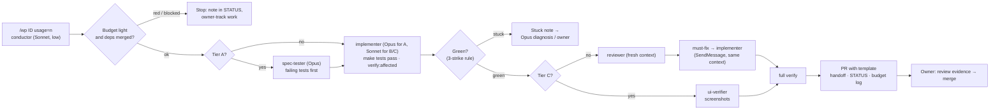

# Kizuna (絆): Development Plan

Delivery plan for building Kizuna with Claude Code · v1.0 · 2026-11-26 · Status: **Proposed**

> **Scope.** This document covers *how* the system in [`architecture-design.md`](architecture-design.md) gets built: the team, the development loops, the usage budget, and a week-by-week schedule from an empty repository to public launch. It does not change the architecture. Where the schedule departs from the architecture roadmap (§12 there), §9 lists each change and the reason for it.
>
> **Assumptions.**
> - There is one human, the **owner**. The owner does not write code. They decide, review behaviour and evidence, test the product by hand, and do the work only a person can do: accounts, money, legal, content judgement, beta users.
> - Claude Code writes all the code: a main session plus subagents.
> - All Claude work comes out of one subscription with a rolling **5-hour** limit and a **weekly** limit, shared with claude.ai chat and Desktop.
> - The owner has about **6–8 hours a week**.

## Contents

0. [Summary](#0-summary)
1. [Operating model: who does what](#1-operating-model-who-does-what)
2. [Usage budget: never trip the weekly limit](#2-usage-budget-never-trip-the-weekly-limit)
3. [Repository set-up for agents (context engineering)](#3-repository-set-up-for-agents-context-engineering)
4. [The team: agent roster](#4-the-team-agent-roster)
5. [Development loops](#5-development-loops)
6. [Risk tiers: how much verification each change gets](#6-risk-tiers-how-much-verification-each-change-gets)
7. [Week-by-week schedule](#7-week-by-week-schedule)
8. [Owner track: work only you can do](#8-owner-track-work-only-you-can-do)
9. [Changes from the architecture roadmap](#9-changes-from-the-architecture-roadmap)
10. [Risks to the plan](#10-risks-to-the-plan)
11. [Getting started: the first three sessions](#11-getting-started-the-first-three-sessions)
- [Appendix A: Templates](#appendix-a-templates)
- [Appendix B: Draft agent and command definitions](#appendix-b-draft-agent-and-command-definitions)
- [Appendix C: Draft root CLAUDE.md](#appendix-c-draft-root-claudemd)

---

## 0. Summary

1. **Small work packages (WPs) are the unit of work.** Each WP is at most one feature in one or two layers, with testable acceptance criteria. One WP runs in one fresh session. Nothing larger than size **M** is allowed: an L is split before it is scheduled.
2. **A thin conductor session runs specialised subagents.** You start a WP with `/wp <id> usage=<n>`. A cheap conductor session reads only the WP file and then delegates: a **spec-tester** writes tests first (Tier A only), an **implementer** makes them pass, and a **reviewer** with a fresh context checks the diff. The conductor then opens a PR. Each subagent gets the model its risk tier needs (§4, §6).
3. **The budget is enforced daily, not hoped for weekly.** Plan to use at most **80%** of the weekly allowance:
   - each of the five build days is capped at **15%**, and the two light days at **2.5%** each;
   - every session starts with your current `/usage` figure and a green, amber or red check that can downgrade models or stop the work (§2.3).

   Because the caps are daily, any seven consecutive days stay under 80%, whether your weekly window is rolling or fixed.
4. **Context is the main cost, so the repository is built to keep it small.** The 137 KB architecture doc is never loaded whole. It is split once into per-module **spec digests**, a 60-line `STATUS.md` replaces "re-read everything", verification output is cut to the failures only, and each package has its own `CLAUDE.md` (§3).
5. **Model routing.** Opus is used for planning and Tier A domain logic. Sonnet does routine implementation and review, and Haiku does search and mechanical work. Bulk content drafting (2,136 keywords, semantic relations) runs through the **Claude API Batch endpoint**, outside the subscription. That costs a few dollars and saves a lot of plan budget (§2.5).
6. **Each loop has a fixed rhythm:**
   - **WP:** spec → tests → implement → verify → review → PR (§5.1);
   - **day:** at most 2–3 WPs, and the owner reviews PRs each morning (§5.2);
   - **week:** plan on Monday, build Monday to Thursday, integrate, demo and retro on Friday, light weekend (§5.3);
   - **phase:** a consolidation week, then a gate review against the architecture's exit criteria (§5.4).
7. **Verification depth scales with risk.** Tier A covers memory, statistics, experiments, planner, grading, RLS and auth, billing and privacy: tests written first by an independent agent, Opus review, and a high-effort code review. Tier B gets a medium review. Tier C (UI, copy) is checked with screenshots and your eyes (§6).
8. **Schedule:** **33 weeks** to public launch (W00–W32), including four consolidation weeks:
   - Phase 0 (W00–W04);
   - Phase 1 (W05–W18), ending with the private beta;
   - Phase 2 (W19–W26);
   - Phase 3 (W27–W32).

   The order is fixed. The pace is set by the capacity measured in W00 and W01. If capacity is lower than assumed, weeks stretch and gates are never skipped. If you fall behind, cut scope from a pre-agreed list (§7.6).
9. **The beta starts as early as possible**, at the end of Phase 1. Population calibration, knot ratings and experiment outcomes depend on calendar time and real data, not on code, so they need to start accumulating while Phase 2 is built (§9).
10. **You always have a queue of your own work.** When the budget is red, the project still moves: content review, vendor set-up, beta users, legal, decisions (§8).

---

## 1. Operating model: who does what

| Role | Who | Responsibilities | Never does |
|---|---|---|---|
| **Owner** (you) | Human | Approves the weekly plan. Answers open questions. Reviews PRs for *behaviour and evidence*, not line by line. Merges. Tests the product by hand on staging. Makes the open decisions (architecture §14). Handles accounts, secrets, money, legal, content judgement and beta users. | Writes code; approves a Tier A PR without the reviewer's sign-off and a green CI |
| **Planner** | Main session, Opus | Writes the weekly plan and WP files, phase gate reviews, ADRs, retros. Turns architecture sections into acceptance criteria. | Implements |
| **Conductor** | Main session, Sonnet, low effort | Runs one WP end to end: checks the budget light, runs subagents, passes review findings back, opens the PR, writes the handoff | Reads the architecture doc; writes production code itself |
| **Subagents** | spec-tester, implementer(s), reviewer, scout, ui-verifier, content-qa (§4) | Specialised, fresh-context work that returns short summaries | Talk to each other directly; expand scope |
| **CI** | GitHub Actions (no Claude usage) | Lint, typecheck, tests, dependency boundaries, cycle check, content determinism, simulation gates | — |

**Your time each week (target 6–8 h):**

| When | What | Time |
|---|---|---|
| Monday | Read and approve the weekly plan, answer `OPEN-Q`s | 30 min |
| Tue–Fri mornings | Review yesterday's PRs: summary, evidence, spec trace. Merge, or comment. | 20–30 min/day |
| Friday | Hands-on test on staging, read the retro, decide on carry-overs | 60 min |
| Any time, especially red-budget days | Owner-track tasks (§8) | 2–4 h |

**How to review a PR when you don't read code.** Every PR description follows the template in Appendix A.4. Check four things:

1. **Spec trace:** each acceptance criterion maps to a test or a piece of evidence.
2. **Evidence:** test summary, screenshots, demo steps.
3. **Reviewer verdict:** no open must-fix items.
4. **Surprises:** anything listed under "deviations" or "out of scope found".

If something looks wrong, comment in plain language ("the summary says X, but the plan said Y"). The next session addresses it.

---

## 2. Usage budget: never trip the weekly limit

### 2.1 How the limits work (check before you rely on this)

- Paid plans have a rolling **5-hour session limit** and a **weekly limit** on top of it. Both are shared between Claude Code, claude.ai chat and Desktop.
- `/usage` in Claude Code shows where you stand on each.
- Anthropic does not publish exact token allowances, and the limits have changed over time (temporary promotions among them). This plan therefore budgets in **percent of your weekly allowance**, as `/usage` reports it, never in absolute tokens.
- Larger models use the allowance faster. As a guide, API list prices put Opus at about 2× Sonnet per token, and Haiku at about 1/20 of Sonnet. Assume your plan's accounting is roughly proportional, but don't depend on exact ratios.
- Every turn re-sends the conversation context. **A session's cost grows with its context size multiplied by its number of turns.** That is why §3 matters as much as model choice.

Sources: [Anthropic support: weekly limits](https://support.claude.com/en/articles/15910845-claude-code-may-july-2026-weekly-limits-promotion), [DataCamp: Claude Code usage limits](https://www.datacamp.com/tutorial/claude-code-usage-limits), [Portkey: Claude Code limits](https://portkey.ai/blog/claude-code-limits), [TechCrunch: weekly rate limits (2025)](https://techcrunch.com/2025/07/28/anthropic-unveils-new-rate-limits-to-curb-claude-code-power-users/). Re-check the current rules in W00.

### 2.2 The weekly envelope

| Bucket | Share of weekly allowance | Notes |
|---|---|---|
| Planning (Monday `/plan-week`) | 5% | Opus, one session |
| Work packages (build) | 60% | Everything in §5.1, reviews included |
| Integration, demo, retro (Friday) | 7% | Sonnet |
| Your own claude.ai chat and ad-hoc questions | 8% | It is shared, so budget for it |
| **Planned total** | **80%** | |
| Reserve | 20% | Hotfixes, a hard WP that overran, production incidents. Not for new scope. |

**Daily caps** (measured as the change in the weekly % on `/usage`):

| Day | Cap | Cumulative "line" |
|---|---|---|
| Day 1 (plan + build) | 15% | 15% |
| Day 2 | 15% | 30% |
| Day 3 | 15% | 45% |
| Day 4 | 15% | 60% |
| Day 5 (integrate, demo, retro) | 15% | 75% |
| Day 6 (light) | 2.5% | 77.5% |
| Day 7 (light) | 2.5% | 80% |

- **If `/usage` shows a fixed weekly reset time,** make Day 1 the first day after the reset.
- **If your window is rolling,** the daily caps alone keep any seven consecutive days at or below 80%.

### 2.3 The traffic light (checked at the start of every session)

Every session command takes your current weekly figure, for example `/wp W07-2 usage=41`. The command compares it with the cumulative line for today:

| Light | Condition | What changes |
|---|---|---|
| 🟢 **Green** | weekly used ≤ line | The normal routing in §2.4. Up to 2 WP sessions in parallel. |
| 🟡 **Amber** | line < used ≤ line + 10 | Tier B/C implementers move to `effort: low`, and Tier A stays on Opus. No parallel sessions. Tier C WPs skip the reviewer. No new L-splits or refactors. Prefer finishing open WPs over starting new ones. |
| 🔴 **Red** | used > line + 10, **or** used > 80% | No new WPs. Only: (a) finishing a WP already past review, at the conductor's minimum, (b) answering your questions, (c) production incidents from the reserve. Switch to owner-track work (§8). |
| ⛔ **Hard stop** | used > 90% | Production incidents only |

**5-hour window rule.** Run at most **2 WP sessions per 5-hour window**. If the session bar on `/usage` is above 75%, don't start a new WP in that window. Finish the current step, write the handoff, and stop.

### 2.4 Model and effort routing

| Work | Model | Effort | Why |
|---|---|---|---|
| Weekly planning, WP decomposition, ADRs, phase gates | Opus | high | Mistakes here multiply through the week |
| **Tier A** tests-first (spec-tester) | Opus | medium | It must understand the statistics and invariants exactly |
| **Tier A** implementation | Opus | high (`xhigh` only after a 3-strike escalation) | FSRS, replay, Bayesian estimates, experiments, RLS, billing |
| **Tier A** review | Opus | medium | Independent check of correctness |
| **Tier B** implementation (API endpoints, jobs, persistence plumbing, engagement rules) | Sonnet | medium | Routine, well specified |
| **Tier B** review | Sonnet | medium | |
| **Tier C** implementation (UI, copy, styling, docs, config) | Sonnet | low–medium | Checked visually |
| Conductor, retro, status updates, PR text | Sonnet | low | Coordination only |
| Search, log triage, "where is X", changelog, digest touch-ups | Haiku | low | Reading-heavy and cheap |
| Bulk content drafting | Claude API **Batch**, outside the plan | — | §2.5 |

### 2.5 Bulk content goes through the API, not the subscription

The content work in architecture §3.1 and §8.7 is drafted by an LLM and reviewed by a person: our own keywords for 2,136 kanji, semantic relations, optional mnemonics. Done interactively in Claude Code, that would cost a large share of a week. Done as an **offline script against the Message Batches API** (50% of the standard price, results within 24 hours), it is cheap:

- Keywords: 2,136 kanji × about 1,000 input tokens (KANJIDIC meanings, components, example words) and about 200 output tokens is about 2.1 M in and 0.4 M out. At Sonnet batch rates that is roughly **$4–5 per full run**. Allow about $20 for the iterations.
- Semantic relations and other passes cost about the same.
- The script lives in `apps/pipeline/authoring/`, stays behind the `AuthoringAssistant` adapter (architecture §8.7), records provenance, and writes a review sheet. **Claude Code writes the script (one S-sized WP). The API runs it.**
- It needs a separate API key and billing account (owner task, W03).

### 2.6 Rules that keep sessions cheap

1. **One WP per session.** Start fresh (`/clear` or a new session) for every WP. Never chain WPs in one long conversation.
2. **Never load the architecture doc whole.** Agents read the spec digest sections that the WP file cites (§3.2).
3. **Subagents return summaries of at most 150 words** plus a list of files changed. Raw logs and file dumps stay in the subagent.
4. **Give subagents exact paths and section anchors.** Open-ended prompts such as "explore the codebase to understand…" are banned, because they are the most expensive kind.
5. **Run checks quietly and only on what changed.** Use `pnpm verify:affected` (Turborepo, only changed packages) with dot reporters, and print only failures, capped at about 60 lines (§3.4). Run the full suite once, before the PR.
6. **CI does the heavy verification.** The conductor reads only the failing job's summary, never the whole log.
7. **The 3-strike rule.** If the same failure survives 3 fix attempts, stop. Write a stuck note in the WP file and escalate: first an Opus diagnosis in plan mode, then you. Thrashing is the biggest single waste.
8. **Watch context.** Check `/context` when a session feels long. Above about 50%, `/compact` with a focus instruction, or write the handoff and end the session.
9. **Hooks do formatting.** A PostToolUse hook runs Prettier and `eslint --fix` on edited files, so no tokens are spent on style (§3.5).
10. **Keep `CLAUDE.md` short and stable** (under 150 lines). It is sent with every session, and a stable prefix caches better.
11. **No unattended recurring Claude jobs.** Scheduled tasks, `/loop` and auto-review bots spend budget quietly. Automation goes in GitHub Actions.
12. **Cloud and local sessions share one budget.** Running sessions in parallel on claude.ai/code is convenient for oversight from a phone, but it is not free extra capacity.

### 2.7 Calibration: measuring real capacity (W00–W01)

The schedule in §7 assumes a capacity of about **8 M-sized WPs a week** inside the 60% build bucket. S counts as half an M. That is an assumption to test, not a promise.

1. In W00 and W01, record the weekly % before and after every WP in `docs/plan/budget-log.md` (template A.5).
2. At the W01 retro, compute `capacity = 60 ÷ (average % per M-equivalent WP)`.
3. Then apply one of these:

| Measured capacity | Action |
|---|---|
| ≥ 8 M/week | Keep the schedule. Leave the surplus as reserve; don't pull work forward in the first month. |
| 5–8 M/week | Each schedule week takes about 1.3 calendar weeks. Keep the order and the gates. |
| < 5 M/week | Either upgrade the plan tier, or run each schedule week over 2 calendar weeks, which puts launch at about 15 months |

Re-calibrate at every phase gate, because Tier A-heavy phases (Phase 2) cost more per WP than UI-heavy ones.

---

## 3. Repository set-up for agents (context engineering)

All of this is created in W00. It is what makes the budget work.

### 3.1 Layout

```
CLAUDE.md                         root rules (<150 lines, draft in Appendix C)
packages/<module>/CLAUDE.md       module rules: purpose, public API, invariants, test commands (<60 lines)
apps/<app>/CLAUDE.md              same, per app
.claude/
  agents/                         spec-tester, implementer, implementer-core, reviewer, scout, ui-verifier, content-qa
  commands/                       plan-week, wp, retro, gate, hotfix
  settings.json                   permissions allowlist, formatting hook
docs/
  architecture-design.md          source of truth (unchanged)
  development-plan.md             this file
  specs/                          spec digests, one per module (§3.2)
  plan/
    STATUS.md                     ≤60 lines: current week, active WPs, blockers, budget light
    roadmap.md                    phase and week checklist with ✅/🔄/⏸
    backlog.md                    out-of-scope finds, ideas, deferred items
    budget-log.md                 one row per session
    weeks/W07.md                  weekly plan + retro
    wp/W07-2.md                   one file per work package (template A.1)
    adr/ADR-0001-*.md             decisions
scripts/verify-summary.mjs        terse verification output (§3.4)
.github/pull_request_template.md  template A.4
```

### 3.2 Spec digests

- **One file per module:** `content`, `pipeline`, `memory`, `insights`, `drills`, `account`, `web`, `platform` (kernel, contracts, server, persistence, jobs, security).
- **Each is 1,500–3,000 words** and extracted from the architecture doc. Every rule links back with an anchor (`→ arch §4.3`). The digest copies formulas, thresholds, tables and invariants word for word, and drops the reasoning.
- **The architecture doc wins any conflict.** A change of design goes: ADR → update the architecture doc → update the digest, in the same PR.
- **Writing them:** they are produced once in W00 (Sonnet). Then the planner (Opus) runs a cross-check pass: every number and threshold in the architecture doc must appear in exactly one digest. You skim each one for 5 minutes.
- **Updates:** they are refreshed as-built in each consolidation week.

### 3.3 `STATUS.md` replaces re-discovery

Every session starts by reading `STATUS.md`, about 60 lines, instead of exploring:

- the current phase and week;
- the light;
- active WPs and their states;
- merged-this-week;
- blockers and `OPEN-Q`s;
- the last three decisions;
- known flaky tests.

The conductor updates it at the end of each WP, and the retro rewrites it on Fridays.

### 3.4 Terse verification

- `pnpm verify:affected` runs lint, typecheck, tests and boundaries for changed packages and their dependents. `pnpm verify` runs everything.
- Both pipe through `scripts/verify-summary.mjs`. It prints `✅ all green (n tests)`, or for each failure the test name, the assertion and the first five lines of the stack. Output is capped at 60 lines.
- Vitest runs with the dot reporter, `--silent`, and `--bail` locally.
- **Agents may run tests only through these scripts.** A raw `pnpm test` with full output is a waste of budget.

### 3.5 Hooks and permissions

- **PostToolUse hook** on `Edit|Write`: run `prettier --write` and `eslint --fix` on the changed file, silently.
- **Permissions allowlist:** the `pnpm` scripts, `git` (no force push), `docker compose`, and read-only commands. This saves you from approving prompts, and saves the turns that approvals cost. In W00, the `fewer-permission-prompts` skill can generate it from real transcripts.
- **No Stop hooks or prompt hooks that call a model.** They cost usage on every turn.

---

## 4. The team: agent roster

Seven custom agents, kept small on purpose. Each one has a fixed **output contract**, so the conductor's context stays small. Drafts are in Appendix B.

| Agent | Model / effort | Tools | Used for | Returns |
|---|---|---|---|---|
| `spec-tester` | Opus / medium | Read, Grep, Glob, Write and Edit (test files only), Bash (verify scripts) | Tier A: turns acceptance criteria plus digest invariants into failing unit, property and golden tests **before** implementation | Test list, with each criterion mapped to a test, ≤150 words |
| `implementer-core` | Opus / high | All except web | Tier A implementation | Summary ≤150 words, files changed, verify result, deviations |
| `implementer` | Sonnet / medium | All except web | Tier B/C implementation | Same contract |
| `reviewer` | Opus / medium (Tier A), Sonnet / medium (Tier B) | Read, Grep, Glob, Bash (read-only git and verify) | Fresh-context review of the WP diff against the WP file, the digest and module rules. Hunts correctness and boundary breaks, not style. | must-fix / should-fix / nit list, each with file:line, ≤250 words |
| `scout` | Haiku / low | Read, Grep, Glob | "Where is X?" and "what calls Y?", to keep other agents from exploring | Paths plus a one-line answer for each |
| `ui-verifier` | Sonnet / low | Bash (Playwright), Read | Tier C evidence: screenshots of the changed screens at phone and desktop width, a basic accessibility scan | Screenshot paths plus issues found |
| `content-qa` | Sonnet / low | Bash (pipeline CLI), Read | Pipeline runs: validation summary, release-diff summary, spot-check sheets for you | Counts plus the review-sheet path |

**Rules for subagents:**

- Tests written by the spec-tester are **frozen for the implementer**. If the implementer believes a test is wrong, it reports this as a deviation. The reviewer then decides, and you are told in the PR.
- Implementers never touch files outside the WP's declared packages without listing them as a deviation.
- At most **2 subagents run at once** in a session, and only while the light is green.
- For follow-ups, the conductor uses `SendMessage` to resume the same implementer, which keeps its context, rather than spawning a new one that has to re-read everything.
- **Built-in skills used in the loop:**
  - `/code-review` at `medium` for Tier B, and at `high` in consolidation weeks and for Tier A gate sweeps. Never `max`.
  - `/security-review` in W17 and W31.
  - `design:accessibility-review` in W31.

---

## 5. Development loops

### 5.1 The WP loop (the inner loop)



**WP definition of done:**

1. Every acceptance criterion is mapped to a test or evidence item.
2. `pnpm verify` is green locally and CI is green.
3. The reviewer has no open must-fix items. Should-fix items are fixed or recorded in `backlog.md`.
4. Module boundaries are respected; CI enforces this.
5. The WP file's Handoff and Actuals sections are filled in (template A.1).
6. `STATUS.md` and `budget-log.md` are updated.
7. The PR uses the template, with evidence.

**Branches.** One branch per WP (`wp/W07-2-record-reviews`). Squash-merge into `main`. `main` is always deployable to staging.

### 5.2 Daily loop

| Time | Owner | Claude |
|---|---|---|
| Morning (20–30 min) | Read `STATUS.md`. Review and merge yesterday's PRs. Answer `OPEN-Q`s in the WP files. Check `/usage`. | — |
| Build block 1 (one 5-hour window) | Start 1–2 `/wp` sessions with today's usage figure. You may walk away. | WP loops |
| Build block 2 (optional, a later window) | Start 1 more `/wp` if the daily cap allows | WP loop |
| End of day (5 min) | Glance at the PRs that opened | Conductor has updated STATUS |

The plan is **2–3 WPs a day, 8–10 a week**. Use the PR queue as a brake: if more than 3 PRs await your review, the next session addresses review comments instead of starting new work. Unreviewed work piling up is how quality drifts.

### 5.3 Weekly loop

| Day | Activity | Who | Budget |
|---|---|---|---|
| **Day 1** | `/plan-week usage=n` (Opus): reads the roadmap, last retro and calibration; writes `weeks/Wnn.md` and the WP files. You approve (30 min). Then the first WP starts. | Planner, then owner | ≤15% (planning ≈5%) |
| **Days 2–4** | WP loops; morning PR reviews | Conductor, owner | ≤15%/day |
| **Day 5** | Merge the remainder, deploy to staging, `ui-verifier` demo pack, then **you test by hand**. `/retro` (Sonnet): planned vs. actual %, calibration factor, carry-overs, STATUS rewrite. | Conductor, owner | ≤15% |
| **Days 6–7** | **Light.** No WPs. Owner-track tasks. Claude only for a production hotfix, from the reserve. | Owner | ≤2.5%/day |

**Planning rule.** A week holds at most `capacity × 0.9` M-equivalents. The 10% slack absorbs review fixes. The planner flags any week whose WP list is more than 50% Tier A, because those cost more.

### 5.4 Phase loop

1. **Consolidation week** (W12, W17, W22/W26 partly, W31), budgeted at about 60% of a normal week:
   - a `/code-review high` sweep over the phase's Tier A modules;
   - refresh the spec digests as-built;
   - pay down the `backlog.md` should-fix items;
   - update the runbooks.
2. **Gate review:** `/gate <phase>` (Opus) reads the architecture exit criteria (§12 there) and the evidence (CI gates, dashboards, test reports). It writes `weeks/GATE-n.md` with each criterion marked pass, fail or measured-later.
3. **You decide go or no-go.** A fail on any criterion that isn't data-gated blocks the next phase. Data-gated criteria are checked at a named later checkpoint (§9).
4. **Re-calibrate capacity** (§2.7).

### 5.5 Escalation and stop rules

| Situation | Rule |
|---|---|
| Same failure after 3 fix attempts | Stop. Stuck note in the WP file. Next: an Opus plan-mode diagnosis of at most 30 minutes. If still stuck, it becomes an `OPEN-Q` for you. |
| Spec ambiguity in Tier A | Never guess. Write an `OPEN-Q` with the options and a recommendation, and continue with the rest of the WP or the next one. You answer next morning, and the answer becomes an ADR if it changes the design. |
| Scope found that isn't in the acceptance criteria | Recorded in `backlog.md`, not implemented |
| WP overruns its estimate by more than 2× | Conductor stops at a clean point, splits the remainder into a new WP and records actuals |
| CI red on `main` | Top priority: the next session is `/hotfix`, from the reserve |
| Red light | Only the actions listed in §2.3 |

---

## 6. Risk tiers: how much verification each change gets

| Tier | Covers (architecture refs) | Tests | Review | Your check |
|---|---|---|---|---|
| **A: correctness-critical** | Content normalisation, alignment, relations, validation, determinism (§3.3). FSRS adapter, Learning flow, recordReviews, idempotency, replay and checkpoints (§4, §7.5). Uncertainty and mastery (§4.4, §4.6). Classifier, group effects, confusion stats, detectors, lifecycle, probes (§5). Planner quotas and sequencing, curriculum (§6.1–6.6). Experiments (§6.7). Grading (§4.3). RLS, auth, isolation (§7.4). Billing webhooks and entitlements (§7.7). Deletion cascade (§7.8). Sim gates (§8.6). | Spec-tester writes them first: unit, property-based (fast-check), golden. Simulation tests for detectors and experiments. | Opus reviewer, and `/code-review high` in consolidation weeks | Read the spec-trace table. Ask "which test proves criterion 3?" |
| **B: plumbing** | API endpoints, jobs wiring, persistence, engagement rules, content loading, observability, deployment | Implementer writes them; contract tests | Sonnet reviewer | Summary and evidence |
| **C: presentation** | Screens, renderers, copy, styling, docs, config | Component tests where there is logic; Playwright for flows | Screenshots by ui-verifier; no reviewer agent unless a state machine is touched | **You look at the screenshots and use it on staging** |

The planner assigns a tier to each WP. You can raise a tier, never lower one.

---

## 7. Week-by-week schedule

Notation: `Wnn-k` is a WP ID, followed by **tier/size**. Sizes are **S** (½ M) and **M**. The "You" column points at owner-track items in §8. A week typically holds 6–9 M-equivalents, leaving room under the assumed capacity of 8.

### 7.1 Phase 0: Foundations, content, scheduler core (W00–W04)

| Week | Goal | Work packages | You | Demo / exit |
|---|---|---|---|---|
| **W00** Setup and calibration | The agent-ready repository | W00-1 Monorepo: pnpm, Turborepo, TS strict, ESLint/Prettier, Vitest, dependency-cruiser rules from arch §2.3/§8.2, `verify` scripts + `verify-summary` (B/M) · W00-2 CI on GitHub Actions + branch protection (B/S) · W00-3 Agent scaffolding: root and module `CLAUDE.md`, `.claude/agents` and `commands`, hook, permissions, PR template, `docs/plan/*` (C/M) · W00-4 Spec digests for all modules + cross-check pass (C/M) · W00-5 `kernel`: UUIDv7 IDs, injected clock, seeded RNG, errors, logger and event base types (A/S) · W00-6 Local dev: docker-compose Postgres, Drizzle set-up, Testcontainers harness (B/S) | O-1 to O-4 | CI green on `main`; first calibration numbers in the budget log |
| **W01** Pipeline I | Parse and normalise the core sources | W01-1 `sources.lock.yaml` + fetcher with checksums (B/S) · W01-2 `content` Drizzle schema (arch §3.1) + content types (B/M) · W01-3 KANJIDIC2 parser + Jōyō table import: teach set, official readings (A/M) · W01-4 Normalisation library: NFC, hiragana storage / katakana display, okurigana and affix markers, radical variants (A/M) · W01-5 KRADFILE parser (B/S) | O-5, O-6 | Capacity calibrated (§2.7); schedule confirmed or stretched |
| **W02** Pipeline II | Components, words, alignment | W02-1 KanjiVG parser: element tree, positions → `component`, `kanji_component` (A/M) · W02-2 JMdict common subset, frequency-ranked (B/M) · W02-3 JmdictFurigana alignment → `word_kanji` with phenomenon tags (A/M) · W02-4 Tatoeba subset + word links (B/M) · W02-5 Cross-checks → review queue (B/S) | O-7 | Review-queue summary from content-qa |
| **W03** Pipeline III and release 0.1 | A deterministic, validated release | W03-1 Relations v1: `shares_component` (IDF), `visual_similar` v1, `phonetic_series` (A/M) · W03-2 Feature tags (B/S) · W03-3 Overrides layer + provenance on every row (B/S) · W03-4 Validation rules + release diff (A/M) · W03-5 Publish: DB load, static chunks + manifest, attribution manifest, CC BY-SA dataset; byte-identical determinism check in CI (B/M) · W03-6 Keyword-drafting Batch script + review-sheet generator (C/S) | O-8, O-9 | Release 0.1 builds deterministically in CI |
| **W04** Scheduler core and simulation · **Gate 0** | Decide the launch facet set with evidence | W04-1 `memory/domain`: FSRS adapter (ts-fsrs) per facet family, Again/Good mapping, Learning flow (arch §4.3), stages (§4.6) (A/M) · W04-2 `sim`: synthetic learner whose ground truth differs from FSRS, adherence and latency models (A/M) · W04-3 Workload model + workload gate in CI, with a stub planner (A/M) · W04-4 Facet experiment report (flagged facets on/off) → ADR (C/S) · `/gate 0` | O-10, O-11 | Architecture Phase 0 exit criteria: deterministic release; all 2,136 Jōyō kanji pass validation; 100 spot-checked by hand |

### 7.2 Phase 1: Core learning loop and private beta (W05–W18)

**Milestone 1a: walking skeleton (W05–W08)**

| Week | Goal | Work packages | You | Demo / exit |
|---|---|---|---|---|
| **W05** Server foundation | The composition root and its rails | W05-1 `contracts`: Zod → OpenAPI → typed client; domain event definitions (B/M) · W05-2 `apps/server`: Fastify, `problem+json`, request ctx, config, pino (B/M) · W05-3 Persistence: per-module schemas and migrations, a transaction helper with `SET LOCAL app.user_id`, the RLS policy pattern, isolation-test harness (A/M) · W05-4 Outbox + pg-boss worker + `processed_event` dedup + post-commit dispatch with the same event ID (A/M) · W05-5 `content` runtime: in-memory release index + query API (B/M) | — | Health endpoint; outbox delivers an event exactly once in tests |
| **W06** Accounts, web shell, staging | Sign in on a real URL | W06-1 Better Auth: magic link + Google, cookie settings, Origin check (A/M) · W06-2 `identity`: user, settings, timezone, learning-day boundary (pure, tested) (A/S) · W06-3 `apps/web` shell: Next.js, Tailwind, shadcn, `packages/ui` tokens, `/api` proxy, generated client, auth pages, goal onboarding (C/M) · W06-4 Staging: api and worker containers, web hosting, managed Postgres, R2 + CDN, migrations in CI (B/M) | O-12, O-13 | **You sign in on staging** |
| **W07** Memory module | The event log and traces, correct under concurrency | W07-1 Schema: `memory_trace`, partitioned `review_event`, `review_idempotency`, `exposure_event`, `scheduler_params`, `engine_version_set` (B/M) · W07-2 `recordReviews` in one transaction: idempotency → event → trace → outbox; MC not scheduling; timestamp clamping (A/M) · W07-3 Out-of-order replay under row lock (with a checkpoint seam) (A/M) · W07-4 Uncertainty (`n_eff`, Beta), mastery vector, snapshot query (A/M) · W07-5 Property tests across memory (A/S) | — | Property suite green (S ≥ 0, monotone intervals, replay = direct apply) |
| **W08** Walking skeleton | First end-to-end study session | W08-1 `drills/grading`: kana, WanaKana, okurigana, fuzzy meaning, accept-lists, alternative-valid detection (A/M) · W08-2 E1/E4/E5 specs, generators, `exercise_spec` hash store (B/M) · W08-3 Planner v0 (due + new) + session endpoints, with the 28-day and 7-day windows (A/M) · W08-4 Minimal session UI (C/M) · W08-5 Playwright E2E: sign in → lesson → MC → typed graduation → trace due (B/S) | O-14 | **You complete a real session on staging** |

**Milestone 1b: complete learning core (W09–W12)**

| Week | Goal | Work packages | You | Demo / exit |
|---|---|---|---|---|
| **W09** Planner v1 | Explainable sessions within the time budget | W09-1 Candidate sources, eligibility, quotas from median latency, backlog guard, adaptive new rate (A/M) · W09-2 Ranking + sequencing (warm-up, siblings ≥ 5 apart, end on success, relearn), reason codes, seed and version persisted (A/M) · W09-3 Planner property tests + golden plans (A/S) · W09-4 Real planner swapped into the sim; workload gate re-run (A/S) | — | Workload gate passes with the real planner |
| **W10** Curriculum and lessons | Learners can progress | W10-1 Curriculum: component-first topological order, frequency weighting, 5–8 per lesson, stagger-then-contrast, cursor (A/M) · W10-2 Vocabulary unlock and context traces (A/S) · W10-3 Lesson UI: components, KanjiVG stroke player, keyword, words, "I already know this" (C/M) · W10-4 Content chunks on CDN + IndexedDB cache by manifest hash (B/M) | O-15 | You do lessons 1–3 |
| **W11** Session client | Resilient and pleasant to use | W11-1 Session state machine incl. alt-reading retry and the shared pacing rule (A/M) · W11-2 Renderers, WanaKana and IME input, shortcuts, `lang="ja"`, fonts (C/M) · W11-3 IndexedDB answer buffer, flush policy, resume, `410` handling (A/M) · W11-4 Device and keyboard matrix (Playwright mobile emulation) + manual checklist for you (C/S) | O-16 | Kill the tab mid-session, resume, nothing lost |
| **W12** Classifier, distractors · *consolidation* | Diagnostic data from day 1 | W12-1 Error classifier v1, logging only (A/M) · W12-2 Distractors v1 by stage (B/M) · W12-3 `/code-review high` sweep over memory, drills and grading + fixes (A/M) · W12-4 Digests as-built, ADRs (C/S) | — | Error classes visible in the internal inspector |

**Milestone 1c: screens and engagement basics (W13–W15)**

| Week | Goal | Work packages | You | Demo / exit |
|---|---|---|---|---|
| **W13** Learner screens | Progress you can see | W13-1 Home endpoint + screen (C/M) · W13-2 Kanji map endpoint + grid of 2,136 cells with filters (C/M) · W13-3 Kanji detail + personal overlay + item actions (B/M) · W13-4 Forecast + calendar heatmap (C/S) | O-17 | Screenshot pack at phone and desktop width |
| **W14** Engagement basics | Goal, XP, streak, all honest | W14-1 XP ledger from events (scheduled items only), `daily_activity`, goal rule (A/M) · W14-2 Streak without freezes + `closeDay` job with 6-hour grace + timezone rule (A/M) · W14-3 Session summary, XP and goal UI, reduced-motion celebrations (C/M) · W14-4 Learning-day credit for offline answers (A/S) | O-18 | Double-delivery test: XP counted once |
| **W15** Public surface | Indexable pages, a waitlist | W15-1 SSG kanji pages ×2,136, attribution, SEO, sitemap (C/M) · W15-2 `/credits` generated from provenance; licence files; dataset link (B/S) · W15-3 Landing page + beta waitlist (C/M) · W15-4 Mobile layout pass (C/M) | O-19 | Waitlist live; you start recruiting |

**Milestone 1d: production readiness and beta (W16–W18)**

| Week | Goal | Work packages | You | Demo / exit |
|---|---|---|---|---|
| **W16** Production basics | Safe to hold real user data | W16-1 RLS on every user table + isolation suite over every repository method and endpoint, blocking in CI (A/M) · W16-2 Sentry, OTel, pino, basic alerts (B/M) · W16-3 GDPR export + deletion cascade (`UserDeleted`), rate limits, CSP and headers (A/M) · W16-4 Weekly calibration report job + internal page (B/M) · W16-5 PITR (14 days) + restore runbook (B/S) | O-20 | Zero isolation failures |
| **W17** *Consolidation* | Hardening | W17-1 Performance budgets measured + fixed (B/M) · W17-2 `/security-review` + fixes (A/M) · W17-3 Bug bash from your checklist; E2E completion (B/M) · W17-4 Beta invites, feedback widget, "Report an issue" triage queue (B/M) · W17-5 Runbooks (C/S) | O-21 | p95 budgets met |
| **W18** **Private beta** · **Gate 1 (technical)** | Real learners | W18-1 Production deploy + smoke tests; content release 1.0-beta (B/S) · W18-2 Beta dashboard: sessions per user per week, review time vs. goal, calibration (B/M) · *30% of the week held for fixes* · `/gate 1` | O-22 | Technical exit criteria pass. Usage criteria checked at W22 (§9). |

### 7.3 Phase 2: Learning intelligence v1 (W19–W26)

Development in W19–W21 runs mostly against **simulated populations**. The beta will not yet meet the gating thresholds (500 reviews from 20 users per tag, arch §5.3) for most tags.

| Week | Goal | Work packages | You | Demo / exit |
|---|---|---|---|---|
| **W19** Population statistics | A calibrated baseline | W19-1 `reporting` schema + `population.stats` nightly skeleton, versioned outputs (B/M) · W19-2 Calibration offsets `c` and `μ_g` with shrinkage + eligibility gating (A/M) · W19-3 Population FSRS parameters per facet family; ADR on the optimiser (Rust binding vs. Python sidecar) (A/M) · W19-4 Sim populations with population-wide difficulty + an injected-weakness generator (A/M) | O-23 | `μ_g` recovered in sim within tolerance |
| **W20** Group effects and confusion | The core signal | W20-1 Group-effect estimator: one-step Laplace, recency weights, empirical-Bayes `σ_type` (A/M) · W20-2 Candidate rules: τ, support, leave-one-out robustness, specificity (A/M) · W20-3 Confusion-pair stats + clusters (A/M) · W20-4 Nightly recompute of predicted R from the log + incremental aggregates (A/M) | — | Estimator golden tests match hand-computed examples |
| **W21** Detectors and lifecycle | Hypotheses that can say no | W21-1 Detectors H1, H2, H4 + sim recall tests (A/M) · W21-2 Detectors H6, H7, H8 + sim tests (A/M) · W21-3 Lifecycle state machine, insights tables, max-3 ranking (A/M) · W21-4 Probes: planner probe source ≤ 10%, fresh-data direction check + combined rule, typed pair probes (A/M) | — | Sim: injected weaknesses found; clean learners mostly silent |
| **W22** Insights UI · *partial consolidation* | Knots learners can trust | W22-1 Insights API (B/S) · W22-2 Knot cards + template evidence + "Why this?" (C/M) · W22-3 `insights.detect` (debounced) + `insights.nightly` (B/M) · W22-4 `/code-review high` over insights (A/S) | O-24, **Phase 1 usage checkpoint** | You read your own knots on staging |
| **W23** Interventions I | Focus drills | W23-1 Intervention requests → focus source ≤ 25% + exposure-not-review rule (A/M) · W23-2 E8, E10, E11 (B/M) · W23-3 E7, E9 (B/M) · W23-4 Templates: contrast pair, family drill, reading focus (B/M) | O-25 | Each exercise demoed |
| **W24** Interventions II | Complete template set | W24-1 E12 kana minimal pairs (typing; audio if O-18 says so) (B/M) · W24-2 Templates: kana pairs, context cloze, leech rebuild (B/M) · W24-3 Focus-drill flows + knot progress in the summary (C/M) · W24-4 Escalation rounds + Chronic (A/S) | O-26 | — |
| **W25** Experiment framework | Measured, not assumed | W25-1 Arm assignment (item- and timing-randomised, stratified, seeded) (A/M) · W25-2 Retention-check scheduler: days 13–15, balanced per day, capacity cap, seeded evaluated subset, missed days, waitlist release, lapse safety valve (A/M) · W25-3 `experiments.evaluate` + platform report (cluster bootstrap) + per-user descriptive counts (A/M) · W25-4 Experiment opt-out + "How Kizuna learns" draft (C/S) | — | Sim: estimator recovers injected effects |
| **W26** Simulation gates · *consolidation* · **Gate 2 (technical)** | All CI gates on | W26-1 CI sim gates: recall ≥ 0.8, false knots ≤ 5% incl. population difficulty, estimator coverage ≥ 90%, workload (A/M) · W26-2 Tuning of τ and probe count → ADR (arch §14.10) (A/M) · W26-3 `/code-review high` + fixes over insights and experiments (A/M) · `/gate 2` | O-27 | Sim gates pass. Knot ratings checked at W30 (§9). |

### 7.4 Phase 3: Launch, monetisation, polish (W27–W32)

| Week | Goal | Work packages | You | Demo / exit |
|---|---|---|---|---|
| **W27** Billing | Money works end to end | W27-1 Entitlements, plans config, overrides; the beta allowlist becomes "everyone Pro" (A/M) · W27-2 Provider adapter (per ADR from O-26): checkout, portal, webhooks → `SubscriptionChanged`, `billing_event` dedup, reconcile (A/M) · W27-3 Pricing page, billing settings, entitlement limits in the planner (B/M) · W27-4 E2E in test mode: checkout → entitlement → portal → cancel, incl. webhook replay (A/S) | O-28 | Test-mode purchase on staging |
| **W28** Engagement v1 | Motivation without grinding | W28-1 Ranks 糸 → 絆 with Mature-based sub-levels + progress bar (B/M) · W28-2 Freezes + vacation mode (A/S) · W28-3 Declarative achievements engine + v1 set (B/M) · W28-4 Email reminders: opt-in, caps, timezone buckets (B/M) | O-29 | — |
| **W29** Onboarding and semantics | Faster start for experienced learners | W29-1 Placement test (A/M) · W29-2 Anki import ✂ (A/M) · W29-3 Curated `semantic_related` (offline Batch draft + your review) + H3 ✂ (A/M) | O-30 | — |
| **W30** Learning polish | Better schedules | W30-1 Per-user FSRS optimisation ✂ (A/M) · W30-2 Flagged-facet decision from the workload gate and beta data → ADR; E2/E3 if enabled (A/M) · W30-3 PWA install ✂ (B/M) · W30-4 Trace checkpoints + partition maintenance (Parquet archiving waits for volume) (B/M) | O-31, **knot-rating checkpoint** | — |
| **W31** *Consolidation*: launch polish | Accessible, fast, legal | W31-1 WCAG 2.2 AA audit (`design:accessibility-review`) + fixes (C/M) · W31-2 Performance and load test at launch scale (B/M) · W31-3 Legal pages, consent banner, cookieless PostHog (B/S) · W31-4 Full E2E: sign-up → placement → session → streak → checkout (B/M) · `/security-review` | O-32 | Legal sign-off |
| **W32** **Public launch** · **Gate 3** | Ship | W32-1 Launch checklist, change freeze, production 1.0, alerts verified (B/S) · *40% of the week held for incidents* · `/gate 3` | O-33 | Architecture Phase 3 exit criteria pass; D7 baseline measurement starts |

✂ = on the cut list (§7.6).

### 7.5 After launch: Phase 4 and beyond (W33+)

A sustainable cadence replaces the build sprint:

- Weekly envelope: **50%** Phase 4 items (arch §12), **30%** user-reported bugs and operations, **20%** reserve.
- One Phase 4 item every 1–2 weeks, in this order:
  1. H5 and H9;
  2. empirical confusable mining;
  3. population priors;
  4. Thompson sampling;
  5. the knowledge-tracing challenger in shadow mode;
  6. the threads graph, daily quests and web push.
- Monthly: a consolidation week and a calibration and experiment review (the effect-size reporting the architecture's Phase 4 exit requires).
- Phase 5 items each start with a design addendum, written by the planner and approved by you, before any WP exists.

### 7.6 If you fall behind

1. **Never skip a gate or a Tier A test.** Slip the calendar instead.
2. **Cut scope in this order**, each with an ADR:
   1. Anki import;
   2. PWA install;
   3. per-user FSRS optimisation (population parameters stay);
   4. H3 and semantic relations;
   5. placement test ("I already know this" stays);
   6. achievement breadth (keep 5);
   7. audio in E12.
3. **More than 2 weeks behind at a gate:** the planner re-baselines the remaining schedule using measured capacity, and you approve.

---

## 8. Owner track: work only you can do

These run in parallel with the build. Do them first on red-budget days and on the light days.

| ID | When | Task | Time |
|---|---|---|---|
| O-1 | W00 | Pick the plan tier. Read §2. Learn `/usage`, `/context`, `/model`, `/clear`. | 1 h |
| O-2 | W00 | Repository settings: branch protection on `main` (CI required, squash merge) | 15 min |
| O-3 | W00 | ADR-0001, hosting: Vercel (web), Fly.io or Render (api + worker), Neon (Postgres with PITR), Cloudflare R2. Confirm Better Auth (arch §14.1). | 30 min |
| O-4 | W00 | Approve root `CLAUDE.md`, agent definitions and spec digests (skim) | 1 h |
| O-5 | W01 | Allow the source download hosts for cloud sessions (EDRDG, KanjiVG, JmdictFurigana, Tatoeba release hosts), or run the fetch locally once | 15 min |
| O-6 | W01 | Read the licence summary (arch §3.4) and re-verify each licence at its source | 45 min |
| O-7 | W02 | Triage the first review queue: accept the suggested overrides or flag them | 1 h |
| O-8 | W03 | Create an Anthropic API key with a spend limit, for Batch content drafting (§2.5) | 15 min |
| O-9 | W03 → W30 | **Keyword review.** About 120 a week, the first 300 (the free-tier scope) by W12. All 2,136 by W30. | ≈ 30–40 min/week |
| O-10 | W04 | **Spot-check 100 random kanji by hand** (architecture Phase 0 exit) | 2 h |
| O-11 | W04 | Approve the facet-set ADR; Gate 0 decision | 30 min |
| O-12 | W06 | Vendor accounts and secrets: hosting, Neon, Cloudflare, Google OAuth client, Resend, Sentry, PostHog | 2 h |
| O-13 | W06 | Domain + DNS | 30 min |
| O-14 | W08 | Do a real session on staging, write 5 notes | 30 min |
| O-15 | W10 | Decide on mnemonics at launch (arch §14.5). Recommended: user-written mnemonics plus component explanations, no authored set. | 15 min |
| O-16 | W11 | Run the manual device and keyboard checklist (your phone, iOS and Android IMEs) | 45 min |
| O-17 | W13 | Default desired retention (arch §14.4). Recommended: 0.90, revisit with beta workload data. | 10 min |
| O-18 | W14 | Audio at launch (arch §14.6). Recommended: defer to after launch unless a licensed TTS vendor is trivial. | 30 min |
| O-19 | W15 → W18 | **Beta recruitment:** aim for 80–120 waitlist sign-ups to get 20–50 active users. Post in learner communities, following each community's self-promotion rules. | 1–2 h/week |
| O-20 | W16 | Privacy-policy and terms drafts (from a reputable template); vendor DPAs | 2 h |
| O-21 | W17 | Bug-bash session: follow the checklist and file issues in plain language | 1.5 h |
| O-22 | W18 → | Onboard beta users in waves of 10. Daily 15-minute feedback triage into `backlog.md`. | 15 min/day |
| O-23 | W19 | **Book the legal review** (licensing, CC BY-SA share-alike, ToS, privacy) to finish by W31 | 1 h |
| O-24 | W22 | Phase 1 usage checkpoint: ≥ 5 sessions/week for 20–50 users, median review time within the goal | 30 min |
| O-25 | W23 | Validate the brand vocabulary ("knots", 糸 → 絆) with 5 beta users (arch §14.8) | 1 h |
| O-26 | W24 | Billing provider (arch §14.2) and free-tier boundaries (§14.3) → ADR | 1 h |
| O-27 | W26 | τ and probe-count ADR; Gate 2 decision | 30 min |
| O-28 | W27 | Stripe or Paddle account, tax set-up, test mode | 1.5 h |
| O-29 | W28 | Review the achievement set and the reminder copy | 30 min |
| O-30 | W29 | Review the semantic relations draft (H3), or cut it | 1–2 h |
| O-31 | W30 | Knot-rating checkpoint: ≥ 50% "helpful", < 20% "not right" (architecture Phase 2 exit) | 30 min |
| O-32 | W31 | Legal sign-off; real-device accessibility pass | 2 h |
| O-33 | W32 | Launch posts; watch the dashboards on launch day | 3 h |

---

## 9. Changes from the architecture roadmap

| # | Change | Reason |
|---|---|---|
| 1 | Added **W00** (setup and calibration) before Phase 0 | Agent-driven development needs the context scaffolding (§3) and a measured capacity before the schedule can be trusted |
| 2 | FSRS adapter and Learning flow moved from Phase 1 to the end of Phase 0 (W04) | The Phase 0 workload simulation needs a scheduler. The sim uses a stub planner until W09, when the real one replaces it and the gate is re-run. |
| 3 | Phase 1 split into milestones 1a–1d, with a **walking skeleton at W08** | You can see and test real progress early. Integration risk surfaces in week 8, not week 18. |
| 4 | Phase 1 and Phase 2 exits split into **technical** (gate week) and **data-gated** (checkpoints O-24 at W22, O-31 at W30) | Usage and rating criteria need weeks of beta data. Waiting idle would waste calendar time, and Phase 2 needs that beta data anyway. Technical criteria still block. |
| 5 | Phase 2 detection built against simulated populations first | Gating thresholds (500 reviews from 20 users per tag) will not be met early in the beta. Simulation includes population-wide difficulty (arch §8.6). |
| 6 | Bulk content drafting moved to the Batch API, outside Claude Code | Protects the subscription budget (§2.5). Matches arch §8.7 (offline, human-reviewed). |
| 7 | Billing provider decision brought forward to W24 (O-26) | So W27 starts with no open decision |
| 8 | Consolidation weeks made explicit (W12, W17, W22/W26 partly, W31) | Agent-written code needs periodic high-effort review sweeps and as-built digest refreshes. They also lower the usage burn. |
| 9 | Total: 33 weeks to launch, against 26–31 in the architecture (one full-time human developer) | Adds the set-up week, consolidation weeks and a 10% planning slack. The real pace comes from calibration (§2.7). |

---

## 10. Risks to the plan

| Risk | Mitigation |
|---|---|
| **Usage spikes** (a hard Tier A WP, thrashing) | Daily caps, the traffic light, the 3-strike rule, the 2× overrun split rule, a 20% reserve |
| **Spec drift**: agents implement "close enough" | Spec digests with exact formulas; spec-tester tests first for Tier A; the reviewer checks against the WP file and digest; the PR spec-trace table |
| **Plausible but wrong statistics** | Golden tests with hand-computed values; property tests; simulation gates with known ground truth; Opus review |
| **Integration breakage between modules** | Walking skeleton at W08; boundaries and cycle checks in CI; contract tests from Zod; `main` always deployable |
| **Your review becomes rubber-stamping** | PR queue cap (3); evidence-first template; a hands-on test every Friday; Tier A requires the reviewer's sign-off before you look |
| **Context rot in long sessions** | One WP per session; STATUS and handoff files; `/compact` above 50% |
| **Subagents re-reading the same files** | `SendMessage` to resume implementers; `scout` for lookups; module `CLAUDE.md` files |
| **Limits or pricing change mid-project** | Everything is budgeted in percent; re-check at each gate; the stretch rule (§2.7) |
| **Beta too small for Phase 2 data** | Early recruitment (O-19 from W15); sim-first development; platform-level reporting per the architecture |
| **Owner burnout** | 6–8 h a week by design; light weekends; red days become owner-track days |

---

## 11. Getting started: the first three sessions

**Session 1: scaffolding (Opus, plan mode, ≈ 1 WP).** Paste:

> Read `docs/development-plan.md` §3, §4 and Appendices A–C. Do not read `docs/architecture-design.md` yet. Create W00-3: root `CLAUDE.md` from Appendix C, `.claude/agents/*` and `.claude/commands/*` from Appendix B (check the frontmatter fields against the current Claude Code docs), the `docs/plan/` files, and the PR template. Write `docs/plan/wp/W00-1.md` … `W00-6.md` from template A.1. Open one PR. Report in under 150 words.

**Session 2: spec digests (Sonnet, then Opus for the cross-check).**

> `/wp W00-4 usage=<n>`. Split `docs/architecture-design.md` into `docs/specs/*.md` per §3.2, one module per subagent, at most 2 at a time. Then cross-check: every number and threshold in the architecture doc appears in exactly one digest.

**Session 3 onwards:** `/wp W00-1 usage=<n>`, then W00-2, W00-5 and W00-6 in the usual loop, and record calibration numbers after each.

---

## Appendix A: Templates

### A.1 Work package file (`docs/plan/wp/Wnn-k.md`)

```markdown
# Wnn-k: <title>
Tier: A|B|C · Size: S|M · Implementer: implementer-core|implementer · Estimate: <n>% weekly
Depends on: <WP ids, merged?> · Branch: wp/Wnn-k-<slug>
Spec refs: docs/specs/<module>.md#<anchor> (→ arch §x.y)

## Goal
<1–2 sentences>

## Acceptance criteria (each must be testable)
1. …
2. …

## Out of scope
- …

## Packages and files expected to change
- packages/<module>/src/domain/…

## Test plan
- Unit: …  · Property: …  · Golden/sim: …  · E2E/screenshot: …

## OPEN-Q
- (none) | Q1: <question> · Options: a / b · Recommendation: a, because …

## Handoff (filled at the end)
State: done | partial (what's left) · Gotchas: … · Follow-ups → backlog.md

## Actuals
Weekly % before/after: … · Sessions: … · Strikes: … · Reviewer must-fix count: …
```

### A.2 Weekly plan (`docs/plan/weeks/Wnn.md`)

```markdown
# Week nn: <goal>   Phase n · Milestone x
Capacity: <M-equivalents> (calibration factor <f>) · Planned: <M-eq> · Tier A share: <%>
Start usage: <%> · Light days: Day 6–7

| WP | Title | Tier/Size | Est. % | Day | Depends |
|---|---|---|---|---|---|

Owner tasks this week: O-…
Demo on Friday: …
Risks / notes: …
```

### A.3 Retro (appended to the weekly file)

```markdown
## Retro
| WP | Est. % | Actual % | Strikes | Must-fix | Merged? |
Total used: <%> (line 80%) · Peak day: <%> · Light that triggered: …
Calibration factor (actual ÷ estimate): <f> → next week's capacity: <M-eq>
Carry-overs: … · What slowed us: … · Change for next week (max 2): …
```

### A.4 Pull request template

```markdown
## What and why
<2–4 sentences, plain language>

## Spec trace
| # | Acceptance criterion | Proven by (test name / evidence) |
|---|---|---|

## Evidence
- verify: ✅ <n> tests · CI: <link>
- Screenshots / demo steps (Tier C)

## Review
Reviewer: <agent, model> · must-fix: 0 open · should-fix: fixed <n>, deferred <n> (backlog links)

## Deviations and surprises
- Files outside the declared packages: …
- Tests disputed (Tier A): …
- Out-of-scope finds → backlog.md

## Risk
Tier: A|B|C · Migration: yes/no (expand-contract?) · Feature flag: …
```

### A.5 Budget log (`docs/plan/budget-log.md`)

```markdown
| Date | Day | Session | WP | Models | Weekly % start | Weekly % end | Δ | Light |
|---|---|---|---|---|---|---|---|---|
```

---

## Appendix B: Draft agent and command definitions

These are drafts. In W00, check field names and allowed values (`model`, `effort`, `tools`) against the current Claude Code documentation before committing them.

**`.claude/agents/spec-tester.md`**

```markdown
---
name: spec-tester
description: Tier A only. Before implementation, writes failing unit, property and golden tests that encode a WP's acceptance criteria and the invariants in its spec digest. Never writes production code.
tools: Read, Grep, Glob, Write, Edit, Bash
model: opus
effort: medium
---
You write tests only, under `**/*.test.ts` and `**/__golden__/**`.
Inputs: the WP file path and the spec-digest anchors it cites. Read nothing else unless a cited file imports it.
Encode formulas and thresholds exactly as written in the digest. Use hand-computed expected values for estimators.
Use fast-check for invariants. Run tests only through `pnpm verify:affected`. They must fail for the right reason.
Return at most 150 words: the criterion → test-name table, plus any ambiguity found (as OPEN-Q text).
```

**`.claude/agents/implementer-core.md`** (and `implementer.md`, identical except `model: sonnet`, `effort: medium`)

```markdown
---
name: implementer-core
description: Implements one Tier A work package so that its frozen tests pass, inside the declared packages, following module rules.
tools: Read, Grep, Glob, Write, Edit, Bash
model: opus
effort: high
---
Read: the WP file, its cited digest anchors, and the CLAUDE.md of each package you touch. Ask `scout` for anything you can't find in two searches.
Tests written by spec-tester are frozen. If one looks wrong, stop and report it as a deviation.
`domain/` stays pure: no I/O, no Date.now, no Math.random. Cross-module imports go through index.ts only.
Verify only with `pnpm verify:affected`. 3-strike rule: after the same failure survives 3 attempts, stop and report a stuck note.
Return at most 150 words: summary, files changed, verify result, deviations, out-of-scope finds.
```

**`.claude/agents/reviewer.md`**

```markdown
---
name: reviewer
description: Fresh-context review of a finished WP diff against its WP file, spec digest and module rules. Read-only. Finds correctness bugs, spec mismatches and boundary breaks, not style.
tools: Read, Grep, Glob, Bash
model: opus
effort: medium
---
Use `git diff main...HEAD` and read only the changed files plus the WP file and its cited digest anchors.
Check each acceptance criterion against the code and tests. Check the module rules (arch §2.3 as digested), idempotency, ctx/RLS scoping, determinism (injected clock and RNG), and numeric formulas against the digest.
Return at most 250 words: must-fix / should-fix / nit items, each with file:line and a one-line reason. Say "no must-fix" explicitly when there are none.
```

**`.claude/agents/scout.md`**

```markdown
---
name: scout
description: Cheap lookups. Finds where something is defined or used and answers in one line per item. Never edits.
tools: Read, Grep, Glob
model: haiku
effort: low
---
Answer only what was asked, as path:line plus a one-line answer. At most 10 items.
```

**`.claude/commands/wp.md`**

```markdown
---
description: Run one work package end to end. Usage: /wp <WP-id> usage=<weekly %>
model: sonnet
---
1. Read docs/plan/STATUS.md and docs/plan/wp/$WP.md only. Compute the light from usage= and the daily line in docs/development-plan.md §2.2–2.3. On red, stop and say so. On amber, apply the amber rules.
2. Check the dependencies are merged. Create the branch.
3. Tier A: run spec-tester, then implementer-core. Tier B/C: run implementer. Pass file paths and anchors; never paste file contents.
4. When green: Tier A/B → reviewer (Opus for A, Sonnet for B); send must-fix items to the same implementer via SendMessage. Tier C → ui-verifier.
5. Run the full `pnpm verify`. Open the PR with .github/pull_request_template.md.
6. Fill in the WP Handoff and Actuals, update STATUS.md, append to budget-log.md (ask the user for the end usage %). Stop.
```

**`.claude/commands/plan-week.md`** (`model: opus`): reads `roadmap.md`, the last retro, `STATUS.md`, `backlog.md` and the schedule row in §7. Writes `weeks/Wnn.md` and the WP files within `capacity × 0.9`. Lists owner tasks and `OPEN-Q`s. Stops for approval.

**`.claude/commands/retro.md`** (`model: sonnet`): fills in the retro (A.3) from the WP actuals and the budget log, rewrites `STATUS.md`, and updates `roadmap.md`.

**`.claude/commands/gate.md`** (`model: opus`): reads the phase's exit criteria (arch §12) and the evidence, and writes `weeks/GATE-n.md`.

**`.claude/commands/hotfix.md`** (`model: sonnet`): fixes CI on `main` or a production bug, using the reserve, with the minimal diff and a regression test.

**`.claude/settings.json`** (sketch): a permissions allowlist for `pnpm verify*`, `pnpm test*`, `pnpm build`, `git status|diff|log|add|commit|push|checkout|switch` (no `--force`), `docker compose *`, `node scripts/*`; plus a PostToolUse hook on `Edit|Write` that runs Prettier and `eslint --fix` on the edited file.

---

## Appendix C: Draft root CLAUDE.md

```markdown
# Kizuna: rules for Claude

Adaptive kanji-learning SaaS. TypeScript modular monolith: pnpm + Turborepo, Fastify API + worker, Next.js web, PostgreSQL (schema per module), pg-boss.

## Read this, not everything
- Start every session with docs/plan/STATUS.md and the WP file you were given.
- Specs: docs/specs/<module>.md, only the anchors your WP cites. Never load docs/architecture-design.md whole; open a section only when a digest links to it and is unclear.
- Each package has its own CLAUDE.md. Read it before editing that package.

## Commands (always use these)
- pnpm verify:affected: lint + typecheck + tests + boundaries for changed packages (terse output)
- pnpm verify: everything, once before a PR
- pnpm db:up / pnpm db:migrate: local Postgres
- Never run raw test commands with full output.

## Architecture rules (CI enforces them)
- Modules import each other only through src/index.ts. Domain events live in packages/contracts.
- domain/ is pure: no I/O, no Date.now(), no Math.random(); clock and RNG are injected.
- No cross-schema joins in application code. Every user-scoped query takes ctx and runs under RLS.
- State-changing commands: one transaction, events written to the outbox in it; handlers are idempotent by event ID.
- apps/web may import only contracts, drills/grading, content types and ui.

## Working rules
- One WP per session. Stay inside the WP's declared packages; anything else is a listed deviation.
- Out-of-scope ideas go to docs/plan/backlog.md, not into code.
- Tier A ambiguity: write an OPEN-Q in the WP file and never guess.
- 3-strike rule: after the same failure survives 3 attempts, stop and write a stuck note.
- Subagent results: at most 150 words plus files changed. No raw logs.
- Commit messages: imperative, scoped (e.g. "memory: replay out-of-order answers").
```
