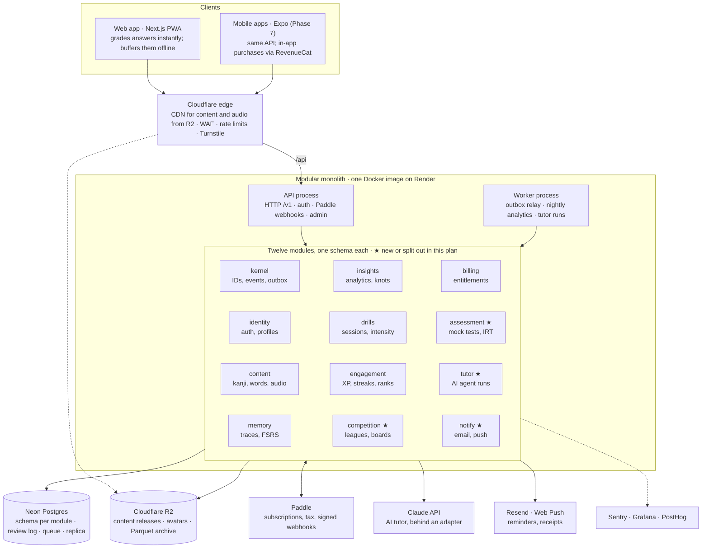
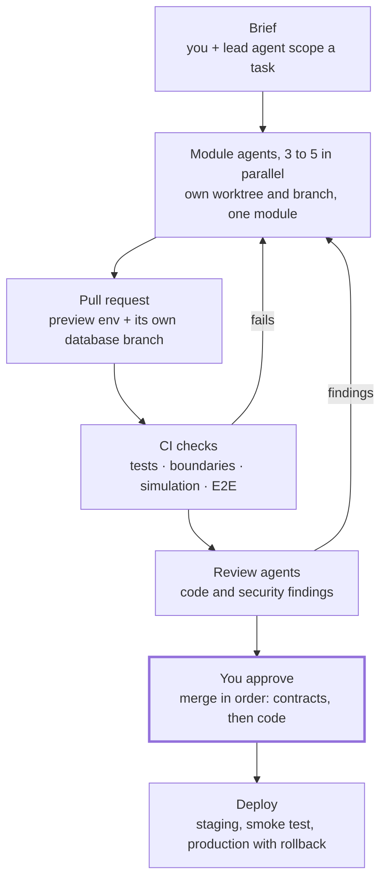
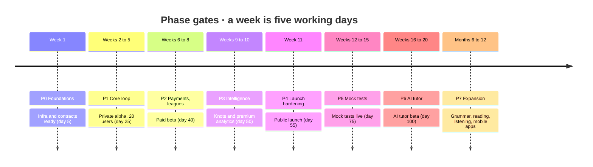

# Kizuna — Production System Design & Implementation Plan

Production system design and implementation plan · v1.0 · 2026-10-27 · Status: **Proposed**

> **Companion to [architecture-design.md](architecture-design.md).** That document defines the memory model, weakness engine and drill planner; this one adds auth, payments, gamification, infrastructure, costs and the phased multi-agent build plan. Nothing here is implemented yet.

## Executive summary

Build Kizuna as a **TypeScript modular monolith** (one API, one worker, one Next.js web app, one PostgreSQL database) on managed infrastructure, with every feature behind a module contract and an entitlement check. That shape runs comfortably to 100k daily learners on a few hundred dollars a month, lets several AI coding agents build in parallel without colliding, and lets you ship new modes, tests and analytics without rewrites.

This plan extends the existing architecture design in the repository ([architecture-design.md](architecture-design.md), v1.0, 2026-10-23), which already defines the memory model, weakness engine and drill planner. It adds what a global, paid, competitive product needs: auth and profiles, vocabulary mode, leaderboards and ranks, a freemium paywall, worldwide subscription payments, JLPT N5 to N1 mock tests, and a path to an AI tutor.

**The eight bets**

1. **Modular monolith, contract-first.** Twelve modules, each owning its own database schema and a typed public API. A new feature is a new module or a plug-in to an existing one, never a cross-cutting rewrite.
2. **One learning engine, many item types.** Kanji and vocabulary are two *tracks* over the same memory model (FSRS-6 per facet). JLPT grammar, reading and listening plug in later the same way.
3. **Evidence over vibes.** Every analytic shows its sample size and uncertainty. Weaknesses are flagged only when the learner does worse than their own memory model predicts, and every intervention is measured against a randomised control.
4. **Freemium that never blocks reviews.** Free users get limited *new* items, basic analytics and leaderboards. Premium unlocks all levels, deep memory analytics, knots, mock tests and (later) the AI tutor. Due reviews are never paywalled, because blocking them breaks the memory model and the learner.
5. **Merchant-of-record payments.** Paddle sells the subscription in 200+ markets, handles VAT/GST, and offers local payment methods. Razorpay (India UPI AutoPay) and RevenueCat (app stores) plug in later behind the same billing adapter.
6. **Gamification that rewards learning.** XP for honest scheduled work, ranks for mastered items, weekly leagues for competition. Grading is server-authoritative once leaderboards exist.
7. **Statistics first, LLMs last.** The memory model and analytics are deterministic and explainable. The AI tutor (future) reads a structured analytics snapshot and assembles tests from a verified item bank; it never grades readings or invents evidence.
8. **Built by a human lead plus parallel AI agents.** Module boundaries double as agent boundaries. A lead agent owns contracts; implementer agents each own one module in their own git worktree; reviewer, test and security agents gate every merge; the human approves.

**Headline numbers** (detail in the cost and plan sections): public launch in about 11 weeks, JLPT mock tests by week 15, AI tutor beta by week 20. The build costs about $12k to $25k in cash with the founder-plus-agents approach. Infrastructure runs about $250 a month at 1k monthly users and about $3,500 a month at 100k; payment fees (5% plus $0.50 per charge) and AI tutor usage are the main variable costs.

## Product scope: free vs premium

Launch ships two learning tracks (kanji and vocabulary) across N5 to N1, the full gamified loop, and premium memory analytics. Mock tests and the AI tutor follow in the first two quarters after launch.

Free is generous on *learning* and limited on *volume and insight*. Due reviews are never limited, for anyone. Blocking a due review would make the memory model wrong and punish the learner for studying, which is the fastest way to lose trust.

| Feature | Free | Premium | Ships in |
| --- | --- | --- | --- |
| Kanji track (2,136 Jōyō kanji) | N5 and N4 (about 300 kanji) | All levels N5 to N1 | Phase 1 |
| Vocabulary track | N5 and N4 (about 1,500 words) | All levels (about 10,000 words) | Phase 1 |
| New items per day | 10 | Set by drill intensity, up to 50 | Phase 1 |
| Due reviews | Unlimited | Unlimited | Phase 1 |
| Drill intensity | 4 presets | 4 presets plus custom retention target, new-item rate and exercise mix | Phase 1 |
| Daily goals, streaks, XP | Yes, 2 streak freezes | Yes, 3 streak freezes | Phase 1 |
| Ranks and weekly leagues | Yes | Yes, plus a premium profile badge | Phase 2 |
| Profile (photo, display name, bio, target level) | Yes | Yes | Phase 1 |
| Basic analytics: accuracy, items by stage, 7-day forecast, calendar | Yes | Yes | Phase 1 |
| Deep analytics: per-facet memory model, forgetting curves, 30-day recall forecast, calibration, confusion map | Preview only | Full | Phase 3 |
| Knots (evidence-backed weaknesses) and focus drills | 1 active knot, 1 focus drill a week | Up to 3 active knots, unlimited focus drills | Phase 3 |
| JLPT readiness forecast for an exam date | No | Yes | Phase 3 |
| Timed JLPT-style mock tests | 1 short N5 test a month | Unlimited, N5 to N1, scaled scores | Phase 5 |
| AI tutor (study plans, generated tests, Q&A on your data) | No | Yes, with a fair-use cap | Phase 6 |
| Data export and account deletion | Yes | Yes | Phase 1 |

All limits live in versioned plan configuration, not in code, so you can change a boundary (say, 15 new items instead of 10) with a config release and an A/B test.

**One scope warning.** A *full* JLPT mock test needs grammar, reading and listening items, not just kanji and vocabulary. Phase 5 ships the vocabulary and kanji sections first (文字・語彙) at all five levels; full four-section tests arrive with the grammar, reading and listening modules in Phase 7.

## Competitive positioning

Kizuna wins by answering the question no competitor answers: *why* this learner forgets what they forget, with evidence, and what to do about it. Everyone else schedules reviews; Kizuna diagnoses.

| Product | Price (USD) | What it does well | Gap Kizuna targets |
| --- | --- | --- | --- |
| [WaniKani](https://knowledge.wanikani.com/account-and-membership/payment-and-billing/subscription-plans/) | $9/month, $89/year, $299 lifetime; levels 1 to 3 free | Radical-first kanji curriculum, strong mnemonics, loyal community | Fixed pace with no intensity choice, order not aligned to JLPT, no vocabulary-only mode, no analytics beyond accuracy, no mock tests |
| Duolingo | Max about $29.99/month; Super price varies by region ([third-party listing](https://subger.com/en/service/duolingo-plus), unverified) | Best-in-class habit loop: leagues, streaks, quests | Shallow Japanese and weak kanji depth; gamification rewards activity, not retention |
| [Bunpro](https://bunpro.jp/pricing) | $5/month, $150 lifetime, 30-day trial | Grammar SRS mapped to JLPT | Grammar-first; little kanji or memory analytics |
| Anki (with FSRS) | Free on desktop | Best scheduler, total control | Do-it-yourself decks, no curriculum, no gamification, no diagnosis |
| Renshuu, Migaku | About $7 to $10/month ([review](https://japanesetaste.com/blogs/japanese-taste-blog/best-apps-to-learn-japanese-for-beginners)) | Broad content, immersion tools | Generic analytics; no evidence-backed weakness model |

**Where Kizuna stands out**

1. **Diagnosis, not just scheduling.** Knots such as "you confuse 未 and 末" or "your kun'yomi lag your on'yomi by 14 points" come with counts, examples and a confidence level, then a drill whose effect is measured against a control.
2. **Choosable intensity tied to an exam date.** Pick Relaxed through Exam Sprint, or set a JLPT date and let the planner compute the daily load, with the workload forecast shown before you commit.
3. **Kanji, vocabulary and tests in one memory model.** A vocabulary review also counts as evidence for each kanji reading inside it.
4. **Honest gamification.** Leagues and ranks as engaging as Duolingo's, but XP comes only from scheduled work and ranks only from mastered items.
5. **Fair global pricing.** Regional prices and local payment methods from launch.

**Recommended launch price:** $7.99 a month or $59.99 a year, with regional discounts of 30 to 60% in lower-income markets. That undercuts WaniKani on the annual plan while carrying more product. Annual should be the default selection: at Paddle's 5% + $0.50 per charge, the fixed fee alone is 6% of a $7.99 monthly charge but under 1% of an annual one. Skip a lifetime plan at launch, because the AI tutor has a real per-user running cost.

## Architecture approach and why

A modular monolith gives Kizuna the clean boundaries of microservices with the operating cost of one app. For a team of one to five people plus agents, that is the only shape that is both production-grade and cheap to change every week.

| Option | Strengths | Weaknesses for Kizuna | Verdict |
| --- | --- | --- | --- |
| Microservices on Kubernetes | Independent scaling and deploys | Distributed transactions across memory, drills and engagement; a platform team's worth of ops; slow feature work | Rejected until a module needs independent scale (not before 100k daily learners) |
| Backend-as-a-service only (Firebase, Supabase functions) | Fastest first demo | The core is domain logic (FSRS, planner, statistics, IRT scoring) that does not fit triggers and edge functions; hard to test and replay; lock-in | Rejected for the core; managed Postgres is still fine |
| Next.js full-stack only | One deployable | No long-running worker for nightly analytics and model fitting; mobile apps need a clean API; engines tied to framework churn | Rejected |
| **Modular monolith + worker + web** | One deploy, in-process calls, single-database transactions, module seams ready to extract | Needs enforced boundaries (solved with lint rules and CI) | **Chosen** |

**What "easy to update and upgrade" means in practice**

- **Module contracts.** Each module exposes one public `index.ts` and a set of typed domain events. Nothing imports another module's internals; CI fails the build if it tries.
- **Plug-in registries.** New item types (vocabulary, grammar, listening), exercise types, weakness detectors, achievements and test sections are registered, not wired in. Adding grammar later means adding a plug-in, not editing the scheduler.
- **Entitlements, not plan names.** Code asks `allows(ctx, "analytics.deep")`, never `if plan == "pro"`. Repackaging tiers is a config change.
- **Feature flags** (PostHog) for gradual rollout and kill switches on every new feature.
- **Versioned engines with shadow mode.** A new scheduler, detector or scoring model runs silently beside the old one, is compared on held-out data, then promoted. Every derived row records the engine version that wrote it.
- **Event log as truth.** All learner state can be rebuilt by replaying the review log, so a better memory model can be applied to history retroactively.
- **Zero-downtime migrations.** Expand, migrate, contract; never a breaking schema change in one deploy.
- **Preview environment per pull request,** each with its own database branch, so every change is tested against real infrastructure before merge.
- **Architecture decision records** in `docs/adr/`, so future contributors and agents know why a choice was made.

## System architecture



A study session costs the API three calls: plan the session, send answer batches, complete it. Kanji and word content never passes through the API; the browser loads it from Cloudflare's cache of the R2 content release and keeps it in IndexedDB. Heavy work (nightly analytics, model fitting, IRT calibration, tutor runs) happens in the worker, so it never slows a learner's session.

## Modules and data model

Twelve modules, each owning one Postgres schema. Two carry over from the existing design unchanged, six are extended, and four are new or split out (`competition`, `assessment`, `tutor`, `notify`).

| Module | Owns | New or changed for this plan | Depends on |
| --- | --- | --- | --- |
| `kernel` | IDs, clock, RNG, event bus, outbox, audit log | Unchanged | none |
| `identity` | Users, auth tables, sessions, profiles, settings, privacy | **Extended:** public profile, username, avatar, country, target level and exam date, visibility flags, roles | kernel |
| `content` | Kanji, words, readings, sentences, relation graph, audio | **Extended:** JLPT level tags for vocabulary, audio assets, test-item stems | kernel |
| `memory` | Traces, review and exposure log, FSRS, mastery | **Extended:** vocabulary facets (listening, production), cross-track evidence | content |
| `insights` | Error classes, detectors, knots, experiments, analytics snapshots | **Extended:** per-user analytics snapshot, pattern-mining detectors, evidence tiers | memory, content |
| `drills` | Session planner, curriculum, exercises, grading | **Extended:** track selection (kanji, vocab, mixed), intensity presets, exam-date planner | insights, memory, content, billing |
| `engagement` | XP, goals, streaks, ranks, achievements | Unchanged design, now with daily quests | identity; consumes events |
| `competition` | Leagues, leaderboards, friends, anti-cheat flags | **New** | engagement events, identity |
| `billing` | Customers, subscriptions, entitlements, providers | **Extended:** multiple providers (Paddle, Razorpay, RevenueCat), regional price book, one-off passes | identity |
| `assessment` | Item bank, IRT parameters, test forms, attempts, scaled scores | **New** | content, memory (read), billing |
| `tutor` | Agent runs, generated quizzes, conversations, token budgets | **New** | insights (read), assessment, drills, billing |
| `notify` | Email, web push, later mobile push; preferences and frequency caps | Split out of engagement | identity |

**Rules that keep it modular:** no SQL joins across schemas; cross-module reads go through query APIs or local read models fed by events; every command writes its events to the outbox in the same transaction; `domain/` code is pure (no I/O, injected clock and RNG).

**New tables (pseudo-schema)**

```text
identity.profile            user_id PK · username UNIQUE (citext) · display_name · avatar_key · bio · country
                            · native_language · target_level (N5..N1) · exam_date · is_public · show_on_leaderboards
                            · username_changed_at · updated_at

competition.league_week     id · starts_at · ends_at · status
competition.league          id · week_id · tier (1..10) · cohort_size
competition.league_member   league_id · user_id · weekly_xp · rank · outcome (promoted|stayed|demoted)
competition.board_snapshot  board_key (global|country:IN|friends:<id>) · period · rows jsonb · computed_at
competition.integrity_flag  user_id · rule · evidence jsonb · status · created_at

assessment.item             id · level · section · question_type · stem jsonb · options jsonb · answer
                            · content_refs · status (draft|reviewed|calibrating|live|retired) · provenance
assessment.item_param       item_id · model (2PL|3PL) · a · b · c · n_responses · fitted_at · version
assessment.form             id · level · sections jsonb (timing, item slots) · blueprint_version
assessment.attempt          id · user_id · form_id · started_at · submitted_at · theta jsonb · scaled jsonb · passed
assessment.response         attempt_id · item_id · answer · correct · latency_ms · flagged

tutor.run                   id · user_id · kind (weekly_report|quiz|chat) · model · tokens_in · tokens_out
                            · cost_usd · snapshot_version · status · created_at
tutor.generated_quiz        id · run_id · spec jsonb · item_ids · rationale jsonb · validated_at
tutor.budget                user_id · month · tokens_used · cap

billing.price_book          plan_key · country · currency · amount · provider_price_id · valid_from
billing.pass                id · user_id · provider · months · starts_at · ends_at   (non-recurring purchases)
```

## Learning engine: memory model, tracks and drill intensity

One memory engine serves every mode. Each thing a learner can forget is its own *memory trace* (user, item, facet), scheduled by FSRS and stored as a projection of an append-only review log, exactly as the existing design specifies.

**Why FSRS.** On the open [srs-benchmark](https://github.com/open-spaced-repetition/srs-benchmark) (about 10,000 Anki users and 350 million reviews), FSRS-6 predicts recall with a log loss of 0.346 against 0.469 for half-life regression, the model Duolingo published. It is open source, deterministic and cheap to run. The scheduler sits behind a versioned interface, so FSRS-7 (already ahead on that benchmark) or a custom model can replace it after winning in shadow mode.

**Tracks (modes)**

| Track | Items | Facets drilled | Unlocks |
| --- | --- | --- | --- |
| Kanji | 2,136 Jōyō kanji, component-first order | Meaning, primary on'yomi, primary kun'yomi, recognition among lookalikes, reading in words | Curriculum order, or JLPT order |
| Vocabulary | About 10,000 words tagged N5 to N1 | Reading, meaning, listening (audio to meaning), production (meaning to word) | JLPT order; does **not** require learning the kanji first. Unknown kanji show furigana. |
| Mixed | Both | All of the above | Kanji first, then words that use them (the existing design's default) |

The learner switches tracks from the home screen at any time; each track has its own new-item queue, while due reviews from all tracks share one daily queue so nothing is forgotten while the learner focuses elsewhere. Cross-track evidence is free: a correct reading of 先生 in vocabulary mode is also logged as an observation of 生's on'yomi in the analytics, without double-scheduling.

**Drill intensity presets**

Intensity is a bundle of parameters, not a mystery setting. Before saving, the app runs the FSRS workload simulator on the learner's own history and shows the projected daily reviews and minutes for the next 30 days, so the choice is informed rather than guessed.

| Preset | Target recall | New items a day | Session length | Exercise mix | Best for |
| --- | --- | --- | --- | --- | --- |
| Relaxed | 85% | 5 | About 10 minutes | More multiple choice in early stages | Busy learners, maintenance |
| Standard (default) | 90% | 10 | About 15 minutes | Typed answers once an item is past Learning | Most learners |
| Intense | 90% | 20 | About 25 minutes | Typed only, more confusable distractors, timed discrimination drills | Faster progress |
| Exam Sprint | 92 to 95% for in-scope items | Computed from the exam date | Computed | Items outside the exam level paused; mock-test practice mixed in | The last 8 to 12 weeks before a JLPT date |
| Custom (premium) | 80 to 95% | 0 to 50 | Any | Any | Power users |

Two guards keep any preset safe. The **backlog guard** stops new items when due reviews exceed twice the learner's daily capacity. The **feasibility check** warns when an exam date cannot be met at the chosen intensity and suggests the lowest intensity that can.

**Daily goals** are set in minutes (5, 10, 20 or 30), XP, or "clear everything due", and are met when the target is hit or all due items are cleared, so a learner with a small queue is never punished.

## Analytics and insight engine

The analytics layer is Kizuna's moat, so it follows one rule: **nothing is shown without its evidence.** Every number on screen carries a sample size, an uncertainty range and the model version that produced it, and weaknesses are flagged only when the learner does worse than their *own* memory model predicts.

**Pipeline**

1. **Capture everything now, analyse later.** Each answer writes a rich `review_event`: prompt, options shown and why each distractor was chosen, raw and normalised answer, correctness, latency, hints, error classes, local hour, position in session, device, memory state before and after, and engine versions. This is the single most important early decision: deep analytics and the AI tutor in Phase 6 can only find patterns in data that Phase 1 recorded.
2. **Online (in the request).** A deterministic error classifier labels each mistake in under 5 ms (for example "answered 末 for 未", "valid reading but the wrong kind", "missed a long vowel") so feedback is instant.
3. **Near-line (worker, 5 minutes after a session).** Recompute that learner's **analytics snapshot**: one versioned JSON document holding mastery by level and facet, group effects, confusion pairs, knots, latency profile and workload forecast. Dashboards read it directly, and it becomes the AI tutor's input later.
4. **Nightly.** Full recompute for active users, population item difficulty, k-anonymous confusion mining (at least 20 users per pair), and export of events older than 90 days to Parquet files in object storage for offline analysis with DuckDB. A columnar warehouse (ClickHouse or MotherDuck) is added only past about 50k monthly users.

**Evidence contract (applies to every insight)**

| Field | Example |
| --- | --- |
| Estimate, in plain terms | "Kun'yomi recall is 12 points below your predicted level" |
| Uncertainty | 90% range: 6 to 18 points |
| Support | 46 reviews across 19 kanji in the last 60 days |
| Method and version | Group residual model v2, Bayesian shrinkage |
| Evidence tier | Strong (at least 90% probability, 30 or more reviews, survives removing the worst item), Moderate, or Preliminary (shown only as "watching") |
| Examples | 3 to 5 real mistakes with what was typed |

**Free vs premium analytics**

| Free | Premium |
| --- | --- |
| Accuracy by week, items by stage, 7-day review forecast, study calendar, streak history | Everything in free, plus: per-facet memory map with current recall and 30-day recall forecast; personal forgetting curve against the population; calibration check ("when we predict 90%, you recall 88%"); skill profile (on'yomi vs kun'yomi, recognition vs recall, isolated vs in words); confusion map; all knots with full evidence; results of your own drill experiments; JLPT readiness for your exam date; time-of-day and session-length effects |
| One knot preview, so the differentiator is felt | Up to 3 active knots at a time, ranked by expected benefit |

**Deeper pattern mining (Phase 6)**

These look for patterns that are not obvious from accuracy alone. Each one ships only after passing three gates: it recovers planted patterns in the synthetic-learner simulator (recall of at least 0.8, false alarms on clean learners at most 5%), it runs four weeks in shadow mode without being shown, and its "this isn't right" feedback rate stays under 20% in beta.

| Pattern | Question it answers | Method |
| --- | --- | --- |
| Fragile correct answers | Which items you get right but slowly, and are about to lose | Latency as a predictor of the next lapse, kept only if it improves held-out prediction |
| Fatigue | When your accuracy drops within a session, and the session length that suits you | Mixed-effects logistic model on position in session |
| Time of day | Whether you retain more studying in the morning or evening | Recall residuals by local hour, shrunk toward the population |
| Interference | Whether learning a lookalike makes you forget the original | Lapse rate of known items after a similar item is introduced |
| Transfer gap | Readings you know in isolation but miss inside words | Isolated-trace strength against in-word residuals |
| Error co-occurrence | Mistake types that travel together, such as long vowels in certain on'yomi | Association rules over error classes |
| Change points | When your retention changed and why (a break, a new intensity) | Bayesian online change-point detection |
| Lapse risk | Which item features predict forgetting for you | Discrete-time survival model |

**Research basis.** The engine leans on well-replicated findings: spaced practice beats massed practice (Cepeda et al., 2006 meta-analysis), retrieval practice beats re-reading (Roediger and Karpicke, 2006), interleaving improves discrimination of confusable items (Rohrer and Taylor, 2007), and effortful retrieval strengthens memory (Bjork's desirable difficulties). Kizuna's own claims, such as "this drill helped", come from its randomised waitlist experiments measured at 14 days or more, not from before-and-after comparisons.

## Gamification: ranks, leagues and leaderboards

Competition drives habit, but it must reward learning, not grinding. So Kizuna separates the two currencies: **XP measures effort** and feeds leagues; **rank measures mastery** and can only be earned by items that survive long intervals.

| Mechanic | Rule | Integrity guard |
| --- | --- | --- |
| XP | 10 per scheduled review, 15 per new item learned, 30 per focus drill, 5 to 20 per mock-test section | Only items the planner scheduled earn XP; re-drilling the same items or cramming earns nothing |
| Rank | Based on items *Mastered* (stable for 90 days or more), across tracks. Five ranks, each with sub-levels: 糸 thread, 紐 string, 縄 rope, 綱 cable, 絆 bond | Cannot be bought or ground; a separate badge shows the highest JLPT level whose items are mostly mastered |
| Weekly leagues | Cohorts of 30 learners with similar weekly XP, 10 tiers. Top 7 promoted, bottom 5 demoted, weeks reset Monday 00:00 UTC | Inactive users are not placed; cohorts are formed by similar activity so beginners can win |
| Leaderboards | Weekly XP (league), all-time mastered items (global, country, friends), mock-test best scaled score per level | Opt-out in privacy settings; minors and private profiles hidden by default |
| Streaks | Days the daily goal is met in the learner's own day (their timezone, day starts 04:00) | Freezes: earn one per 7-day streak, hold 2 (premium 3); vacation mode pauses streak and reviews |
| Daily quests | Three small rotating goals ("untie a knot", "learn 5 words") | Always achievable within that day's plan |
| Achievements | Config-driven rules over events: milestones, completed radical families, knots untied, comebacks | Versioned and unit-tested |

**Anti-cheat (required once leaderboards exist).** The server re-grades every answer and only server-graded answers earn XP. A rules engine flags implausible activity: typed answers faster than about 300 ms, accuracy near 100% at volumes far above the learner's history, more than a set XP per hour, or many accounts from one device. Flagged users drop off public boards pending review (shadow removal), and nothing is deleted automatically. Every rule is a pure function with tests, and the flag stores its evidence.

**How it runs.** League standings live in Postgres (a cohort is 30 rows, which is trivial to rank) and update from `ReviewRecorded` events. Global and country boards are recomputed every minute into a snapshot table and served from cache. A Redis sorted set is added only if board reads ever load the database, which is unlikely below about 100k monthly users.

## Auth, identity and profiles

Use **Better Auth, self-hosted on our own Postgres.** It covers every sign-in method Kizuna needs, keeps users in our database (which row-level security depends on), and costs nothing per user. A hosted provider such as Clerk is faster to set up, but its per-user fees grow with exactly the free users a freemium product wants many of.

**Sign-in methods:** email and password, magic link, Google, Apple (required for the iOS app later), Discord (where much of the JLPT community lives), and passkeys. Optional TOTP two-factor authentication, required for admin accounts.

**Protections**

- Cloudflare Turnstile on sign-up, sign-in and password reset, plus per-IP and per-account rate limits.
- HttpOnly, Secure, SameSite=Lax session cookies; the web app calls the API through a same-origin proxy, so there is no CORS or third-party cookie. Origin check on every mutation.
- Email verification before leaderboards or payments; breached-password check on sign-up.
- A sessions page listing devices, with "sign out everywhere".
- Every API handler resolves a request context (`userId`, entitlements, timezone, `now`) and Postgres row-level security enforces `user_id` on every user-owned table. CI runs cross-user access tests against every endpoint; any failure blocks release.
- Roles: user, moderator, support, admin. Support and admin access to learner data is read-only by default and audit-logged.

**Profile (editable, like any modern site)**

| Field | Rules |
| --- | --- |
| Profile photo | Direct upload to object storage with a presigned URL, max 5 MB; the worker resizes to 256 px and 64 px WebP, strips metadata, and runs an image-safety check before it becomes public |
| Display name | 1 to 32 characters, any script, profanity-filtered in several languages |
| Username (handle) | Unique, 3 to 20 characters, changeable once every 30 days; old handles reserved for 90 days |
| Bio | 160 characters, filtered |
| Country, native language | Optional; country powers country leaderboards and regional pricing hints (never the price itself) |
| JLPT target and exam date | Drives Exam Sprint, readiness forecasts and the AI tutor |
| Privacy | Public profile on or off, appear on leaderboards on or off, show streak on or off |
| Account | Change email (verify both), change password, connected sign-in methods, two-factor, data export, delete account (hard delete within 30 days) |

Users must be 13 or older (16 in some EU countries without parental consent); profiles of users under 18 are private by default. A "report profile" button feeds the moderation queue.

## Payments and subscriptions

Sell premium through **Paddle Billing as merchant of record**. Paddle is the legal seller, so it collects and files VAT, GST and sales tax in every market, handles fraud, chargebacks and buyer support, and pays you out. That is the only realistic way for a small team to accept subscriptions from most of the world on day one.

| Provider | Role | Coverage | Fees | When |
| --- | --- | --- | --- | --- |
| [Paddle Billing](https://www.paddle.com/pricing) | Primary, merchant of record | [200+ countries and territories, 30+ currencies](https://developer.paddle.com/concepts/sell/supported-countries-locales/) | 5% + $0.50 per transaction, tax and chargebacks included; bespoke pricing may apply under $10 | Phase 2 (launch) |
| [Razorpay](https://razorpay.com/pricing/) | India domestic: UPI AutoPay and RuPay subscriptions | India | 2% platform fee on UPI and cards plus 18% GST; subscription UPI pricing on request | Phase 7, if India becomes a top market |
| [RevenueCat](https://www.revenuecat.com/pricing/) on top of App Store and Google Play | In-app purchases in the mobile apps | Store-supported countries | Free up to $2,500 monthly tracked revenue, then 1%; plus the store's commission | Phase 7, with the mobile apps |

**Payment methods.** Paddle supports cards, PayPal, Apple Pay, Google Pay, Alipay, WeChat Pay, UPI, Pix, iDEAL, Bancontact, BLIK, KakaoPay, Naver Pay and more ([list](https://developer.paddle.com/concepts/payment-methods/overview)). Its documentation confirms *recurring* billing only for cards, Apple Pay and Google Pay. So Kizuna sells two products:

- **Subscriptions** (monthly, yearly) for card and wallet users.
- **Prepaid passes** (3 or 12 months, no auto-renewal) for learners who pay with UPI, Pix, Alipay or bank methods. A pass is just an entitlement with an end date, and the app reminds the learner before it expires.

**Regional pricing.** A price book holds one price per plan per country or currency, grouped into three purchasing-power tiers (full price; about 40% off; about 60% off). Paddle localises the price at checkout based on billing country, so the price follows the payment method's country, not the IP address. Changing a price is a config release, not a code change.

**How it flows**

1. The learner picks a plan on the pricing page; Paddle's checkout overlay opens with local currency and methods. The free trial is 7 days, with no card required for the in-app trial (a time-limited entitlement) and a card required only for a trial that auto-converts.
2. Paddle sends signed webhooks (`subscription.created`, `subscription.updated`, `transaction.completed`, `subscription.canceled`).
3. The billing module verifies the signature, stores the raw event once (idempotency by event ID), and upserts the normalised subscription.
4. It emits `EntitlementsChanged`; the drills, insights, assessment and tutor modules refresh their cached limits, and the web client refreshes on the next request.
5. A daily reconciliation job re-reads every active subscription from Paddle to catch any missed webhook.

**Entitlements are the contract.** Every provider maps into the same entitlement set (`tracks.all_levels`, `limits.new_per_day`, `analytics.deep`, `knots.max_active`, `tests.unlimited`, `tutor.monthly_tokens`). Features never know which provider or plan unlocked them, so adding Razorpay or the app stores later touches only the billing module. Overrides cover beta testers, refunds, promotions and comped accounts without touching a provider.

**Lifecycle rules:** cancel at period end; 3-day grace period on a failed renewal while Paddle retries; downgrade keeps all learning data and history (premium analytics simply hide); student and teacher discount codes in Phase 4; gift subscriptions later.

## Infrastructure

Run on managed platforms in one primary region (US East), with Cloudflare's edge in front. Everything ships as Docker images and is described in code, so moving to AWS later is a migration, not a rewrite.

| Layer | Choice | Why | Alternative |
| --- | --- | --- | --- |
| Edge: DNS, CDN, WAF, bot protection | Cloudflare (Pro plan), Turnstile | Global cache for content chunks and audio, rate limiting and WAF rules at the edge | AWS CloudFront + WAF |
| Object storage | Cloudflare R2 | No egress fees; content releases, stroke SVGs, audio, avatars, Parquet archives | S3 |
| Web app | Vercel (Next.js) | Static public kanji and word pages for SEO, previews per pull request | Next.js container on Render |
| API and worker | Render, two services from one image | Simple autoscaling, background workers, preview environments, private networking | Fly.io, AWS ECS Fargate |
| Database | Neon Postgres (Launch plan, Scale plan past about 20k daily users for 30-day restore) | Point-in-time restore, autoscaling compute, read replicas, and **a database branch per pull request** | Supabase, AWS RDS |
| Queue and cron | pg-boss on Postgres | No extra system to run; outbox relay, nightly jobs | Redis + BullMQ |
| Cache | In-process LRU first; Upstash Redis added when needed | Avoids another moving part until load requires it | Valkey on AWS |
| Email | Resend | Transactional mail and reminders, React email templates | Postmark |
| Errors | Sentry | Front end, API and worker with release tracking | Bugsnag |
| Traces and metrics | OpenTelemetry to Grafana Cloud | Vendor-neutral instrumentation | Honeycomb |
| Product analytics and flags | PostHog | Funnels, retention, feature flags, experiments for UI | Amplitude + LaunchDarkly |
| Uptime and status page | Better Stack | Public status page for a paid product | Instatus |
| AI | Anthropic Claude API behind an adapter | Tutor and offline content drafting; batch and prompt caching cut cost | Any provider behind the same adapter |
| Infrastructure as code | OpenTofu (Cloudflare, Neon, Vercel) + Render blueprint | Reviewable, repeatable environments | Pulumi |
| Secrets | Platform secret stores, synced from Doppler | One source of truth, rotation | 1Password Secrets Automation |

**Environments**

| Environment | Purpose | Data |
| --- | --- | --- |
| Local | Docker Compose Postgres with a seeded content release | Synthetic learners |
| Preview (one per pull request) | Every agent's branch runs here; end-to-end tests run against it | Neon branch of staging |
| Staging | Release candidate, Paddle sandbox, load tests | Anonymised copy of production |
| Production | Live | Real |

**CI/CD (GitHub Actions)**

1. On every pull request: lint, type-check, unit and property tests, module-boundary check, API contract tests, migration dry-run on a Neon branch, the synthetic-learner simulation gate, then Playwright end-to-end tests on the preview environment.
2. On merge to `main`: build one image, run migrations (expand-only), deploy to staging, smoke test, then promote to production with health checks and automatic rollback on error-rate spikes.
3. Weekly: dependency updates (Renovate), CodeQL scan, restore-from-backup check (quarterly drill).

**Operations.** Alerts on API error rate, p95 latency, job failures, queue depth, webhook failures and model calibration drift. Short runbooks for webhook replay, content-release rollback, restore from point in time, and user data export or deletion.

## Security, privacy and compliance

Target OWASP ASVS Level 2 at launch. Card data never touches Kizuna's servers, because Paddle's checkout collects it, which keeps Kizuna out of most PCI DSS scope.

| Area | Control |
| --- | --- |
| Data isolation | Request context required by every repository method; Postgres row-level security on every user-owned table; cross-user access tests in CI |
| Input and output | Zod validation on every input; CSP and security headers; uploads scanned, resized and metadata-stripped |
| Abuse | Cloudflare WAF and rate limits; Turnstile on auth forms; per-user write limits; anti-cheat flags |
| Secrets | Platform secret stores; no secrets in the repo (secret scanning in CI); rotation runbook |
| Supply chain | Renovate, CodeQL, lockfile review, pinned GitHub Actions |
| Payments | Signed, idempotent webhooks; daily reconciliation; no card data stored |
| Audit | Append-only audit log for admin, support and billing actions |
| Backups | Point-in-time restore (7 days on Neon Launch, 30 on Scale), nightly logical backup to R2, quarterly restore drill |
| Testing | Independent penetration test before public launch, then yearly |

**Privacy law.** Self-serve export and hard deletion within 30 days satisfy the core rights under GDPR and UK GDPR, California's CCPA/CPRA and India's Digital Personal Data Protection Act 2023. Minimal personal data: email, optional display name and photo. A data processing agreement with each vendor. Product analytics in cookieless mode with a consent banner for anything else. Users must be at least 13; no marketing to children.

**AI data handling.** The tutor sees a pseudonymous analytics snapshot, never email, name or photo. It is opt-in, its runs are logged with token counts, and the policy page states that learner data is not used to train third-party models.

**Content licensing.** Dictionary data (KANJIDIC2, JMdict) is CC BY-SA; attribution is generated from row-level provenance, as the existing design specifies. Mock-test items must be original: official JLPT questions are copyrighted and must never be copied, and tests are labelled "JLPT-style practice", never official. Get a legal review of licensing and terms before launch.

## Scalability and reliability

"Thousands of users" fits on the smallest tier with room to spare. The design is sized so that each tenfold growth step is a configuration change (bigger instances, a replica, archiving), not an architecture change.

Assumptions: daily users are about 30% of monthly users; each daily user makes about 150 reviews; answers are sent in batches of 5; peak traffic is 10 times the average. Review events older than 90 days move from Postgres to Parquet archives.

|  | 1k monthly users | 10k | 50k | 100k |
| --- | --- | --- | --- | --- |
| Daily active users | 300 | 3,000 | 15,000 | 30,000 |
| Reviews per day | 45k | 450k | 2.25M | 4.5M |
| Peak answer requests per second | About 1 | About 10 | About 50 | About 105 |
| Review rows kept in Postgres (90 days) | About 4M | About 40M | About 200M | About 400M |
| API instances | 1 (2 GB) | 2 (2 GB) | 2 (4 GB) | 3 or 4 (4 GB) |
| Workers | 1 small | 1 | 1 to 2 | 2, with a separate pool for analytics |
| Database | 0.25 to 1 compute unit, autoscaling | 1 to 2 units | 2 to 4 units + read replica | 4 to 8 units + read replica; reviews hash-partitioned by user |
| Extra pieces | None | Upstash Redis for rate limits | Columnar warehouse for population analytics | Consider reserved database capacity |

**Why the hot path stays cheap.** A session plan loads one learner's few thousand traces by index and runs in memory (under 50 ms of CPU). Kanji and word content comes from the CDN and the browser's IndexedDB cache, not the API. Answers are graded instantly in the browser and re-graded on the server in batches, so the API sees a few requests per session rather than one per answer.

**Performance budgets (p95):** session plan under 300 ms, answer batch under 150 ms, home screen under 200 ms, page load (LCP) under 2.5 s on a mid-range phone.

**Reliability targets:** 99.9% monthly availability for the API, a recovery point of 5 minutes or less (point-in-time restore) and a recovery time of 1 hour or less. Sessions survive outages: the client buffers answers in IndexedDB with idempotency keys and flushes them when the API is back, so a short outage loses no learning.

**Before launch:** a k6 load test on staging at 10 times expected launch peak, a failover drill (restore the database to a point in time), and a chaos test that kills the worker mid-job to prove every job is idempotent.

## Cost of implementation and maintenance

Building it as a founder with parallel AI agents costs about $12k to $25k in cash over 20 weeks; running it costs about $250 a month at 1k monthly users and about $3,500 a month at 100k. All figures are USD. Vendor prices are list prices checked in October 2026 and linked where opened; salary and service ranges are approximate market rates, not quotes.

**One-time build cost (to AI tutor beta, about 20 weeks)**

| Scenario | Team | Cash cost | What the money buys |
| --- | --- | --- | --- |
| **A. Founder + AI agents (recommended)** | You full time, 3 to 5 Claude Code agents in parallel | $12k to $25k | AI coding plan or API usage ($200 to $400 a month), infrastructure during the build (about $1k), native-speaker review of keywords, mnemonics and test items ($4k to $8k), legal review of terms, privacy and licensing ($1.5k to $4k), penetration test ($2k to $5k), brand and logo ($0.5k to $2k), store and developer accounts |
| B. Small hired team in India, also using agents | 2 senior full-stack engineers, part-time designer, part-time Japanese content specialist | $55k to $80k | Salaries for about 4 months plus everything in A |
| C. US or EU agency | 4 to 6 people | $150k to $300k | Fastest hands-off option; least control over the learning engine |

**Monthly running cost by scale (infrastructure and services)**

| Item | 1k monthly users | 10k | 50k | 100k |
| --- | --- | --- | --- | --- |
| Database: [Neon](https://neon.com/pricing) ($0.106 per compute-hour on Launch, $0.222 on Scale; $0.35 per GB-month) | $45 | $140 | $400 | $1,300 |
| API and worker: [Render](https://render.com/articles/how-much-does-cloud-application-hosting-cost-for-small-businesses) ($25 workspace; instances $7 to $85) | $80 | $130 | $330 | $600 |
| Web: [Vercel Pro](https://vercel.com/pricing) ($20 a seat, usage beyond the $20 credit) | $20 | $40 | $100 | $200 |
| Cloudflare Pro, R2 storage, Workers | $25 | $30 | $50 | $80 |
| Email: [Resend](https://resend.com/pricing) | $20 | $35 | $160 | $350 |
| Errors: [Sentry](https://sentry.io/pricing/) Team, then Business | $26 | $50 | $120 | $200 |
| Product analytics: PostHog (free tier, approximate beyond) | $0 | $0 | $100 | $250 |
| Traces and metrics: Grafana Cloud (approximate) | $0 | $20 | $50 | $100 |
| Redis (Upstash), uptime and status page, analytics warehouse | $0 | $35 | $155 | $310 |
| Image moderation and other small AI calls | $5 | $10 | $30 | $60 |
| GitHub, secrets manager, domain, workspace email | $30 | $40 | $60 | $100 |
| **Total per month** | **About $250** | **About $530** | **About $1,560** | **About $3,550** |
| Per monthly user | $0.25 | $0.05 | $0.03 | $0.04 |

The database dominates at 100k. Moving to reserved, fixed-size capacity (or AWS RDS) at that point typically cuts that line substantially; revisit when you reach about 50k.

**Payment fees** ([Paddle](https://www.paddle.com/pricing): 5% + $0.50 per transaction)

| Plan | Price | Paddle fee | Fee share | You keep |
| --- | --- | --- | --- | --- |
| Monthly | $7.99 | $0.90 | 11.3% | $7.09 |
| Annual | $59.99 | $3.50 | 5.8% | $56.49 ($4.71 a month) |
| Annual, lowest regional tier | $24.99 | $1.75 | 7.0% | $23.24 |

The fixed $0.50 is why annual plans and prepaid passes should be the default in low-price regions. Paddle notes that products under $10 may need bespoke pricing, so confirm the monthly-plan fee with them before launch.

**AI tutor cost per premium user per month (Phase 6)**

Estimated for a typical month: 4 weekly reports run through the Batch API (50% discount), 8 generated tests, and 40 chat messages, with prompt caching on the system prompt and tools. Prices from Anthropic's current list.

| Model | Price per million tokens (input / output) | Estimated cost per premium user |
| --- | --- | --- |
| Claude Opus 5.5 | $4 / $20 | About $3.00 |
| Claude Sonnet 5.5 | $2 / $10 | About $1.60 |
| Claude Haiku 5.5 | $0.10 / $0.50 | About $0.10 |

At $4.71 to $7.09 net revenue per subscriber, an all-Opus tutor would consume roughly half of premium revenue. The plan therefore picks a model per route (report, test generation, chat) by measuring quality on an evaluation set, sets a monthly token cap per user, and keeps a "Premium + AI" tier as an option. This choice is yours; the cost table is what it trades against.

**Ongoing non-infrastructure costs**

- AI coding tools for continued development: $200 to $400 a month.
- Support and community: you, until about 10k monthly users; then part-time help at $500 to $1,500 a month.
- Content quality (reports, new items, mock-test review): $300 to $1,000 a month once tests launch.
- Yearly: penetration test ($3k to $5k), legal refresh ($1k to $2k), Apple developer program ($99).

**Unit economics at a glance.** At a 4% free-to-paid conversion and about $5.50 average net revenue per subscriber, 10k monthly users bring about $2,200 a month against about $530 of infrastructure. Infrastructure is covered from roughly 100 paying subscribers.

## Implementation plan: phases, days and agents

Seven phases, each ending in something shippable: public launch on day 55 (week 11), mock tests on day 75 (week 15), AI tutor beta on day 100 (week 20), then a second half-year of expansion. Days are working days, five a week, for one full-time founder running three to five AI coding agents in parallel.

**Why this approach**

- **Module boundaries are agent boundaries.** Because each module owns its folder, schema and contract, two agents can build `billing` and `competition` at the same time without touching the same files.
- **Contract-first unblocks parallel work.** On day 1 of each phase the lead agent merges the API schemas, event types and schema stubs; the web agent builds against a generated client and a mock server, so the front end never waits for the back end.
- **Riskiest learning work first.** The memory loop must be right before anything is sold, and payments before intelligence, so each phase de-risks the next.
- **Your review time is the bottleneck, not agent time.** Realistically you can review 6 to 10 pull requests a day. More than five agents produces a queue, not speed, so the plan caps parallelism there.
- **Analytics data from day one.** The rich review log ships in Phase 1, so Phase 3 and Phase 6 analyse months of real history instead of starting cold.

### Agent roles

| Role | Who | Owns | Never touches |
| --- | --- | --- | --- |
| Product owner and approver | You | Priorities, approvals, merges, production configuration (DNS, Paddle, secrets), legal, beta users | n/a |
| Lead architect agent | One long-running Claude Code session on `main` | Contracts package, event schemas, ADRs, `CLAUDE.md`, task briefs, integration merges, root configuration and lockfile | Module internals while another agent owns them |
| Module agents (2 to 4 at a time) | One session per module, each in its own git worktree, branch and preview environment | One module's domain, application and infrastructure code plus its tests and migrations | Other modules, shared root files |
| Web agent(s) | 1 to 2 sessions | Front-end features, built against the generated client and mock server | Back-end modules |
| Content agent | 1 session | Data pipeline, validation, LLM-drafted mnemonics and test items routed to human review | Learner data |
| QA agent | 1 session | Synthetic-learner simulation, property tests, Playwright end-to-end tests on preview environments, load tests | Production |
| Review agents | Run on every pull request | Code review for correctness; security review on auth, billing, row-level security and upload changes | Writing feature code |



Agents never merge their own work: every change reaches production only through CI, a review agent and your approval.

### Rules of engagement

1. **One writer per module at a time.** The module folder is the agent's territory; CI's boundary check rejects imports into another module's internals.
2. **Shared files are serialised.** Only the lead agent edits root configuration, the lockfile and CI; others ask in their pull request.
3. **Migrations live with their module** and are named by timestamp, so two agents never collide on numbering.
4. **Every task starts from a brief** (template below) with scope, contracts, acceptance criteria and required tests.
5. **Definition of done:** CI green on the preview environment, no high-severity review findings, your approval, and an ADR if a decision was made.
6. **Merge order follows dependencies:** contracts, then back-end modules, then web; the lead agent rebases the rest.

```markdown
# Brief: competition/leagues-v1
Goal: weekly leagues of 30 with promotion and demotion
Module: packages/competition (you own it this week); no other module edits
Contracts: CompetitionApi v1, events ReviewRecorded and LeagueWeekClosed (already merged)
Acceptance:
  - cohorts formed Monday 00:00 UTC from users active in the last 14 days
  - top 7 promoted, bottom 5 demoted, ties broken by earliest XP
  - XP only from server-graded, planner-scheduled reviews
Tests: unit (pure ranking rules), property (no user in two leagues), simulated full week
Out of scope: UI, notifications, anti-cheat rules (next brief)
```

### Daily cadence

| Time | What happens | Who |
| --- | --- | --- |
| 09:00 to 09:45 | Read overnight CI, simulation and QA reports; lead agent proposes the day's briefs; you approve and start sessions | You + lead agent |
| 10:00 to 13:00 | Agents build in their worktrees; you answer blocking questions and do product and design work | Module, web and content agents |
| 14:00 to 16:00 | Review agents run; you review and merge in dependency order | You + review agents |
| 16:00 to 17:00 | Deploy to staging; QA agent runs end-to-end and simulation suites; you use the app for 20 minutes | QA agent + you |
| Overnight | Full simulation suite, load tests (from Phase 4), dependency updates | CI |

Friday: demo to yourself or beta users, retro, update the plan and ADRs, and a scope check against this document.

### Phases



Each phase ends at a gate: the next phase starts only when its exit criteria in the table below pass.

| Phase | Days (weeks) | Parallel workstreams | Exit criteria |
| --- | --- | --- | --- |
| **P0 Foundations** | 1 to 5 (week 1) | Lead: monorepo, kernel, contracts, `CLAUDE.md`, first ADRs. DevOps: infrastructure as code, CI, preview environments. Content: pipeline v0 (KANJIDIC2, JMdict subset, KanjiVG, furigana alignment). Web: Next.js shell, design system, auth pages | A pull request deploys to its own preview environment with its own database branch; content release 0.1 builds deterministically |
| **P1 Core learning loop** | 6 to 25 (weeks 2 to 5) | Identity: Better Auth, profiles, avatars, settings, row-level security. Memory: traces, FSRS, review log, mastery. Drills: planner, tracks, intensity presets, grading. Web (2): session UI, lessons, home, goals, basic analytics, profile. Content: vocabulary tagging N5 to N1, audio, public SEO pages. QA: simulator, property and end-to-end tests | 20 alpha users doing 5+ sessions a week; performance budgets met; zero cross-user test failures; prediction calibration in the expected FSRS range |
| **P2 Monetisation and competition** | 26 to 40 (weeks 6 to 8) | Billing: Paddle, webhooks, entitlements, price book, passes. Competition: leagues, boards, anti-cheat, server-graded XP. Engagement: ranks, freezes, achievements, quests. Notify: email and web push. Web: pricing, checkout, leaderboards | Checkout, entitlement, cancellation and refund pass end to end in Paddle's sandbox, including webhook replay; a simulated league week promotes and demotes correctly |
| **P3 Intelligence and premium analytics** | 41 to 50 (weeks 9 to 10) | Insights (2): error classifier, detectors, knots, experiments, analytics snapshot, readiness forecast. Drills: focus-drill exercises. Web: knots, evidence views, premium dashboards. QA: simulation gates | Weakness recall at least 0.8 and false alarms at most 5% in simulation; "this isn't right" feedback under 20% in alpha |
| **P4 Hardening and launch** | 51 to 55 (week 11) | Security review and external penetration test; k6 load test at 10x peak; chaos test; WCAG 2.2 AA audit; legal pages; status page | No open high-severity findings; load test and restore drill pass; **public launch** |
| **P5 JLPT mock tests** | 56 to 75 (weeks 12 to 15) | Assessment: item bank, test forms, timer engine, IRT calibration, scaled scores. Content: item drafting with native-speaker review. Web: exam UI (timer, sections, review screen, results) | N5 to N3 vocabulary and kanji sections live; N2 and N1 in beta; calibration job running |
| **P6 Deep analytics and AI tutor** | 76 to 100 (weeks 16 to 20) | Insights: pattern detectors in shadow mode, Parquet archive, warehouse. Tutor: model adapter, tools, weekly reports, generated tests, token budgets. QA: tutor evaluation set. Web: tutor UI | Tutor passes its evaluation set; cost per premium user within budget; at least 2 pattern detectors promoted from shadow mode |
| **P7 Expansion** | Months 6 to 12 | Grammar, then reading, then listening modules, enabling full four-section mock tests; Expo mobile apps with RevenueCat; Razorpay UPI; friends; classrooms | Each item type ships with its own design addendum and exit criteria |

### Week 1, day by day

| Day | Lead agent | DevOps agent | Content agent | Web agent | You |
| --- | --- | --- | --- | --- | --- |
| 1 | Monorepo (pnpm, Turborepo), kernel, boundary lint, `CLAUDE.md`, ADRs 001 to 005 | Accounts wired into OpenTofu: Cloudflare, Neon, Render, Vercel | Source lockfile, KANJIDIC2 importer | Next.js app, design tokens | Create accounts and domain; **apply to Paddle now** (seller verification takes days); decide legal entity |
| 2 | Contracts package (Zod to OpenAPI to typed client), event types | CI pipeline: lint, types, tests, boundaries | KanjiVG and Radkfile import | Layout, routing, i18n scaffolding | Review and merge |
| 3 | Better Auth spike, identity schema stub | Preview environment per pull request with a Neon branch | JMdict subset and furigana alignment | Auth pages against the mock server | Review and merge |
| 4 | Integration, task briefs for Phase 1 | Sentry, OpenTelemetry, structured logs | Validation rules; release 0.1 published to R2 | Public kanji page from release 0.1 | Review and merge |
| 5 | Phase 1 contracts merged | Production pipeline with rollback | Release diff report | Sign-up to kanji page works on a preview URL | Demo, retro, approve Phase 1 plan |

## Future scope: JLPT mock tests and the AI tutor

### Timed JLPT-style mock tests

Mock tests mirror the real exam's sections, time limits and 0 to 180 scale, and report an *estimated* scaled score with a pass probability. Kizuna never claims an official score, and every item is original.

| Level | Sections and time limits | Scored sections | Pass mark (sectional minimum) |
| --- | --- | --- | --- |
| N1 | Language knowledge and reading 110 min; listening 55 min | Language knowledge 0 to 60, reading 0 to 60, listening 0 to 60 | 100 (19 each) |
| N2 | Language knowledge and reading 105 min; listening 50 min | Same three, 0 to 60 each | 90 (19 each) |
| N3 | Vocabulary 30 min; grammar and reading 70 min; listening 40 min | Same three, 0 to 60 each | 95 (19 each) |
| N4 | Vocabulary 25 min; grammar and reading 55 min; listening 35 min | Language knowledge and reading 0 to 120, listening 0 to 60 | 90 (38 and 19) |
| N5 | Vocabulary 20 min; grammar and reading 40 min; listening 30 min | Language knowledge and reading 0 to 120, listening 0 to 60 | 80 (38 and 19) |

Sources: [JLPT test sections](https://www.jlpt.jp/e/guideline/testsections.html) and [scoring and pass marks](https://www.jlpt.jp/e/guideline/results.html) (official site; times may change).

**How tests work**

- **Item bank and lifecycle.** Items are written in the real exam's question formats (kanji reading, orthography, word in context, paraphrase, usage, and later grammar, reading and listening). Each moves through *draft* (LLM-drafted under a level vocabulary limit, checked by a Japanese tokenizer), *native-speaker review*, *calibrating* (served unscored inside real tests, as the JLPT itself does), *live*, and *retired* when it drifts or is over-exposed.
- **Scoring with item response theory.** Each live item carries fitted difficulty and discrimination parameters (a 3-parameter model for 4-option questions, to account for guessing). A learner's ability per section is estimated from their answers and mapped to the 0 to 60 scale, with an uncertainty range. The mapping is checked against learners who opt in to share their real JLPT results, which is the evidence that the estimate means something.
- **Exam engine.** The server owns the timer (start and end times are recorded server-side; the browser only counts down), every answer autosaves, a dropped connection resumes within the time left, and answers are hidden until submission.
- **Three modes.** Full timed mock; single-section practice; and a 15-minute adaptive readiness check that picks each next item for maximum information.
- **Results feed learning.** Every missed vocabulary or kanji item creates or strengthens a memory trace, and patterns in test errors feed the knot detectors.

### The AI tutor (background agent)

The tutor reads the learner's analytics snapshot and acts only through a small set of server-side tools. It never writes learner state directly, never grades readings, and never invents evidence: every fact it states traces to a tool result.

**Its three jobs**

1. **Weekly study report** (overnight, through the Batch API): what improved, the top knots, a plan for the coming week and a suggested intensity.
2. **Tests on demand**, such as "test me on my weak N3 readings": the agent writes a test spec, then the server assembles items from the verified bank or deterministic generators. Answers come from the database, not the model.
3. **Questions about your own data**, such as "why do I keep missing 待?": answers grounded in the knot's evidence, with links to the actual reviews.

| Tool | Purpose | Guard |
| --- | --- | --- |
| `get_learner_snapshot` | Mastery, knots, confusions, latency profile, forecasts | Read-only; pseudonymous; no email, name or photo |
| `get_evidence` | The reviews and statistics behind a knot or item | Read-only |
| `search_items` | Find items by level, track, facet, tag or memory stage | Read-only |
| `assemble_test` | Turn a spec into a test | Server validates every item and answer; length and difficulty limits |
| `schedule_focus` | Add a tutor block to the next session | Respects intensity, daily budget and running experiments |
| `lookup_entry` | Dictionary data for a grounded explanation | Read-only |

**Guardrails and cost control:** structured outputs validated against schemas; Japanese text checked by tokenizer against the dictionary; a monthly token budget per user; a chosen model and effort level per job; prompt caching for the system prompt and tool definitions; an evaluation set of about 200 anonymised snapshots with a rubric, run before any model or prompt change; a feature-flag kill switch; cost logged per run. Every model call goes through one adapter, so the provider or model can change without touching the tutor's logic.

**What the analytics must already cover for the tutor to be useful** (all captured in Phases 1 to 5): mastery by level, track and facet; current and 30-day recall per item; knots with evidence; confusion pairs; error-class mix; latency profile; session habits (time of day, length, fatigue); intensity and adherence; exam date and readiness; mock-test section scores and missed items; results of past interventions. This list is the reason the review log is designed to be rich from day one.

## Risks and open decisions

The biggest risks are scope, trust in the insights, and AI cost; each has a mechanism in this plan rather than a hope.

| Risk | Likelihood / impact | Mitigation |
| --- | --- | --- |
| Scope creep and founder burnout | High / high | Phase exit gates; at most five agents; Friday scope check against this document |
| Agent-written code with subtle bugs or security holes | Medium / high | Tests required in every brief; review agent on every pull request; security review on auth, billing, row-level security and uploads; you merge |
| False insights erode trust | Medium / high | Evidence contract; confirmation probes before a knot is shown; shadow mode; "this isn't right" feedback tracked |
| Payment onboarding delays | Medium / high | Apply to Paddle in week 1; billing adapter keeps Lemon Squeezy or Stripe Managed Payments as fallbacks |
| Free tier too generous, low conversion | Medium / medium | All limits in config; A/B test boundaries after launch |
| AI tutor cost outruns revenue | Medium / medium | Model per job chosen by evaluation; token caps; batch and caching; optional "Premium + AI" tier |
| Mock-test scores mislead learners | Medium / medium | Labelled as estimates with uncertainty; calibrated against self-reported real results; original items only |
| Leaderboard cheating | Medium / low | Server grading; integrity rules; shadow removal |
| Content errors (wrong readings or meanings) | Medium / medium | Pipeline validation; cross-source checks; user reports; native-speaker review |
| Database cost at 100k users | Low / medium | Event archiving; reserved capacity or RDS at about 50k |

**Open decisions (with recommendations)**

1. **Legal entity and payout country.** This decides whether Razorpay is possible and how tax works. Decide in week 1.
2. **Price points.** Recommended $7.99 a month or $59.99 a year, with three regional tiers; validate with a beta survey.
3. **Free-tier boundary.** Recommended N5 and N4 content with 10 new items a day; revisit after 30 days of conversion data.
4. **AI model per tutor job.** Pick from the cost table using the evaluation set in Phase 6.
5. **Trial style.** Recommended 7-day in-app trial without a card.
6. **Lifetime plan.** Recommended no at launch; reconsider once tutor costs are measured.
7. **Native mobile timing.** Recommended PWA first, Expo apps in Phase 7.
8. **Brand vocabulary.** Test "knots" and the 糸 to 絆 ranks with beta users.

The first step is to settle decisions 1 to 3, apply to Paddle, and start Phase 0 day 1 with the lead agent creating the monorepo and `CLAUDE.md`.
