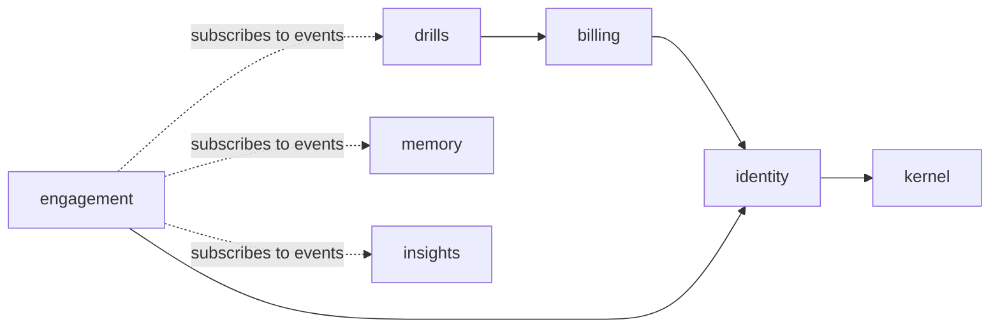

# account: spec digest
Source: docs/architecture-design.md. The architecture doc wins any conflict.
Covers: §2.2 (identity, engagement, billing rows; packaging in v1), §7.2 (gamification rules), §7.4, §7.5 (identity, engagement and billing schema; learning-day close rule), §7.7, §7.8

## §2.2 Module rows and packaging

| Module | Owns (Postgres schema) | Responsibilities | May depend on |
|---|---|---|---|
| `identity` | `identity` | Users, auth integration, profile, settings, timezone and learning-day boundary, data export/deletion orchestration | kernel |
| `engagement` | `engagement` | XP, daily goals, streaks, ranks, achievements, reminders | identity; consumes events. Nothing depends on it. |
| `billing` | `billing` | Provider adapter, subscriptions, entitlements | identity, kernel |

→ arch §2.2



→ arch §2.2

- Packaging in v1: `identity`, `billing` and `engagement` ship as one package, `packages/account`, with a sub-folder per area. → arch §2.2
- Calls between those three areas may be direct, without going through a public interface. → arch §2.2
- Each keeps its own Postgres schema, so splitting them later only means moving folders. → arch §2.2
- The boundary rules in §2.3 apply in full between `account` and the core modules (`content`, `memory`, `insights`, `drills`). → arch §2.2

# Identity

## §7.4 Authentication and user isolation

- Auth: Better Auth, self-hosted against our Postgres. It provides email magic link or OTP, Google and Apple OAuth, and passkeys. → arch §7.4
- Sessions: cookies are `HttpOnly`, `Secure` and `SameSite=Lax`. → arch §7.4
- The web app calls the API through a same-origin `/api` proxy (a Next.js rewrite), so there is no CORS and no third-party cookie. → arch §7.4
- CSRF protection is SameSite plus an `Origin` check on every mutation. → arch §7.4
- Request context: every handler resolves `ctx = {userId, entitlements, tz, now, requestId}`. Every module command and query requires `ctx`. At the type level, no repository method can run without a user scope. → arch §7.4
- Defense in depth, Postgres row-level security (RLS): → arch §7.4
  - Every user-owned table has a policy `user_id = current_setting('app.user_id')::uuid`.
  - That setting is applied with `SET LOCAL` inside each transaction, which works with transaction-mode pooling.
  - Worker jobs run one transaction per user, using the same mechanism.
  - A separate maintenance role can bypass RLS, and every use of it is audit-logged.
- Isolation test suite: CI runs automated cross-user access attempts against every repository method and endpoint. Any failure blocks the release. → arch §7.4
- Roles: v1 has `user` and `admin`. Admin access is read-only by default and audited. → arch §7.4
- Organisations and classrooms are deferred, but the schema leaves room for them: add a nullable `org_id` and extend the RLS policies. → arch §7.4

## §7.5 Identity schema

Timestamps are `timestamptz` in UTC. IDs are UUIDv7 or ULIDs. One schema per module. The tables are pseudo-schema, design guidance rather than DDL. → arch §7.5

```
identity.user               id PK · email UNIQUE · display_name · locale · timezone (IANA) · day_start_hour
                            · created_at · deleted_at
identity.user_settings      user_id PK · daily_goal_minutes · desired_retention · new_per_day_max · track
                            · reminders jsonb · ui jsonb · experiments_opt_out
(auth library tables: account, session, verification, passkey)
```

→ arch §7.5

# Engagement

## §7.2 Gamification rules

Core loop: cue (reminder or streak) → a 5–15-minute session → feedback (XP, rings, knot progress) → visible progress (kanji map, rank) → the next cue. → arch §7.2

| Mechanic | Rule (initial values) | Integrity guard |
|---|---|---|
| XP | 10 per scheduled item completed, 15 per new item learned, 30 per focus-drill block | XP only for planner-scheduled items; nothing for re-queued attempts or self-initiated cramming |
| Daily goal | 5, 10 or 20 minutes (converted to an XP target), or "clear all due" | Met when the target is reached *or* everything due is cleared |
| Streak | Days the goal is met, counted in the learner's **learning day** (their timezone, day starting 04:00 by default) | Freezes: earn 1 per 7-day streak, hold up to 2 (Pro: 3). Vacation mode pauses both the streak and reviews. A timezone change applies **from the next learning day** and never reopens a day that has already closed, so moving the clock cannot rescue a missed day. |
| Ranks | Based on kanji **Mastered**: 糸 *thread* → 紐 *string* → 縄 *rope* → 綱 *cable* → 絆 *bond*, with sub-levels | Every rank kanji contains 糸, matching the brand. Ranks cannot be bought or ground. The **sub-levels of the first rank (糸) count kanji reaching Mature** (as defined in §4.6: the meaning remembered well for about a week, and one of its words at least Young). A progress bar always shows how far the next rank is. |
| Knots | Confirmed weaknesses appear as knots to untie. Resolving one earns "Knot untied". | Only confirmed hypotheses are shown. Results are honest, including "inconclusive". |
| Achievements | Declarative rules over events and aggregates: milestones, completed radical families, streaks, knots untied, comebacks, exercise-type explorer | Config-driven and versioned. Rules are pure and unit-tested. |
| Celebrations | Rank-ups, family completion, streak milestones (7, 30, 100, 365) | Reduced-motion variants |
| Daily quests (Phase 4) | 3 small rotating goals ("untie a knot", "learn 5") | Must align with that day's plan |

→ arch §7.2

Ethical habit design: no fake urgency, no streak-loss upsells, a clear "done for today" state, opt-in reminders with frequency caps, and vacation mode. → arch §7.2

## §7.5 Engagement schema and learning-day close rule

```
engagement.xp_ledger        id · user_id · amount · reason · source_event_id UNIQUE · occurred_at   (append-only)
engagement.daily_activity   PK(user_id, local_date) · reviews · new_items · xp · minutes · goal_met · freeze_used
engagement.streak           user_id PK · current · longest · last_qualified_date · freezes_available · vacation_until
engagement.user_achievement PK(user_id, achievement_key) · unlocked_at · context jsonb
engagement.notification_log id · user_id · channel · kind · sent_at
```

→ arch §7.5

- XP and streak credit go to the learning day the answer *occurred* in, if that day is still open. Days close 6 hours after they end, which gives offline study a grace period. Otherwise credit goes to the day it was received. A closed day is never reopened. → arch §7.5
- Answers that had already produced XP or classifier labels keep them. Replay changes only scheduling state. → arch §7.5
- Client timestamps are clamped: they cannot be later than `received_at`, and they cannot fall more than 24 hours before the session started. → arch §7.5

# Billing

## §7.7 Subscriptions and entitlements

Billing stays thin: features depend on **entitlements, not plan names**. → arch §7.7

```
plans (versioned config in code)
  free: { kanji_scope: "first_300", new_per_day_max: 10, insights_active_max: 1,
          focus_drills_per_week: 1, history_days: 90, streak_freeze_cap: 2 }
  pro:  { kanji_scope: "all", new_per_day_max: 50, insights_active_max: 3,
          focus_drills_per_week: "unlimited", history_days: "all", streak_freeze_cap: 3,
          experiment_results: true, advanced_stats: true }
```

→ arch §7.7

- Checks read entitlements, never plan names: `entitlements.allows(ctx, "insights.full")` and `entitlements.limit(ctx, "new_per_day_max")`. → arch §7.7
- Provider adapter interface: `createCheckout`, `createPortalLink`, `parseWebhook`, where `parseWebhook` produces a normalised `SubscriptionChanged`. → arch §7.7
- Webhooks are signature-verified and deduplicated through `billing_event`. A daily reconcile job is the safety net. → arch §7.7
- Provider choice: Stripe Billing (Checkout, Customer Portal and Stripe Tax) or a merchant-of-record provider such as Paddle, which handles global VAT and sales tax for a solo seller. The adapter keeps this decision reversible (see §14). → arch §7.7
- Overrides (`entitlement_override`) cover the beta ("everyone is Pro"), promotions, refunds and comps without touching the provider. → arch §7.7
- Free tier principle: the differentiator must be *experienced* in the free tier: one active knot and a weekly focus drill. Pro unlocks scale (all kanji, all knots, full experiment results). Exact boundaries are an open decision (§14). → arch §7.7
- Deliberately not built in v1: seats, usage-based pricing, a coupon UI, invoice UI (the portal covers it), proration logic (the provider handles it). → arch §7.7
- Extension path: add classrooms with `organization`, `membership` and seat plans, and one-off packs (for example a JLPT course) through `entitlement_grant` rows with `source=purchase`. No change to feature checks is needed. → arch §7.7

## §7.5 Billing schema

```
billing.customer            user_id PK · provider · provider_customer_id
billing.subscription        id · user_id · provider · provider_subscription_id UNIQUE · plan_key
                            · status(trialing|active|past_due|canceled) · current_period_end · cancel_at_period_end
                            · raw jsonb · updated_at
billing.entitlement_override user_id · key · value jsonb · reason · expires_at
billing.billing_event       provider_event_id PK · type · payload jsonb · processed_at   (webhook idempotency)
```

→ arch §7.5

# Privacy and compliance (identity-orchestrated)

## §7.8 Privacy, security, and compliance

- GDPR / UK GDPR: self-serve export and deletion. Deletion is a hard cascade delete within 30 days, and it covers **every copy**: → arch §7.8
  - the live database, within 24 hours;
  - **Parquet archives**: the user's rows are removed by rewriting the files in their user-hash bucket, within 7 days;
  - **backups**: point-in-time recovery retention is set to **14 days**, so the deleted data ages out of backups well inside 30 days. The privacy policy states this, and a restore drill never restores a deleted user (the deletion log is re-applied after any restore).
- Minimal PII: email, plus an optional display name. → arch §7.8
- DPAs with vendors, and an EU-region hosting option. → arch §7.8
- Age: users must be 13 or older, or 16 where local law requires parental consent below that. Nothing is marketed to children. → arch §7.8
- Analytics: a cookie consent banner covers analytics only. PostHog can run in cookieless mode. Population analytics use pseudonymous IDs, and mined confusions require k-anonymity of at least 20 users. → arch §7.8
- Security: → arch §7.8
  - Zod validation on every input, and rate limits: per IP for auth, per user for writes.
  - Signed webhooks, a CSP and security headers, secrets in the hosting platform's secret store.
  - Dependency updates and scanning (Renovate or Dependabot).
- Backups: managed point-in-time recovery with 14-day retention, and a quarterly restore drill. → arch §7.8
- Account deletion: personal rows are deleted. Already-aggregated population statistics (item difficulty, confusion counts) are retained because they contain no personal data. → arch §7.8
- The `review_idempotency` table carries `user_id` and has RLS like every user-owned table, so the account-deletion cascade (§7.8) removes its rows. → arch §7.5
