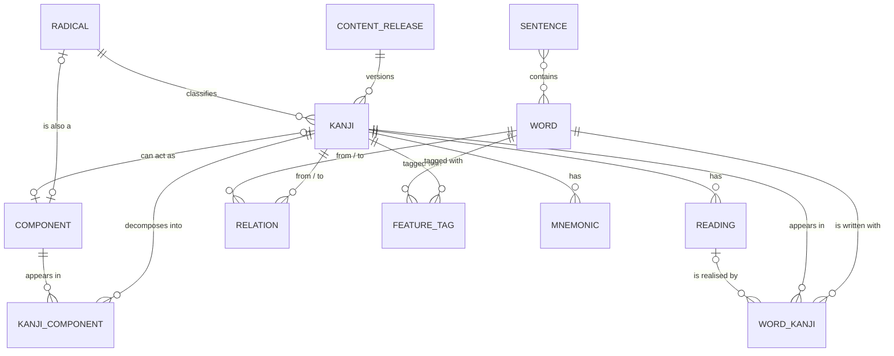

# content: spec digest
Source: docs/architecture-design.md. The architecture doc wins any conflict.
Covers: §2.2 (content row), §3.1, §3.2, §7.5 (content schema, stable references, release validation), §7.6 (content job), §8.2 (content package), §8.4 (content hot path)

## §2.2 Module row

| Module | Owns (Postgres schema) | Responsibilities | May depend on |
|---|---|---|---|
| `content` | `content` | Read-only linguistic knowledge: kanji, radicals, components, readings, words, sentences, relations, feature tags. Holds the in-memory index of the current release and the distractor candidate queries. | kernel |

→ arch §2.2

- `content` depends only on `kernel`. `memory`, `insights` and `drills` may depend on `content`. → arch §2.2
- The `content` schema is owned by `content`; no cross-schema joins in application code. → arch §2.2

## §3.1 Core content entities

Entity-relationship diagram. → arch §3.1


```

Entity tables. → arch §3.1

| Entity | Key fields | Notes |
|---|---|---|
| `kanji` | `literal` (PK), codepoint, strokes, radical, grade, jlpt_approx, freq_rank, is_joyo, `keyword` (our own), meanings (lang-tagged) | The ID is the character itself. |
| `radical` | Kangxi number 1–214 (PK), literal, variant forms (氵 for 水), keyword | The *classification* radical, exactly one per kanji |
| `component` | own slug (PK), glyph, optional link to kanji or radical, keyword, strokes | The *visual building blocks*. Some have no Unicode code point; for those, use the KanjiVG element ID. |
| `kanji_component` | kanji, component, position (`hen`, `tsukuri`, `kanmuri`, `ashi`, `tare`, `nyō`, `kamae`, …), role (`semantic`, `phonetic`, `form`, `unknown`), depth, order | A nested decomposition tree, flattened with depth |
| `reading` | ID such as `生:on:せい`, kind (`on`, `kun`, `nanori`), kana, okurigana, is_joyo, is_core, is_primary_of_kind, usage_weight | Readings are first-class rows because learners forget them one by one. |
| `word` | JMdict `ent_seq` (PK), headword, kana, alternative forms, senses (POS, lang-tagged glosses), freq_rank, is_common, jlpt_approx | Only a curated, frequency-ranked subset (~30–50k) is loaded. |
| `word_kanji` | word, position, kanji, reading used, surface kana, phenomenon (`regular`, `rendaku`, `sokuon`, `jukujikun`, `ateji`, `irregular`) | Links each kanji in a word to *the reading used*. This is the key to context and reading analytics. |
| `sentence` | source ID, Japanese text, translations, word IDs, license, quality | Tatoeba subset, tokenised |
| `relation` | from/to (type + ID), kind, weight 0–1, directed, origin (`curated`, `computed`, `empirical`), evidence | A typed, weighted graph of about 100k edges. See §3.2. |
| `feature_tag` | item type, item ID, tag | Precomputed grouping vocabulary for weakness discovery |
| `mnemonic` | kanji, text, author (`system` or `user`), visibility, license | Original content only |
| `content_release` | semver, source manifest (versions and checksums), `is_current` | Releases are immutable |
| `id_redirect` | old ID, new ID, release | Handles JMdict merges and deprecations |

→ arch §3.1

Modelling decisions. → arch §3.1

- **Stable IDs.** Learner data references content by stable natural keys, so a content release never invalidates a learner's history. Referenced content is never hard-deleted. It is deprecated and redirected instead.
- **Component ≠ radical.** A kanji has one dictionary radical but several nested components, each with a position and a role. Weakness grouping uses both, because 持, 待 and 特 share the component 寺 but have different radicals.
- **Readings carry teaching metadata.** The Jōyō table defines the official readings. A reading is `is_core` when it is Jōyō and used by at least one common word. Each kind has one `is_primary_of_kind` reading (the most frequent). Rare and nanori readings appear on detail pages but are never drilled in isolation.
- **Meanings.** Each kanji gets a primary `keyword` that we author ourselves; we never copy keywords from commercial courses. For grading, the accept-list is all KANJIDIC meanings, plus curated synonyms, plus that user's own synonyms.
- **Language tags everywhere.** English comes first. JMdict and KANJIDIC also carry French, Spanish, Portuguese, German and Russian glosses, which supports i18n later.

Each modelling decision above is a rule. → arch §3.1

## §3.2 Relationship graph

Relation kinds (stored in `content.relation`, see §3.1). → arch §3.2

| Relation kind | Meaning | How it is produced in v1 | Example |
|---|---|---|---|
| `shares_component` | kanji ↔ kanji | Derived from `kanji_component`. Weight is the IDF-weighted overlap, so rare shared components count more. | 持 ↔ 待 |
| `visual_similar` | easy to confuse visually | Score = 0.5·position-aware component Jaccard + 0.3·same layout + 0.2·stroke-count closeness. Keep the top 10 per kanji above a threshold, then add curated classic pairs. v2 adds glyph-image similarity and empirical confusion data. | 未 ↔ 末, 土 ↔ 士, 己 ↔ 已 ↔ 巳 |
| `phonetic_series` | shares a phonetic component and on'yomi | Component `role=phonetic` plus a matching on'yomi. Exceptions are flagged. | 青 → 清 晴 精 請 静 (セイ) |
| `semantic_related` | near-synonym, same field, or antonym | Proposals seeded from gloss overlap and WordNet, drafted with LLM help, then human-reviewed. Also a small semantic-field taxonomy (~60 fields). | 暑 ↔ 熱 ↔ 温 |
| `homophone` | identical on'yomi | Derived from readings. Weighted by frequency and used only for reading-confusion analysis. | 公 ↔ 工 ↔ 校 (コウ) |
| `word_pair` | word-level confusables | Homophone words, transitive/intransitive pairs, words sharing kanji | 機会 ↔ 機械, 開く ↔ 開ける |
| `empirical_confusable` | learners actually confuse these | Mined from anonymised population confusion counts, with k-anonymity ≥ 20 users (Phase 4) | — |
| `variant_of` | glyph variants | KANJIDIC/Unihan variant fields (low priority) | 國 → 国 |

→ arch §3.2

The graph is stored as adjacency rows in `content.relation` and loaded into memory per process. That is tens of megabytes at most, so no graph database is needed. → arch §3.2

**Feature tags** are computed per item at release time, and they are what weakness discovery groups by:
`radical:氵`, `component:寺`, `position:hen`, `reading_kind:kun`, `reading:生:on:せい`, `phonetic:青`, `field:weather`, `visual_cluster:17`, `jlpt:N3`, `grade:4`, `strokes:11-15`, `phenomenon:rendaku`, `okurigana:yes`.

→ arch §3.2


## §7.5 Persistence: content schema

- There is one PostgreSQL database with **one schema per module**. Each module owns its migrations (Drizzle). Timestamps are `timestamptz` in UTC, and IDs are UUIDv7 or ULIDs, which are time-sortable. → arch §7.5
- `MEMORY_TRACE` references content polymorphically through `(item_type, item_id)`. There is no foreign key across schemas; release validation checks that every reference resolves. → arch §7.5
- The table definitions in §7.5 are **pseudo-schema**, meant as design guidance rather than DDL. The `content` tables are listed in §3.1. → arch §7.5
- Referenced content is never hard-deleted. It is deprecated and redirected through `id_redirect`; `content_release` rows are immutable. → arch §7.5, arch §3.1

## §7.6 Background jobs (worker)

| Job | Trigger | Purpose |
|---|---|---|
| `content.migrateRelease` | on release switch | Apply ID redirects to traces |

→ arch §7.6

## §8.2 Package

- `packages/content/`: content types, query API, in-memory release index. → arch §8.2

## §8.4 Hot path

- Content comes from the in-process index, and the client fetches content from the CDN, not the API. → arch §8.4
- Extraction seam (third in order of likely need): content serving goes fully static. → arch §8.4
