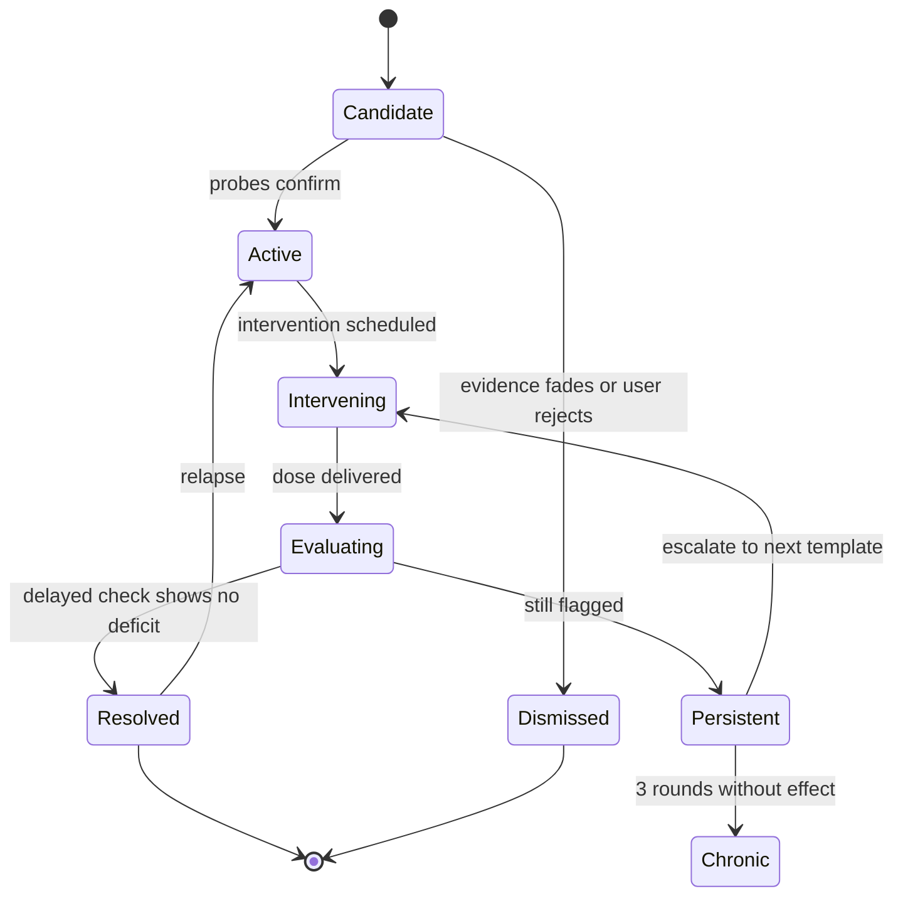

# insights: spec digest

Source: docs/architecture-design.md. The architecture doc wins any conflict.
Covers: §2.2 (insights row, Avoiding cycles), §5.1, §5.2, §5.3, §5.4, §5.5, §5.6, §5.7, §6.7, §7.5 (insights schema).

## Module (→ arch §2.2)

| Module | Owns (Postgres schema) | Responsibilities | May depend on |
|---|---|---|---|
| `insights` | `insights` | Error classification, weakness detectors, hypotheses, intervention requests, experiments and their evaluation | memory (read), content, kernel |

→ arch §2.2

**Avoiding cycles.** `insights` never calls `drills`. It emits *intervention requests* (`{template, traceIds, dose}`) and *arm assignments* as data. `drills` reads those and turns them into exercises. → arch §2.2

## 5.1 Pipeline (→ arch §5.1)

```mermaid
flowchart LR
  A["Answer batch"] --> B["Error classifier<br/>sync, deterministic"]
  B --> C[("review_event<br/>+ error classes")]
  C --> D["Feature join<br/>trace → tags"]
  D --> E["Aggregates<br/>group residuals · confusion counts<br/>incremental + nightly"]
  P0[("Population calibration<br/>c (facet × exercise type) · μ_g per group")] --> E
  E --> F["Detectors H1–H9<br/>pure functions"]
  F --> G{"Passes<br/>thresholds?"}
  G -- "no" --> X["Keep watching"]
  G -- "yes" --> H["Candidate:<br/>diagnostic probes<br/>6–10 items"]
  H --> I{"Probes below expectation<br/>and combined rule holds?"}
  I -- "no" --> X
  I -- "yes" --> J["Active hypothesis<br/>shown as a knot"]
  J --> K["Intervention request<br/>+ randomised arms"]
  K --> L["Focus drills<br/>in sessions"]
  L --> M["Retention check, days 13–15<br/>both arms, balanced per day"]
  M --> N{"Deficit<br/>gone? (δ_g)"}
  N -- "yes" --> O["Resolved"]
  N -- "no" --> P["Escalate template<br/>max 3 rounds"]
  P --> K
```



→ arch §5.1

## 5.2 Error classification (→ arch §5.2)

Deterministic, synchronous classifier on every wrong or retried answer. Checks run from most to least specific; an answer can receive several labels. → arch §5.2

| Code | Detected when the answer… | Example |
|---|---|---|
| `R_ALT_VALID` | is a valid reading of this kanji, but of the wrong kind | 生 on'yomi asked → なま |
| `R_VISUAL_NEIGHBOR` | is a reading of a `visual_similar` kanji | 末 → み (the reading of 未) |
| `R_PHONETIC_SIBLING` | is the on'yomi of the phonetic series where this kanji is an exception | 特 → じ (寺 series: 持, 時, 侍) instead of とく |
| `R_KANA_DETAIL:{long_vowel, sokuon, dakuten, yoon, n}` | is within one kana edit of correct, of that specific type | しょ for しょう; きて for きって |
| `R_RENDAKU_MISSED` / `R_RENDAKU_SPURIOUS` | in a word: voicing missing where needed, or added where not | ひとひと for 人々 (missed) |
| `R_ON_KUN_SWAP_IN_WORD` | in a word: the kun reading was used where the alignment says on, or vice versa | |
| `M_VISUAL_NEIGHBOR` | is the meaning of a `visual_similar` kanji | 末 → "not yet" |
| `M_SEMANTIC_NEIGHBOR` | is the meaning of a `semantic_related` kanji | 暑 → "hot (to the touch)" |
| `M_COMPONENT_LEAK` | is the keyword of one of the kanji's components | 河 → "water" |
| `REC_DISTRACTOR:{visual, semantic, phonetic, random}` | picked an MC distractor (its relation type is already recorded) | |
| `UNKNOWN` | was "I don't know" or blank | |
| `TYPO_TOLERATED` | was accepted as correct with a fuzzy match | "seaa" |

→ arch §5.2

## 5.3 Group-effect statistics (→ arch §5.3)

**Step 1: calibrate the baseline against the population.** Residuals are taken against a **calibrated** prediction: → arch §5.3

```
Calibrated recall:  logit R̃_i = logit R_i + c[facet, exercise_type, stage_band]
Expected outcome:   p_i = γ_i + (1 − γ_i)·R̃_i       γ_i = guess rate (0 for typed answers); R from the pre-review FSRS state
Population offset:  μ_g = how much worse or better than calibrated prediction learners in general do on group g
```

→ arch §5.3

- `c` and `μ_g` are fitted nightly by `population.stats` across all users. Each is shrunk towards 0 in proportion to how little data supports it. → arch §5.3
- **Gating.** A group tag is not eligible for detection until its `μ_g` rests on at least 500 reviews from at least 20 users. Before that the system stays silent. → arch §5.3

**Step 2: the learner's own group effect.** The model and its estimate: → arch §5.3

```
Model:      logit P(y_i = 1) = logit(p_i) + μ_g + δ_g    for reviews i in group g
Prior:      δ_g ~ N(0, σ²_type)                    σ_type fitted across the population (empirical Bayes), default 0.5
Weights:    w_i = 2^(−age_i / 21 days)              recent evidence counts more, so recovery shows up

One-step Laplace estimate (closed form, cheap), with q_i = σ(logit p_i + μ_g):
  δ̂_g  = Σ w_i (y_i − q_i) / ( Σ w_i q_i (1 − q_i) + 1/σ² )
  sd_g = ( Σ w_i q_i (1 − q_i) + 1/σ² )^(−1/2)
```

→ arch §5.3

A group becomes a **candidate** only when all of these hold (initial values, to be tuned in simulation): → arch §5.3

1. `P(δ_g < −τ) ≥ 0.9` with `τ = 0.5`. At the ~90% accuracy the scheduler targets, that is about **5–6 percentage points** (σ(logit 0.9 − 0.5) ≈ 0.845). It is about 9 points at 80% accuracy. τ is an initial value, tuned in simulation against the false-knot gate (§8.6). → arch §5.3
2. **Support:** at least 12 reviews across at least 3 distinct items within the 60-day window. → arch §5.3
3. **Robustness:** the group is still flagged after leaving out its single worst item. If it is not, the problem is a leech (H8), not a pattern. → arch §5.3
4. **Specificity:** the group is not already explained by a flagged parent group. If "kun readings" is flagged, "kun readings of N3 kanji" is not flagged too unless it is notably worse. → arch §5.3

The effect is reported in human terms as `Δpp = σ(logit q̄ + δ̂) − q̄`, where `q̄` is what learners in general achieve on that group. → arch §5.3

## 5.4 Confusion-pair statistics (→ arch §5.4)

- **Directed counts.** `c(A→B)` counts answers to A that gave B's reading or meaning, or picked B as A's distractor. **Opportunities** `e(A→B)` are all typed reviews of A, plus the MC reviews of A where B was an option. → arch §5.4
- **Flag rules:** → arch §5.4
  - Typed answers: flag at `c ≥ 2` within 30 days.
  - MC answers: flag at `c ≥ 3` when the mean of `Beta(1 + c, 1 + e − c)` is at least `2/k`.
- Flagged pairs merge symmetrically. Connected components form **clusters** (持/待/特). → arch §5.4
- Pairs confused **without an existing relation edge** are still flagged, and they feed population mining of new `empirical_confusable` edges. → arch §5.4

## 5.5 Detector catalog (→ arch §5.5)

Each detector is a pure function, `detect(snapshot, contentIndex, config) → HypothesisCandidate[]`, returning its evidence. New detector = one function, its config, a simulation test. → arch §5.5

| ID | Hypothesis | Signal | Scope key | Default intervention |
|---|---|---|---|---|
| H1 | Radical or component family weakness | `δ_g` for `radical:*` and `component:*` | `radical:氵` | **Family drill:** the component's meaning, a sort / odd-one-out across the family, contrast with lookalike components |
| H2 | Visual confusion | Confusion pair or cluster stats, `*_VISUAL_NEIGHBOR`, `REC_DISTRACTOR:visual` | `pair:未/末` | **Contrast drill:** side by side with the differing strokes highlighted, minimal-pair MC, rapid timed discrimination |
| H3 | Semantic confusion | `M_SEMANTIC_NEIGHBOR`, `REC_DISTRACTOR:semantic`, pair stats on semantic edges | `pair:暑/熱` | **Contrast in context:** collocation cloze (暑い日 / 熱いお茶), usage notes |
| H4 | Reading-type weakness | `δ_g` for `reading_kind:on` or `reading_kind:kun` over context answers (attributed through `word_kanji`); rate of `R_ON_KUN_SWAP_IN_WORD`. When isolated reading facets are enabled, also the rate of `R_ALT_VALID`. | `reading_kind:kun` | **Reading-focus drill:** the same kanji read on vs. kun by context (compound vs. okurigana), plus rules of thumb |
| H5 | Specific reading or phonetic series | `δ_g` for `reading:*` or `phonetic:*`; `R_PHONETIC_SIBLING` | `phonetic:青` | **Series lesson:** the family and its shared on'yomi, with exceptions highlighted |
| H6 | Kana-detail errors | `R_KANA_DETAIL:*` is ≥ 30% of reading errors and ≥ 6 occurrences | `kana:long_vowel` | **Minimal-pair typing and listening** (しょう/しょ, きって/きて) |
| H7 | Context-transfer gap | The kanji's `meaning` trace is Strong (or, when enabled, its isolated reading trace), but `δ_g` < −τ for context traces using that reading (or globally for the `context` facet) | `context:生:on:せい` | **Vocabulary cloze:** 3–5 words using that kanji and reading, plus sentence reading |
| H8 | Leech | ≥ 4 lapses and S < 2 days, for one trace | `trace:<id>` | **Rebuild:** component breakdown, a prompt to write their own mnemonic, contrast with its confusion partner |
| H9 | Interference | Lapses of a known kanji A within 14 days of introducing a similar B exceed the predicted lapse rate | user-level trait | **Curriculum rule:** stagger similar introductions until A is Mature, then introduce B contrastively |

→ arch §5.5

## 5.6 Hypothesis lifecycle (→ arch §5.6)



→ arch §5.6

- **At most 3 active hypotheses per user** at a time. They are ranked by expected benefit = `|Δpp|` × items in scope × item importance (frequency). → arch §5.6
- **Candidates are not shown** to the learner until **probes confirm them on fresh data**. This is the main false-alarm filter, so it must be able to say no: → arch §5.6
  - A group candidate gets **6–10 typed probe items** spread over the next sessions. It is confirmed only if **both** of these hold:
    1. **Fresh-data direction check.** On the probes alone, the learner scores below the calibrated expectation: `Σ (y_i − q_i) < 0` over the probe answers. This is a plain count with no prior.
    2. **Combined rule.** The candidate rule of §5.3 still holds when the probes are added to the original evidence.

    Otherwise the candidate returns to watching. → arch §5.6
    - *Rough operating point (8 probes, expected 85%):* a learner who truly scores 75% passes the direction check about 63% of the time. A learner with no deficit passes it about 34% of the time. The simulation gate (§8.6) tunes the probe count. → arch §5.6
  - A pair candidate gets 4–6 targeted **typed** opportunities: a typed prompt for A or B, where producing the other's answer is the confusion. It is confirmed if the confusion recurs at least once. If a probe has to be multiple choice (for example `recognition`, where typing is impossible), confirmation uses the same MC rule as detection (§5.4: `c ≥ 3` and the mean of `Beta(1 + c, 1 + e − c)` at least `2/k`), counted over the probe opportunities only. → arch §5.6
- **Resolved** means `P(δ_g < −τ/2) < 0.3` after at least 10 new observations; for pair hypotheses, no confusion across the last 6 opportunities. → arch §5.6
- **Lifecycle decisions use `δ_g` only.** Resolve, escalate and relapse are decided from the group effect. The per-user experiment comparison (§6.7) is not used. → arch §5.6
- **Chronic** hypotheses become a long-term focus, shown less prominently and never nagged about. → arch §5.6
- **User feedback** ("not right", "I already know this") demotes the hypothesis and is stored as a label, which gives a direct measure of detector precision. → arch §5.6

## 5.7 Explanations (→ arch §5.7)

Every hypothesis stores structured evidence: → arch §5.7

- counts and `Δpp`;
- the items in scope;
- 3–5 example mistakes, each with what was actually answered;
- the detector and its version.

## 6.7 Interventions as experiments: delayed-retention evaluation (→ arch §6.7)

1. **Assignment.** When a hypothesis becomes active, its eligible in-scope traces are randomised into **Treatment** and **Control (waitlist)**. The split is 50/50, stratified by stage, seeded, and recorded in `hypothesis_item.arm`. → arch §6.7
   - *Group hypotheses (H1, H4–H7):* randomise items within the user. → arch §6.7
   - *Single-unit hypotheses (H2, H3, H8):* randomise **timing** instead, across hypothesis instances: either drilled immediately, or waitlisted until *after its check window closes* (end of day 15). This happens within a user who has several, otherwise across users. These are evaluated at platform level, and per-user results are labelled "observational". → arch §6.7
2. **Treatment.** Focus-drill blocks over 1–3 sessions, with the dose recorded. **Control** items get standard SRS only. They receive the intervention only after the hypothesis's check window has closed (end of day 15). The one exception is an item that lapses twice, which gets the drill straight away (a safety valve, recorded as censored). → arch §6.7
3. **Drill answers are exposures, not scheduling reviews.** Focus-drill answers do not change FSRS state, so both arms follow the same standard SRS schedule. The drill is the only planned difference between them. → arch §6.7
4. **Outcome: a fixed-day retention check for both arms.** → arch §6.7
   - **Primary:** every *evaluated* treatment and control item of that hypothesis (see Budget below) gets one retention check in the **window of days 13–15** after the last treatment session, using the same exercise type. The check is a normal typed review and updates FSRS like any other. → arch §6.7
     - **Spreading.** The checks are spread over the three days, with each day's checks **balanced across arms** (paired treatment and control items, as far as counts allow). → arch §6.7
     - **Budget.** Retention checks take at most 5% of a learner's daily time goal (§6.2). That is about 3–5 answers a day at a 10-minute goal, and about 2 at a 5-minute goal. The window is never stretched, so the number of *evaluated* items is capped when the experiment starts: → arch §6.7
       - **Daily check capacity** = 5% of the time goal ÷ the learner's median typed-answer latency, with a floor of 1. That floor is the **only permitted overrun** of the quota, for learners whose answers are very slow.
       - **Evaluated items** = at most 3 × daily check capacity, minus the capacity already promised to other open check windows, keeping the arms equal in size.
       - **The evaluated subset is fixed by a seeded random draw when the experiment starts**, stratified by arm, and recorded on `hypothesis_item`. **Outcomes come only from this subset.** A natural review of an evaluated item that falls in its window is used as its check and simply saves quota. Natural reviews of items *outside* the subset are never outcomes.
       - **All in-scope items are still randomised and treated as usual.** A small capacity means fewer outcomes, not a biased sample.
       - If the remaining capacity is 0, the *next* experiment's start is delayed instead.
     - **Missed days.** If the learner doesn't study on a window day, that day's checks are recorded as **missing outcomes for both arms' items** scheduled that day. They are never moved to a later day, and the reason is stored. → arch §6.7
   - **Estimand.** This measures the effect of *assigning* the drill (intention to treat). That includes any difference in later SRS reviews the drill causes. → arch §6.7
   - The outcome is **plain accuracy, treatment vs. control**. No model-based counterfactual is needed. FSRS-predicted recall at check time is used only as a covariate to reduce variance. → arch §6.7
      - **Secondary:** for confusion hypotheses, the confusion rate per opportunity over the 14 days. The short-term residual on the first natural review at least 2 days after treatment is reported for description only. → arch §6.7
5. **Estimates.** → arch §6.7
   - **Platform (the only place effects are estimated):** the effect per *intervention template × hypothesis type*, pooled across users, with a cluster bootstrap by user for confidence intervals.
   - **Per user (descriptive only):** shown as counts, for example "drilled 5 of 6 right, not drilled 3 of 6", labelled "too few items to be conclusive". It never drives decisions.
6. **Decisions.** → arch §6.7
   - Per user: resolve or escalate, from `δ_g` only (§5.6).
   - Platform: choose the default template per hypothesis type.
   - Phase 4: Thompson sampling over template variants.
7. **Sample size.** Telling a 75% vs. 85% accuracy difference apart (α = 0.05, power 0.8) needs about 250 items per arm *before* accounting for clustering within users. At about 6 items per arm per hypothesis, that is 40+ hypothesis instances per template, more once clustering is accounted for. Results are reported as estimates with intervals and are not called conclusive before the planned sample is reached. The Phase 4 exit criteria (§12) reflect this. → arch §6.7

**Known biases.** Spillover is expected: a family drill also helps control items that share the radical. That biases the estimate *towards zero*, which is the conservative direction. Censoring the worst control items (the lapse safety valve) also biases towards zero. Metrics, check days and the analysis are fixed in code before analysis. → arch §6.7

**Ethics and UX.** Control items are a short waitlist under normal SRS, never a long withholding of help. This is disclosed on a "How Kizuna learns" page and in the privacy policy. Users can opt out of experiments, in which case evaluation is observational only. → arch §6.7

## 7.5 Persistence: insights schema (→ arch §7.5)

```
insights.hypothesis         id PK · user_id · type(H1..H9) · scope_key · status · confidence · delta_hat · delta_sd
                            · support jsonb · evidence jsonb · detector_version · first_detected_at
                            · last_evaluated_at · resolved_at · user_feedback
                            UNIQUE(user_id, type, scope_key) WHERE status NOT IN (resolved, dismissed)
insights.hypothesis_item    hypothesis_id · trace_id · arm(treatment|control|none) · assigned_at · evaluated bool
                            · check_due_on · check_outcome(correct|wrong|missing) · censored
insights.intervention       id · hypothesis_id · template · params jsonb · round · status · dose_delivered
                            · started_at · ended_at
insights.experiment         id · intervention_id · design(item_randomized|timing_randomized|observational) · seed
                            · eval_window_days · outcome jsonb (effect, CI, n per arm) · status
```

→ arch §7.5
